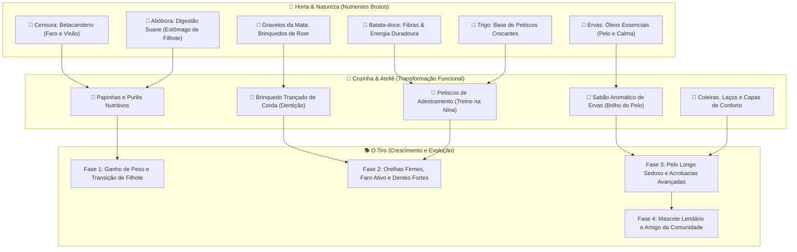

# 🐾 Dossiê Master: O Tiro no Centro do Universo
### *Repensando o Jogo sob a Lente de Tamagotchi, Chao Garden e Evolução Biocomportamental*

> **Nota de Alinhamento:** Documento de design e pesquisa para consolidar a visão do *Tiro Adventure* como um verdadeiro jogo de bichinho virtual (Virtual Pet), onde toda a economia, produção agrícola e história orbitam o desenvolvimento do cão.

---

## 1. O Diagnóstico: O Paradoxo do "Simulador sem Alma"

### 1.1. Onde estamos hoje
O *Tiro Adventure* construiu uma infraestrutura econômica invejável: ciclos de cultivo balanceados, 6 estações produtivas, depósitos com limites precisos, contratos com comerciantes e obras comunitárias. No entanto, o jogo sofre de um paradoxo comum em simuladores:
* **O Tiro atualmente é um "consumidor passivo":** Ele possui 4 barras de necessidade que caem mecanicamente. Preencher essas barras serve apenas para evitar que ele fique triste.
* **O jogador joga *ao redor* do cão, não *por causa* dele:** Se substituíssemos o Tiro por uma cabana ou um caminhão de entrega, a economia continuaria operando da mesma forma (plantar $\to$ processar $\to$ vender por moedas $\to$ comprar prédios).

### 1.2. A Virada Copernicana: O Tiro como Conquista Macro
O Tiro não deve orbitar a fazenda; **a fazenda inteira deve orbitar o Tiro**.
* **Moedas, canteiros, galinheiros e ateliês são apenas *meios*.**
* **O *fim único e glorioso* é criar, alimentar, educar, ver crescer e moldar um Yorkshire Terrier único no mundo.**
* Cada cenoura plantada, cada tábua cortada e cada contrato entregue deve responder à pergunta:  
  👉 *"Como isso ajuda o Tiro a crescer mais forte, mais inteligente e mais feliz hoje?"*

```
[VISÃO ANTIGA (Loop Frio)]
Plantar Cenoura ──> Colher ──> Vender na Feira ──> Ganhar Moeda ──> Comprar Prédio
  (Tiro fica no canto apenas consumindo 1 petisco para não morrer de fome)

[NOVA VISÃO TIRO-CÊNTRICA (Loop Vivo)]
Tiro é Filhote e precisa formar o pelo e ossos
        ↓
Plantar Abóbora & Cenoura (Ricas em betacaroteno e fibras suaves)
        ↓
Cozinhar "Papinha Nutritiva de Filhote" no Fogão
        ↓
Alimentar o Tiro ──> [Ganho de Nutrição + Brilho na Pelagem]
        ↓
Orelhas empinam, corpo cresce e ele aprende a farejar na Praça!
        ↓
Desbloqueia novas áreas e histórias pela maturidade do cão
```

---

## 2. A Biblioteca dos Clássicos: Lições das Obras-Primas do Gênero

Para transformar o Tiro em uma referência moderna de bichinho virtual, analisamos a fundo as mecânicas consagradas de 6 lendas dos Virtual Pets:

| Obra de Referência | Mecânica Central de Ouro | Como isso se traduz no *Tiro Adventure* |
| :--- | :--- | :--- |
| **Chao Garden**<br>*(Sonic Adventure 1 & 2)* | **Morfologia guiada por Nutrição:** Frutas e animais absorvidos alteram stats (Swim, Fly, Run, Power, Stamina), que por sua vez **deformam fisicamente o corpo** (orelhas pontudas, rabo de tigre, asas).<br><br>**A Escolinha do Jardim:** Pets aprendem a desenhar no chão, tocar instrumentos e dançar. | A comida que o Tiro consome e as atividades que ele faz moldam sua **postura, brilho da pelagem e musculatura**. Seus truques aprendidos na Praça deixam de ser uma barra estática e passam a ser comportamentos autônomos que ele executa espontaneamente na sala. |
| **Digimon World**<br>*(PS1 / V-Pet Bandai)* | **Qualidade de Cuidado (Care Quality) & Disciplina:** O pet evolui não por timer, mas por atender critérios de vida: Peso ideal, zero acidentes de higiene, balanço entre Felicidade (*Happiness*) e Disciplina (*Discipline*). | O crescimento do Tiro de *Filhote* para *Jovem* e *Adulto* exige marcos de nutrição caseira, higiene constante e afeto acumulado, tornando o crescimento um rito comemorado. |
| **Monster Rancher 2**<br>*(Tecmo)* | **Fadiga vs Estresse & Fases de Vida:** Gerenciamento entre cansaço muscular e estresse mental. O pet passa por estágios claros (Infância com crescimento rápido $\to$ Adolescência de pico $\to$ Maturidade). | Diferenciar o cansaço físico (energia gasta passeando) do estresse (ficar muito tempo sujo ou com fome). Ervas aromáticas e banhos mornos funcionam como calmantes terapêuticos. |
| **Nintendogs**<br>*(Nintendo DS/3DS)* | **Sensorialidade do Toque e Condicionamento:** O prazer físico de escovar o pelo, ver as partículas de brilho (*sheen*), descobrir cócegas em pontos específicos e treinar comandos por repetição e petisco. | Uma camada tátil no cantinho do pet: escovação real com os dedos (essencial para um Yorkshire), secador de pelos após o banho e reações corporais (bater a patinha quando coça atrás da orelha). |
| **Petz / Dogz**<br>*(PF.Magic)* | **Personalidade Emergente & Memória:** Cães têm preferências individuais espontâneas (brinquedos favoritos, medo de trovão, hábitos de pedir comida cutucando a perna). | O Tiro desenvolve **traços de personalidade próprios** baseados no histórico de ações do tutor (Comilão, Dorminhoco, Explorador, Dengoso). |
| **Finch**<br>*(Mobile Cozy/Self-Care)* | **O Diário de Descobertas:** O pet volta de passeios e expressa **opiniões pessoais** sobre o que viu e comeu (*"Hoje o Tiro provou mirtilo cru: achou azedo e fez careta!"*). | O Caderninho do Tiro ganha uma aba de **"Recordações"**, catalogando a primeira vez que ele provou cada fruta, conheceu um animal ou visitou um local. |

---

## 3. O Desenvolvimento Físico: Morfologia, Corpo e Pelagem

O Yorkshire Terrier é uma das raças mais expressivas do mundo canino: nasce quase todo preto com orelhas caídas, e ao longo de meses sua pelagem clareia para azul-aço e dourado, as orelhas empinam e o pelo ganha comprimento sedoso.

### 3.1. As 4 Fases Biológicas do Tiro

```
[FASE 1: FILHOTINHO] ──────> [FASE 2: JUVENIL] ──────> [FASE 3: ADULTO NOBRE] ──────> [FASE 4: COMPANHEIRO MESTRE]
  (Capítulos 1 a 3)            (Capítulos 4 a 6)          (Capítulos 7 a 9)               (Pós-Jogo / Obras)
  Orelhinhas caídas,           Orelhas em "V",            Pelo longo e fluido,            Aura de serenidade,
  porte de 65%,                energia elétrica,          porte clássico Yorkshire,       interage com toda a vila,
  tropeça ao andar             pelo clareando             usa roupas do Ateliê            senta no Banco da Praça
```

#### 🍼 Fase 1: O Filhotinho Desajeitado (Puppy)
* **Idade Biológica:** 2 a 4 meses.
* **Aspecto Visual:**
  * Corpo proporcionalmente menor (~65% do tamanho padrão).
  * Cabeça arredondada, focinho curto e patinhas rechonchudas.
  * **Orelhas caídas** (traço clássico de filhotes antes da cartilagem firmar).
  * Pelagem curta e escura (preto com pequenas manchinhas castanhas).
* **Comportamento & Fisiologia:**
  * **Estômago pequeno:** A barra de fome esvazia em ritmo constante, mas é saciada com poucas porções. Não tolera sólidos duros.
  * **Sono polifásico:** Tira pequenos cochilos de 5 minutos ao longo do dia; dorme emboladinho na caminha.
  * **Passos incertos:** Ao correr atrás da bolinha, ocasionalmente dá uma derrapada engraçada ou tropeça nas próprias patinhas.
* **Dieta Exigida:** Papinhas mornas, purê de batata suave, leite de vaca fresco e cenouras cozidas no fogão.

#### 🐾 Fase 2: O Juvenil Curioso (Junior)
* **Idade Biológica:** 5 a 9 meses.
* **Aspecto Visual:**
  * Corpo ganha elasticidade e postura esguia (~85% do tamanho).
  * **As orelhas empinam!** Ficam em formato de "V" ereto e atento.
  * A cabeça e o peito começam a clarear para tons dourados quentes (*tan*).
* **Comportamento & Fisiologia:**
  * **Fase de Dentição:** Coceira na gengiva! Ele adora roer brinquedos. Se você não der um mordedor de gravetos talhado na bancada, ele vai roer o tapete da sala!
  * **Ativação do Faro:** O narizinho começa a farejar o ar; é aqui que surge a mecânica dos montinhos de terra brilhantes no mapa.
  * **Pico de Energia:** Vigor para passear na Praça com a Nina e aprender os primeiros truques (*Dar a pata*, *Falar*).
* **Dieta Exigida:** Alimentos crocantes para os dentes (biscoitos de maçã, chips de batata-doce, espigas de milho cozidas).

#### 🐕 Fase 3: O Adulto Nobre (Adult)
* **Idade Biológica:** 1 a 3 anos.
* **Aspecto Visual:**
  * O Yorkshire em sua glória: pelagem longa que escorre pelo dorso em tons azul-aço (*blue & tan*).
  * Postura firme, olhar inteligente e cauda empinada com penacho sedoso.
  * **Manequim Completo:** Suporta todos os apetrechos costurados no Ateliê (lacinho clássico na cabeça, bandanas, casacos de inverno, capa do tesouro).
* **Comportamento & Fisiologia:**
  * **Companheiro de Trabalho:** Não fica só esperando em casa; ele te acompanha no Sítio, late amigável para as vacas no curral e abana o rabo ao ver os canteiros cheios.
  * **Resistência Atlética:** Capacidade de completar as rotas mais longas de caminhada (Trilha do Pôr do Sol, Clareira Misteriosa).
  * **Domínio de Truques:** Prontidão para acrobacias com a Nina (*Rolar*, *Pular obstáculos*, *Girar*).

#### 👑 Fase 4: O Guardião do Vale (Master Companion)
* **Fase de Excelência (Endgame & Obras Comunitárias):**
  * O Tiro é a lenda do vilarejo. Todos os NPCs o conhecem pelo nome.
  * **Comportamento Social:** No **Banco da Praça**, ele senta ao seu lado e recebe carinho dos pedestres. Quando amigos cães visitam (como a Pipoca), ele os recebe como anfitrião.
  * **Presença Radiante:** Quando todas as 4 barras de necessidade estão verdes e o vínculo está no nível máximo, ele emite pequenas partículas sutis de brilho dourado e anda com passo saltitante de orgulho.

---

### 3.2. Parâmetros Físicos Contínuos (Além da Idade)

O corpo do Tiro não deve mudar apenas em saltos de fase; ele deve refletir o cuidado diário através de **dois índices visuais dinâmicos**:

```
                       ┌─────────────────────────┐
                       │  ÍNDICES FÍSICOS DO CÃO │
                       └────────────┬────────────┘
                                    │
            ┌───────────────────────┴───────────────────────┐
            ▼                                               ▼
   [BRILHO DA PELAGEM]                             [TONICIDADE E POSTURA]
  (Coat Sheen: 0% a 100%)                         (Vitality / Body Fitness)
  • Opaco / Emaranhado: Pelo sem graça            • Preguiçoso: Anda curvado, passos lentos
  • Penteado: Macio e alinhado                    • Equilibrado: Anda leve e atento
  • Radiante (90%+): Estrelinhas de brilho        • Atlético: Peito estufado, cauda alta,
    quando ele anda no sol                          salta sobre pequenas poças
```

1. **Brilho e Textura da Pelagem (*Coat Sheen*):**
   * *O que afeta:* Escovação diária no cantinho com a escova de cerdas; banhos com sabão aromático de ervas; alimentação rica em ômegas (sementes, leite fresco).
   * *Feedback no Jogo:* No nível máximo de brilho, o sprite do Tiro ganha um efeito de realce de luz (*sheen highlight*) que desliza pelos pelos conforme ele anda.
2. **Postura e Agilidade (*Fitness & Tone*):**
   * *O que afeta:* Rotina de passeios na Praça e brincadeiras de arremessar a bolinha.
   * *Feedback no Jogo:* Se o cão passa dias sem brincar ou passear, ele anda com a cauda mais baixa e se senta com frequência. Quando está condicionado, sua animação de caminhada é um trote garboso e cheio de vida.

---

## 4. O Desenvolvimento Comportamental: Mente, Hábitos e Personalidade

No *Tamagotchi* e no *Finch*, o apego emocional nasce quando o pet demonstra **ter uma mente própria**, em vez de ser um autômato previsível.

### 4.1. O Radar de Personalidade (5 Eixos Emergentes)

Em vez de escolher uma personalidade num menu, o caráter do Tiro **emerge das ações que o tutor prioriza** no dia a dia:


1. **Curioso (Faro e Aventura):**
   * *Como sobe:* Deixar o Tiro cavar muitos montinhos de faro, levá-lo para mundos novos assim que desbloqueiam.
   * *Efeito:* Ele para no mapa para cheirar flores, borboletas e cantos de cercas; acha achados raros com mais frequência.
2. **Comilão Gourmet (Apetite e Paladar):**
   * *Como sobe:* Alimentá-lo com receitas caseiras variadas no fogão, em vez de dar apenas ração simples.
   * *Efeito:* Ele corre para a tigela assim que você chega perto da geladeira; comemora com uma dancinha especial quando ganha sua comida favorita.
3. **Atleta Brincalhão (Energia e Sociabilidade):**
   * *Como sobe:* Muitas sessões de arremesso de bola, brincadeiras de cabo de guerra e treinos de truques na Nina.
   * *Efeito:* Ele corre em círculos na sala de pura euforia (*zoomies* caninos!), desafia a Pipoca para correr na Praça.
4. **Carinhoso / Dengoso (Afeto e Presença):**
   * *Como sobe:* Sessões longas de carinho com os dedos, escovação paciente, atender desejos rapidamente.
   * *Efeito:* Anda sempre colado aos calcanhares do tutor; quando o jogador fica parado no mapa, o Tiro deita sobre os pés dele.
5. **Zen / Tranquilo (Paz e Sono):**
   * *Como sobe:* Banhos mornos bem ensaboados, sonecas na caminha de luxo, rotinas sem deixar as barras chegarem ao vermelho.
   * *Efeito:* Dorme em poses relaxadas (com a barriguinha para cima), suspira satisfeito após comer e é imune a estresse.

---

### 4.2. O Álbum de Recordações do Tiro ("O Livro da Vida")

No cantinho do pet, ao tocar no **Caderninho** flutuante, abre-se a aba **"Recordações"**: um livro encadernado em couro com cantoneiras douradas contendo as fotografias polaroid em pixel art de toda a trajetória do cãozinho.

O álbum é dividido em dois grandes pilares de coleção: **Fotos da História** e **Fotos Secretas com Dicas**.

```
                ┌───────────────────────────────────────────────┐
                │      O ÁLBUM DE RECORDAÇÕES DO TIRO           │
                └───────────────────────┬───────────────────────┘
                                        │
             ┌──────────────────────────┴──────────────────────────┐
             ▼                                                     ▼
   [FOTOS DA HISTÓRIA]                                   [MISTÉRIOS & FOTOS SECRETAS]
• Liberadas pelas missões principais                 • Silhuetas com fitinha adesiva
• Cronologia de crescimento do cão                   • Lupa de Dica com enigma poético
• Garantem o álbum base de todo jogador              • Desbloqueadas por situações inusitadas,
                                                       clima, culinária e ações secretas
```

---

#### 📘 Parte 1: As Fotos da História (Marcos Canônicos)
São conquistadas naturalmente ao concluir os grandes passos dos capítulos. Garantem que todo jogador terá uma linha do tempo afetiva e cronológica da vida do seu companheiro:

| Foto | Como Desbloqueia | Anotação no Álbum |
| :--- | :--- | :--- |
| **#01: Chegada na Caixa** | Missão inicial da Laís | *"Um novelinho de pelo tímido olhando pelo vão da caixa de papelão. O início de tudo."* |
| **#02: O Primeiro Ensopado** | Montar o Fogão e cozinhar | *"Focinho sujo de purê de abóbora. Acho que ele aprovou o almoço caseiro!"* |
| **#03: A Grande Descoberta** | Primeiro item cavado com o Faro | *"Cavar buracos é a nova paixão dele. O quintal da Vovó que lute!"* |
| **#04: As Orelhas em Pé!** | Concluir o Capítulo 3 | *"Acordou rapazinho! As duas orelhas empinaram de vez como duas anteninhas."* |
| **#05: O Amigo de Corrida** | Conhecer a Nina e a Pipoca | *"Tiro e Pipoca apostando corrida perto do chafariz da praça."* |
| **#06: O Mascote da Banca** | Abrir a Banca na Vila | *"Sentado orgulhoso na banqueta ao lado das cestas de legumes da feira."* |
| **#07: A Capa do Tesouro** | Abrir o Baú da Clareira | *"O explorador mais elegante do vale com seu chapéu e capa da floresta."* |
| **#08: O Banco da Turma** | Concluir a Obra da Praça | *"Sentado no meio de todo mundo no banco de madeira. Um verdadeiro morador da vila."* |

---

#### 🔮 Parte 2: As Fotos Secretas (Mistérios com Dicas Enigmáticas)
Cada foto secreta fica como uma silhueta sombreada no álbum. Ao tocar nela, surge uma **Lupa de Dica** com um enigma deixado no caderninho. Os jogadores precisam experimentar situações inusitadas no mundo para capturar o momento:

#### 1. "O Fantasminha do Banho"
* **A Cena:** O Tiro coberto de espuma branca dos pés à cabeça, com os olhinhos pretos brilhando como um pequeno fantasminha dócil.
* **Gatilho:** Fazer carinho repetido na cabeça dele enquanto a espuma do sabão está ativa, antes de ligar a água para enxaguar.
* **Dica Enigmática:**  
  🔍 *"Dizem que se você brincar demais com as bolhas antes da água cair, uma criaturinha de espuma branca ganha vida na banheira..."*

#### 2. "O Ladrão da Horta"
* **A Cena:** O Tiro correndo todo lépido com uma cenoura inteira na boca, enquanto a Vovó Bloblo ri com a mão na cintura ao fundo.
* **Gatilho:** Colher um canteiro de cenouras com o Tiro na mesma tela enquanto a fome dele estiver abaixo de 30%.
* **Dica Enigmática:**  
  🔍 *"Cachorrinhos de barriga vazia não conseguem resistir ao cheiro de legumes fresquinhos arrancados da terra..."*

#### 3. "Serenata sob o Pôr do Sol"
* **A Cena:** O Tiro sentado na beirada da ponte da Natureza, uivando suavemente para o céu avermelhado.
* **Gatilho:** Iniciar o passeio da Trilha do Pôr do Sol entre 17h e 18h no relógio real do aparelho.
* **Dica Enigmática:**  
  🔍 *"Quando o sol beija as montanhas e o céu fica cor de abóbora, uma canção canina ecoa pelas colinas do vale..."*

#### 4. "Toca dos Trovões"
* **A Cena:** Apenas o focinho do Tiro e os dois olhinhos curiosos aparecendo debaixo do sofá da sala, enroladinho em uma manta.
* **Gatilho:** Abrir a tela da Casa durante um dia de chuva e tocar 3 vezes no sofá para chamá-lo com calma.
* **Dica Enigmática:**  
  🔍 *"O céu ruge estrondos lá fora... onde será que um cãozinho corajoso esconde suas orelhas compridas?"*

#### 5. "Cochilo Real"
* **A Cena:** O Tiro dormindo de barriguinha para cima com as 4 patas pro ar, usando uma coroa de flores torta na cabeça.
* **Gatilho:** Vestir o acessório *Coroa de Flores* e colocá-lo para dormir na caminha com 100% de felicidade.
* **Dica Enigmática:**  
  🔍 *"Até os pequenos reis precisam descansar seus laços floridos... mas a pose de dormir não tem nada de nobre!"*

#### 6. "O Caçador de Meias"
* **A Cena:** O Tiro chacoalhando uma meia colorida da Laís com toda a energia da sala.
* **Gatilho:** Abrir a Mochila, fechar sem selecionar nenhum item e tocar no cesto de roupas da Casa duas vezes seguidas.
* **Dica Enigmática:**  
  🔍 *"Se um cesto de roupas limpas ficar desprotegido, um pequeno predador de tecidos encontrará sua presa favorita..."*

#### 7. "A Careta do Mirtilo"
* **A Cena:** O Tiro piscando um olho só com a linguinha de fora, fazendo uma careta hilária após o choque de sabor.
* **Gatilho:** Oferecer um mirtilo cru pela primeiríssima vez ao cão sem cozinhá-lo no fogão.
* **Dica Enigmática:**  
  🔍 *"Nem todas as frutas da floresta são docinhas de início... algumas dão um choque azedo na primeira lambida!"*

#### 8. "O Amigo da Lua"
* **A Cena:** O Tiro sentado no Banco da Praça iluminado pela luz prateada da lua cheia, com vaga-lumes ao redor.
* **Gatilho:** Visitar a Praça após as 21h e sentar no Banco da Praça concluído.
* **Dica Enigmática:**  
  🔍 *"Quando a vila adormece e a praça se esvazia, quem senta sob o luar recebe a visita das luzes que piscam no escuro..."*

---

#### 🎁 Recompensas por Completar Páginas do Álbum
* **A cada página completa (4 a 6 fotos):** Desbloqueia um item de conforto exclusivo para o cantinho do pet:
  * *Página 1 (Infância):* O **Tapete de Pata Bordado** para o chão da Casa.
  * *Página 2 (Travessuras):* A **Câmera Fotográfica Vintage** para decorar a cômoda.
  * *Página 3 (Segredos):* A **Moldura Dourada Reluzente**, permitindo escolher a foto favorita para ser o quadro principal da parede da Casa.
* **Diálogos de Carinho dos NPCs:** Ao destravar fotos com NPCs (como o *Ladrão da Horta* ou o *Caçador de Meias*), a Laís ou a Vovó comentam carinhosamente a travessura na conversa seguinte.

---

### 4.3. O Guia Gastronômico do Tiro (Paladar e Reações Únicas)

Cachorros possuem preferências individuais marcantes. No novo design, cada receita nova experimentada pelo Tiro dispara uma microanimação e é registrada no Caderninho:

```
                  ┌─────────────────────────────────────┐
                  │    O TIRO EXPERIMENTA UM PRATO      │
                  └──────────────────┬──────────────────┘
                                     │
          ┌──────────────────────────┼──────────────────────────┐
          ▼                          ▼                          ▼
   [AMOR À PRIMEIRA MORDIDA]   [ESTRANHAMENTO CÔMICO]      [A CAJADA DE AZEDO]
• Pula nas 2 patas traseiras • Lambe a ponta e recua    • Dá uma fungada espirrando,
• Abana o corpo inteiro      • Dá 2 latidinhos finos      esfrega o focinho com as
• Pede mais com as patinhas  • Come desconfiado mas curte   patas e sai trotando
 (Vira "Comida Favorita"!)   ("Adquiriu o gosto")        (Reação registrada no Diário)
```

* **Comida Favorita Única do Save:** Cada jogo sorteia afinidades sutis: um Tiro pode amar *Biscoito de Maçã* e torcer o nariz para *Purê de Batata*, enquanto outro é louco por *Cenouras*. O jogador cozinha para descobrir o que faz os olhos do seu cão brilharem.
* **Bônus de Favorito:** Receber o prato favorito concede bônus temporário de felicidade e uma animação exclusiva onde ele dá piruetas de alegria.

---

### 4.4. O Salão de Estilo de Yorkshire (Pelagem que Cresce)

Fiel à biologia do Yorkshire Terrier, a pelagem do Tiro tem vida própria:
1. **Crescimento Contínuo do Pelo:** Se o jogador passar semanas sem cortar, a pelagem vai ficando volumosa e a franja cobre suavemente os olhos com um charme descabelado.
2. **Penteados no Espelho da Casa:**
   * *O Topknot Tradicional:* Lacinho vermelho na cabeça para prender a franja e deixar os olhinhos à mostra.
   * *Tosa Filhote (Puppy Cut):* Pelo curto e arredondado, ideal para correr sem acumular folhas.
   * *Tosa de Gala:* Pelagem longa escovada até o chão, com brilho sedoso de exposição.
3. **Penteados de Espuma no Banho:** Ao ensaboar com a esponja, o jogador pode desenhar formas na cabeça do Tiro (moicano, chifrinhos de unicórnio), que ele chacoalha com alegria ao final!

---

### 4.5. O "Gotcha Day" (O Aniversário de Resgate)

A data de criação do save do jogador é gravada como o **Gotcha Day** (o dia do resgate do Tiro pela Laís):
* A cada aniversário (ou a cada 30 dias de convivência no jogo), os vizinhos da vila preparam uma **Festa Surpresa na Casa**:
  * A Laís traz uma fatia de **Bolo Canino de Aveia e Maçã**.
  * A Nina traz um brinquedo artesanal novo.
  * O Tiro ganha um **Chapeuzinho de Festa** comemorativo e um selo no Álbum com a contagem de tempo de amizade entre tutor e cão.

### 4.6. Linguagem Corporal Canina Autêntica (Animações de Ócio)

Para que o Tiro pareça um ser vivo na tela do celular:
1. **O Espreguiçar Matinal:** Ao acordar na caminha, ele estica as duas patas dianteiras para a frente, abaixa o peito e dá um bocejo longo com a língua para fora.
2. **O Ritual do Tapete:** Antes de deitar, ele dá três voltas no próprio eixo e cava o tecido da caminha com as patas dianteiras para "ajeitar o ninho".
3. **A Cabecinha Inclinada:** Quando o jogador toca em um objeto interativo perto dele (como a geladeira ou a horta), o Tiro para, olha para a tela e inclina a cabeça para a esquerda e para a direita, como cães reais fazem ao ouvir um som curioso.
4. **O Chacoalhar Pós-Banho:** Ao terminar o banho na banheira, ele se chacoalha dos pés à cabeça, espirrando gotinhas de água pela tela.

---

## 5. A Grande Simbiose: A Fazenda a Serviço do Pet

Aqui está a peça-chave de design: **como cada elemento da economia existente se converte em suporte direto para o desenvolvimento do cão.**



### 5.1. A Horta como Farmácia e Nutrição Canina
* **Cenoura:** Acelera o desenvolvimento sensorial. Alimenta a barra de **Faro**, fazendo os montinhos de terra brilharem de mais longe.
* **Abóbora:** O alimento reconfortante. Ideal para a fase de filhote; zera qualquer desconforto estomacal e dá bônus de sono tranquilo.
* **Trigo & Milho:** Moídos no moinho e misturados com ovos no fogão, tornam-se os **Biscoitos de Alta Recompensa**, essenciais para a Nina ensinar truques acrobáticos difíceis.
* **Ervas Aromáticas:** Não são para temperar comida de humanos; são fervidas no caldeirão para fazer o **Shampoo de Banho Herbal**, que deixa a pelagem do cão com o efeito de brilho estelar por 24 horas reais.
* **Mirtilo (Tesouro da Trilha):** O superalimento do cão adulto. Aumenta a agilidade mental, permitindo que o Tiro faça rotas de passeio duplo sem cansaço excessivo.

### 5.2. A Cozinha como Centro Dietético
Em vez de pratos abstratos de restaurante, as receitas do Fogão e do Liquidificador ganham nomes e propósitos claros para o cão:
1. *Papinha da Vovó Bloblo (Abóbora + Cenoura cozida):* A comida que ajuda o filhote a completar a Fase 1.
2. *Purê Energético (Batata + Leite morno):* Revitaliza o cão exausto de passeios longos.
3. *Biscoitinhos Crocantes de Osso (Farinha + Ovos + Trigo):* Moeda de troca com a Nina para os treinos de adestramento na Praça.
4. *Picolé Refrescante de Morango:* Dado nos dias quentes para evitar que a barra de higiene/energia caia rápido.

### 5.3. A Carpintaria e o Ateliê como Criadores de Conforto
* **Gravetos da Natureza:** Talhados na bancada viram o **Mordedor de Dentição** (evita que o juvenil roa a mobília).
* **Tecidos e Fibras no Ateliê:**
  * *Caminha Ortopédica de Espuma:* Substitui a caminha básica; faz a energia do cão recuperar duas vezes mais rápido enquanto o jogador está offline.
  * *Toalha Aveludada de Banho:* Seca o cão instantaneamente após o banho, evitando que ele saia molhado tremendo de frio.
  * *Lacinho Tradicional de Yorkshire:* O acessório de formatura quando o Tiro atinge a maturidade da Fase 3.

---

## 6. O Loop Central Renovado: Como Tudo se Conecta

O novo fluxo de jogo fecha um ciclo perfeito onde **toda ação no mundo tem reflexo no corpo e na mente do cachorro**:

```
                       ┌──────────────────────────────┐
                       │       O TIRO DEMANDA         │
                       │ (Fase da vida, fome, treino) │
                       └──────────────┬───────────────┘
                                      │
                                      ▼
                       ┌──────────────────────────────┐
                       │      A FAZENDA PRODUZ        │
                       │ (Plantio, moagem, colheita)  │
                       └──────────────┬───────────────┘
                                      │
                                      ▼
                       ┌──────────────────────────────┐
                       │     A COZINHA TRANSFORMA     │
                       │ (Dietas, shampoos, petiscos) │
                       └──────────────┬───────────────┘
                                      │
                                      ▼
                       ┌──────────────────────────────┐
                       │     O CUIDADO NUTRE O CÃO    │
                       │(Alimentar, escovar, adestrar)│
                       └──────────────┬───────────────┘
                                      │
                                      ▼
                       ┌──────────────────────────────┐
                       │     O TIRO CRESCE E MUDA     │
                       │(Salto de fase, corpo, truque)│
                       └──────────────┬───────────────┘
                                      │
                                      ▼
                       ┌──────────────────────────────┐
                       │   DESBLOQUEIA NOVO CAPÍTULO  │
                       │   (Novas áreas, novos NPCs)  │
                       └──────────────┬───────────────┘
                                      │
                                      └───────(Reinicia em nível superior)
```

1. **A Necessidade Biológica:** O Tiro atinge um ponto onde precisa de nutrição avançada para suas cartilagens (ex: fazer as orelhas empinarem).
2. **A Missão do Tutor:** A Laís ou a Vovó Bloblo avisam: *"Para as orelhinhas dele subirem, precisamos de caldo rico em cálcio e fósforo!"*
3. **A Produção Agrícola:** O jogador planta cenouras e ordenha leite fresco da vaquinha no sítio.
4. **O Ritual no Fogão:** O jogador prepara a refeição especial com tempo de preparo.
5. **O Banquete e o Feedback Visual:** O Tiro come com alegria visível, a barra de desenvolvimento enche.
6. **O Salto de Crescimento (Celebração):** O `ModalCard` entra com raios dourados e confete: *"As orelhinhas do Tiro empinaram! Ele agora é um Jovem Explorador!"*
7. **Novos Horizontes:** Agora que ele é jovem e ágil, a Nina abre o portão da Praça para ele passear.

---

## 7. Roteiro de Transição e Próximos Passos (Sem Quebrar o Jogo Atual)

A beleza deste redesenho é que **a infraestrutura técnica do jogo já está 90% pronta para recebê-lo**. Não é necessário jogar nada fora:

1. **Os 9 Capítulos atuais já mapeiam perfeitamente as 3 primeiras fases:**
   * Capítulos 1 a 3 (Casa e Cozinha) = **Fase 1 (Filhote)**.
   * Capítulos 4 a 6 (Vila, Praça e Caverna) = **Fase 2 (Juvenil)**.
   * Capítulos 7 a 9 (Banca, Estufa e Ateliê) = **Fase 3 (Adulto)**.
   * Endgame e Obras da Praça = **Fase 4 (Guardião)**.
2. **Compatibilidade Total com Saves Legados:**
   * Quem já está no Capítulo 8 terá seu Tiro carregado imediatamente na **Fase 3 (Adulto)**, com todas as memórias anteriores marcadas como "Lembranças de infância", preservando cada segundo de progresso.
3. **Divisão de Tarefas Sugerida para Futuras Sessões:**
   * **Pacote Visual:** Desenho das variações de sprite do Tiro (Filhote com orelha caída e Juvenil) no PixelLab.
   * **Pacote de Estado:** Adicionar a variável `life_stage` e a barra de desenvolvimento no `DogState.gd`.
   * **Pacote Sensorial:** Mini-interação de escovação no cantinho do pet e efeito de brilho nos pelos.
   * **Pacote Narrativo:** Ajustar as falas da Laís e Nina para celebrarem o crescimento do cão nos finais de capítulos.

---

### Resumo da Filosofia
> *"No Tiro Adventure, você não constrói uma fazenda para acumular ouro em um cofre digital.*  
> *Você constrói um refúgio acolhedor na colina para ver o filhotinho assustado que você resgatou no primeiro dia se transformar no cachorro mais feliz, elegante e companheiro que o mundo dos games já viu."*
