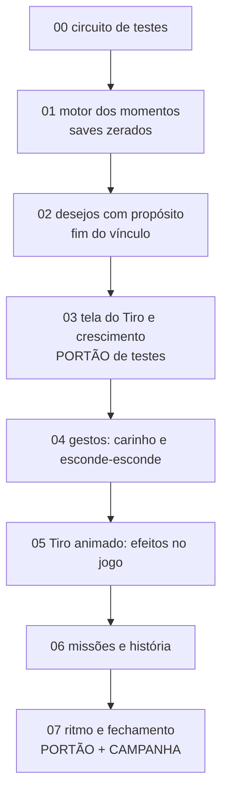

# Plano "Cuidar é crescer": necessidades, desejos e crescimento num ciclo só

**PLANO CONCLUÍDO — etapas 00–07 aprovadas pelo Vitor em 23/10/2026.** Ritmo atual aprovado por enquanto, sem nova calibração; terceira rodada Quick dispensada (110/111 + teste focado de `nina_blueberry` PASS).

> Pedido do Vitor (23/10/2026): o desejo do Tiro ficou avulso (pede coisa aleatória toda hora e não tem
> função), as necessidades (fome, banho...) não impactam nada, e o crescimento por Coragem/Esperteza virou
> repetição ("passar 1 milhão de vezes na cabeça dele"). Repensar como atributos, desejos, missões e
> crescimento se casam; **simplificar e dar mais utilidade às coisas**. Saves: **sempre zerados**, sem
> compatibilidade. E repensar o **circuito de testes**: cada etapa levava ~40 min porque testava tudo; os
> ciclos de teste têm que fazer sentido para o que a etapa mexe, e o ciclo total (com simulação de tempos)
> fica só para o fim.

## A ideia em uma linha

> **Necessidade = quando dá para cuidar · Desejo = o que ele está pedindo agora · Momento = o que fica disso
> e faz ele crescer.**

Detalhes em [00 Visão](00_VISAO.md) e regras/números em [02 Desenho](02_DESENHO.md).

## Como passar para o próximo agente

Copie e troque só o número e o nome do arquivo da etapa:

```text
Execute somente a etapa NN de docs/plans/cuidado/ETAPA_NN_NOME.md.
Leia CLAUDE.md (ou AGENTS.md), docs/ROADMAP.md (Estado atual), docs/plans/cuidado/README.md,
docs/plans/cuidado/00_VISAO.md, docs/plans/cuidado/01_REGRAS_E_TESTES.md, docs/plans/cuidado/02_DESENHO.md
(só as seções que a etapa indicar) e o arquivo da etapa.
Confirme que a anterior está concluída.
Testes: nível "etapa" (tools\test.ps1 -Level etapa -Tests <teste novo>); "portão" só nas etapas 03 e 07;
"campanha" só na 07. Nunca rodar a suíte inteira fora disso.
Saves: sempre zerados; não escreva migração nem teste de save antigo.
Atualize README (registro), DECISOES (se ajustou algo) e Estado atual do ROADMAP.
Não execute a etapa seguinte, não faça push na main nem publique.
Ao terminar, siga a seção "Sessões encadeadas" para abrir a sessão da próxima etapa.
```

Até a etapa 00 terminar, `tools\test.ps1` não existe: a própria 00 usa `tools\test_all.ps1 -Only ...`.

## Sessões encadeadas

Mesma regra do plano anterior (pedido do Vitor, 19/10/2026): cada etapa roda numa sessão própria. Ao
concluir uma etapa (critérios marcados e registro atualizado), o agente abre outra sessão **no Codex** com
`create_thread`, no mesmo projeto e ambiente local, **`model: "gpt-6.1-sol"`** (ajuste pedido pelo Vitor nesta
execução, 23/10/2026), título `Cuidado — Etapa NN`, mensagem inicial = bloco acima com o número e arquivo da
próxima. Depois para de mexer em arquivos. Não usar `create_session`/Claude para este encadeamento.

Não abrir a próxima quando: a etapa não foi concluída; a ferramenta recusou por profundidade; ou o Vitor
pediu para parar. Não há portão de arte neste plano (o único desenho novo é o copinho da 04). A 07 é a
última e termina com o Vitor aprovando o ritmo.

## Documentos

| Arquivo | O que decide |
|---|---|
| [00 Visão](00_VISAO.md) | diagnóstico com números, o modelo novo, princípios, o que sai e o que fica |
| [01 Regras e testes](01_REGRAS_E_TESTES.md) | contrato do agente e o **circuito de testes em quatro níveis** |
| [02 Desenho](02_DESENHO.md) | regras e números: necessidades, momentos, desejos, Tiro animado, gestos, missões, dados |
| [Decisões](DECISOES.md) | decisões do Vitor e de desenho; ajustes feitos durante a execução |

## Ordem de execução



| Feita | Etapa | Entrega | Teste novo | Testes |
|---|---|---|---|---|
| [x] | [00](ETAPA_00_TESTES.md) | `tools/test.ps1` com níveis, mapa automático por arquivo mudado, saves isolados por teste (paralelo), falhas históricas resolvidas, testes de save antigo removidos | — | linha de base dos níveis |
| [x] | [01](ETAPA_01_MOMENTOS.md) | pilares por momentos, cuidado útil = momento, teto por período, fim de pontos/reserva/Radiante, `SAVE_VERSION` 14 | `moments_test` | etapa |
| [x] | [02](ETAPA_02_DESEJOS.md) | um desejo por período, sorteio pela fase e pelo que falta, prêmio = momento; vínculo/afeto removidos | `wish_moments_test` | etapa |
| [x] | [03](ETAPA_03_TELA.md) | tela do Tiro mostra o que ele precisa; painel de crescimento em momentos; aviso "Momento de …"; aba Desejos sai | `care_ui_test` | **portão** |
| [x] | [04](ETAPA_04_GESTOS.md) | carinho de segurar com lugar favorito; esconde-esconde (Esperteza) | `gestures_test` | etapa |
| [x] | [05](ETAPA_05_ANIMADO.md) | estado "Tiro animado" visível com efeitos na horta, passeio e faro | `mood_test` | etapa |
| [x] | [06](ETAPA_06_MISSOES.md) | diárias só da fazenda, missões de cuidado revistas, Laís apresenta desejo/momento | `care_story_test` | etapa |
| [x] | [07](ETAPA_07_FECHAMENTO.md) | feita/aprovada pelo Vitor em 23/10/2026; ritmo aprovado por enquanto, sem nova calibração; terceira rodada Quick dispensada (110/111 + teste focado PASS) | `care_bot_test` | **portão + campanha**; [resultados](RESULTADOS.md) |

## Registro

**Etapa 07 feita/aprovada pelo Vitor em 23/10/2026; plano Cuidado concluído (00–07).** Ritmo
atual aprovado por enquanto, sem nova calibração: Filhotinho 1,5 min de jogo ativo; Dentinhos
0,34 dia; Aventureiro 2,08 dias; Mocinho 8,84 dias; adulto 19,84 dias. Vitor também dispensou
a terceira rodada Quick: fica aceita a evidência 110/111 + teste focado de `nina_blueberry` PASS,
como está, sem declarar Quick 111/111. Ressalvas aceitas; resultados e logs preservados.
Fechamento somente documental, sem novos testes, export, commit, push, publicação ou sessão/thread nova.

Os registros técnicos abaixo preservam o histórico anterior à aprovação final.

**Etapa 07 executada com ressalvas (23/10/2026, Codex; local):** anterior confirmada concluída.
Robô cuida por necessidades/momentos, atende desejo, escova por dia, usa copinhos com petisco/teto;
runner reproduz ausência e fixa a semente do cachorro. `progression_test` sem concessão de momentos,
**PASS: 778 ciclos, 64 aquisições, 111 missões**, cinco crescimentos. Duas invocações de campanha:
primeira técnica inválida; segunda com cinco componentes PASS e Quick **stalled 110/111, zero
violações**, única pendência `nina_blueberry`. Política de alimento específico corrigida e teste
focado PASS, sem terceira campanha. Etapa final 4/4 PASS em 12,5 s; fixtures obsoletas do portão
corrigidas e fechamento do portão registrado em [RESULTADOS](RESULTADOS.md). Tour 114 PNGs por
resolução (360/390/412), aberto/conferido; toque Web confirma carinho 0→0→1 e copinhos com um petisco
e um momento. Nenhum formato de save ou dado de balanceamento alterado.

**Números aprovados por enquanto pelo Vitor em 23/10/2026:** Filhotinho 1,5 min ativos (dia 0,00), Dentinhos **0,34 d**,
Aventureiro **2,08 d**, Mocinho **8,84 d**, adulto **19,84 d**. As três fases intermediárias estão
antes das faixas 1–3/5–8/10–14; Filhotinho/adulto dentro. **Vitor aprovou manter o ritmo por enquanto,
sem nova calibração, e dispensou a terceira rodada Quick.** Evidência aceita para o fechamento:
110/111 + teste focado de `nina_blueberry` PASS; o Quick integral não foi revalidado nem declarado verde.
Etapa 07 e plano concluídos com essas ressalvas. Sem sessão nova, commit, push ou publicação. Detalhes, evidências e limites em RESULTADOS;
fora do plano em [FUTURO](FUTURO.md).

**Portão fechado por reexecução focada:** passagem final em 465,2 s (dentro de 8 min),
90 PASS/1 FAIL (`r20261023_074844_28a6cf0e`). Única restante era `festival_test` com contagem
antiga de principais (50→51); corrigida e reexecutada **PASS, 441 verificações**, saída 0.
Os 91 testes estão validados; o CSV da passagem continua 90/91, sem ocultar a reexecução.
As ressalvas foram aceitas pelo Vitor em 23/10/2026: ritmo aprovado por enquanto e terceira rodada
Quick dispensada; os resultados técnicos acima permanecem como foram medidos.

**Etapa 06 concluída (23/10/2026, Codex):** Rotinas só da fazenda, sem care/care_week/tiro_walk nem catálogo legado; roupas em big_harvest/orders_week. Laís apresenta desejo/momento em `lais_first_wish` (capítulo 2, após caminha/Filhotinho; histórico sem fresh) e Tiro animado em `lais_first_crops`. Como fazer de momentos/fontes e objetivo wish, textos antigos vedados. SAVE_VERSION 17, reset sem migração. `care_story_test` + nível etapa story/navigation: 13/13 PASS em 48,1 s; save atual/áreas relacionadas: 12/12 PASS em 51,7 s. Evidência, comandos/listas/logs em [VALIDACAO_06](VALIDACAO_06.md). README/DECISOES/ROADMAP/PROGRESSION/AGENTS/CLAUDE atualizados. Sem portão/campanha, commit, push ou publicação. **07 não executada nem sessão aberta, conforme pedido do Vitor.**

Etapa 00 concluída (23/10/2026, Codex): portão 87/87 PASS em 506,2 s; reexecução focada de progression_test autorizada pelo Vitor e PASS em aproximadamente 959,3 s (16 min), 767 ciclos, 64 aquisições e 110 missões; stderr vazio e saída 0. Quick e portão não repetidos. Sessão Cuidado — Etapa 01 já criada no Codex 6.1; implementação da 01 ainda não iniciada.

| Data | Etapa | Quem | Resultado |
|---|---|---|---|
| 23/10/2026 | planejamento | Claude Code | plano escrito; aguardando execução da 00 |

| 23/10/2026 | 00 (parcial) | Codex | Circuito em quatro níveis, saves isolados, fixtures/legado de testes revisados; rápido 19,5 s e portão 87/87 PASS em 506,2 s (meta excedida em 26,2 s). Campanha única 974,7 s: 5 PASS (inclui Quick 110/110, 40,35 d simulados, zero guardas) + progression_test interrompido após 526,3 s/ciclo 400 por não abrir o Álbum; fixture corrigida/parse PASS. Fechamento bloqueado até autorizar/validar somente esse teste, sem repetir Quick/portão. Não abriu 01. |

| 23/10/2026 | 00 (concluída) | Codex | Vitor autorizou a reexecução focada: progression_test PASS, 767 ciclos, 64 aquisições e 110 missões, aproximadamente 959,3 s (intervalo do log), exit 0 e stderr vazio. Demais cinco componentes da campanha já PASS; portão e Quick não repetidos. Evidência: build/test_logs/cuidado00/progression_final.log. Sessão da 01 já criada no mesmo projeto, Codex 6.1. Registro parcial acima preservado como histórico. |
| 23/10/2026 | 01 (concluída) | Claude Code (continuação do Codex) | Motor dos momentos: `growth.json → moments`, `GrowthState.moments/phase_moments/period_moments`, `GameState._gain_moment/_moment_source`, `Events.moment_gained`, SAVE_VERSION 14, DEV `dev_add_moment/dev_set_need/dev_next_period`, interface mínima have/need. `moments_test` (substitui `pillars_test`) PASS; nível etapa 56/56 PASS em 346,8 s (log `build/test_logs/r20261023_032629_63ada2a4`). As falhas da rodada anterior eram obsoletas e não se repetiram. Sem portão/campanha. Próxima: 02, não aberta. |
| 23/10/2026 | 02 (concluída) | Claude Code (continuação do Codex, que só leu os arquivos) | Um desejo por período (`WishState.current/period/last_ids`, `GameState.update_wishes/_pick_wish/fulfill_wish()`), `wishes.json` com 11 desejos, atender = 1 momento fora do teto; vínculo/afeto removidos de dados, estado, UI e testes (`bond_levels`, `Events.bond_up`, `show_bond`, `claimed_bond_level`, prêmios `affection`; ícone `bond_heart` → `heart`); truques/passeios longos por fase; `SAVE_VERSION` 15. `wish_moments_test` PASS (substitui `wishes_test` e `bond_test`); nível etapa: 26 PASS na bateria ampliada (wishes, tricks, walks, album, story + testes editados), quatro ajustes de teste e rerun PASS. Sem portão/campanha. Próxima: 03, não aberta. Detalhes em DECISOES. |
| 23/10/2026 | 03 (concluída) | Claude Code (Codex sem limite de uso) | Tela do Tiro: balão do desejo com cartão (Pegar/Dar/Ir), anéis que pedem com ícone do pilar (`GameState.need_asking/need_pillar/asking_need`), aviso "Momento de …!" (`MomentNotice`) com ícone voando ao avatar, anel do HUD por `GrowthUi.fraction`, `AvatarAsk` no avatar, requisitos de momentos em bolinhas e "de onde vêm" (`PillarUi.dots/origins`, `growth.json → moments.sources[].label/go`), aba/tela Desejos e `scenes/ui/wishes_screen/` apagadas (abas Tiro · Mapa · Missões · Mochila). `care_ui_test` PASS. **Portão (`-Level portao`, Jobs 3): 442,8 s (7 min 23 s, dentro dos 8 min), 86 PASS e 1 FAIL: `park_test` ("sem espaço: não guarda") por instabilidade em paralelo; reexecutado isolado PASS.** Capturas em `build/screenshots/cuidado03/` nas três resoluções (360×780, 390×844, 412×915), abertas e conferidas (um bug de rótulo vertical em "De onde vêm" corrigido e recapturado). Sem campanha. Próxima: 04, não aberta.
| 23/10/2026 | 04 (concluída, sem toque emulado) | Claude Code (Codex sem limite de uso) | Carinho de segurar 1,2 s com anel (`HoldRing`) ou esfregar 160 px = um carinho por gesto (`PetScreen.hold_begin/move/tick/end`); lugar favorito cabeça/queixo/barriga por semente (`GameState.favorite_spot/pet(zone)`, `pet_favorite` +25, diário, aviso, `PetAnimator.love`); esconde-esconde desde o Aventureiro (`hide_and_seek/finish_hide_and_seek`, `treat: true` em 5 itens, `HideSeekUi` no Sheet, escolha Bola/Copinhos em Brincar, ícone PixelLab `hide_cup`); `growth.json → gestures`. `gestures_test` PASS; `pet_care_test` adaptado ao gesto de segurar. Nível etapa (`-Areas pet,growth`, que arrastou ~48 testes por arquivos amplos): 47 PASS e 1 FAIL, `world_selector_test` ("Bandeja da Bancada abre após a viagem"; falha também isolada, fora da área tocada, não investigada). Capturas 360/390/412 em `build/screenshots/cuidado04/` abertas. **`tools/touch_test.ps1` NÃO rodado** (exige export Web + servidor). Próxima: 05, não aberta. |
| 23/10/2026 | 04 (pendências fechadas) | Codex | Export DEV e servidor locais; toque Web 390×844 com roteiro `tools/care_gestures_touch_steps.json`, 9 verificações PASS no save descartável (0,8 s = nenhum carinho; 3 s = um; copinhos gastam um petisco ao iniciar e dão um momento ao terminar). Capturas conferidas. O toque revelou e permitiu corrigir dois problemas do Popover: menu cortado pelas abas e pressão interna fechando antes da seleção. Regressões em `gestures_test` falharam antes/passaram depois. Nível etapa 28/28 PASS em 233,5 s; após o último ajuste, 21/21 afetados PASS em 105,8 s. Seletor: PASS isolado e na primeira bateria (28/28, 243,1 s), mas falha antiga intermitente reapareceu em rodada adicional; mesma asserção comprovada antes da 04, no log inicial da 01. Registrada, sem alterar navegação. Comandos, listas e logs em [VALIDACAO_04](VALIDACAO_04.md). Critérios da 04 marcados. Sem portão/campanha, commit, push ou publicação. **05 não aberta: a ferramenta `create_thread` não está disponível nesta sessão; 05 não executada.** |

| 23/10/2026 | 05 (concluída) | Codex | Tiro animado calculado + config: colheita 20% de +1 se couber (sorteio persistente por plantio, CollectFx existente), passeio com +1 sorteio congelado antes de gastar energia, faro com um extra global por período em mundo aberto (sem empilhar nem adiar o normal). Selo Animado/ajuda no avatar e brilho discreto, estático em Menos animação. SAVE_VERSION 16, reset sem migração. `mood_test` PASS; nível etapa 28/28 PASS em 140,9 s; ajuste visual final do selo + revalidação 10/10 PASS em 39,7 s. Capturas 360×780 abertas/conferidas. Comandos, listas e logs em [VALIDACAO_05](VALIDACAO_05.md). Sem portão/campanha, commit, push ou publicação. **06 não executada nem sessão aberta, conforme pedido do Vitor.** |
