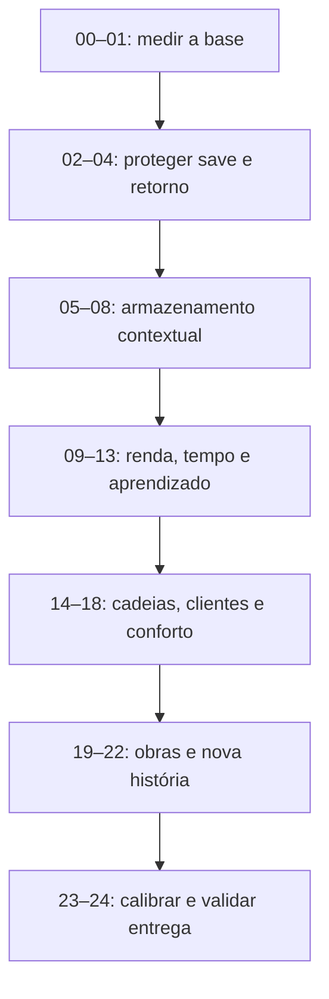

# Economia e progressão — plano R1

**Planejamento concluído em 17/10/2026. Implementação: etapas 00–22 concluídas (00–08 em 17/10/2026, 09–22 em 18/10/2026; com ressalvas de testes históricos, ver registro); etapas 23 (com ressalvas) e 24 (com ressalvas) concluídas em 19/10/2026. Plano R1 encerrado localmente.** Este plano substitui os rascunhos V0, após a pesquisa e o novo pedido do Vitor. Nenhum número abaixo representa teste de diversão já aprovado nem alteração já aplicada ao jogo.

O objetivo é uma progressão acolhedora no início, com escolhas de estoque/produção no meio e motivos afetivos e comunitários para continuar. Dificuldade cresce pela combinação do que foi aprendido; não pela punição de ausência. O pacote mantém o layout atual, preserva saves e não publica automaticamente.

## Como passar para o próximo agente

Copie a instrução abaixo e troque apenas NN e o nome do arquivo da etapa:

```text
Execute somente a etapa NN de docs/plans/economia/ETAPA_NN_NOME.md.
Leia AGENTS.md, docs/ROADMAP.md e docs/plans/economia/README.md.
Respeite os contratos e as tabelas referenciados pela etapa.
Confirme que as anteriores estão concluídas e preserve alterações locais existentes.
Implemente, verifique os critérios da etapa e registre evidência real.
Atualize README, DECISOES (se houver ajuste) e Estado atual do ROADMAP.
Não execute a etapa seguinte, não resete saves e não faça push/publicação.
```

As etapas são sequenciais porque alterações de economia, migração, interface e testes compartilham arquivos. Não distribuir etapas dependentes para implementação simultânea. É possível delegar revisão/leitura/testes dentro da mesma etapa, com um responsável pela integração. Somente marcar `[x]` quando todos os critérios daquela entrega foram verificados. Se houver bloqueio, registrar exatamente o que falta, sem saltar para a próxima.

## Documentos de referência

| Arquivo | O que decide |
|---|---|
| [00 Visão](00_VISAO.md) | identidade, princípios e resultado pretendido |
| [01 Regras de execução](01_REGRAS_DE_EXECUCAO.md) | escopo por agente, autoridade dos dados, testes e encerramento |
| [02 Tabelas](02_TABELAS_BALANCEAMENTO.md) | capacidades, preços, rendimentos, tempos, XP e proteção |
| [03 Jornada](03_JORNADA_E_MISSOES.md) | ordem, desbloqueios, aliases e linhas de personagens |
| [04 Simulação e aceite](04_SIMULACAO_E_ACEITE.md) | perfis de jogador, métricas, cenários e ajuste |
| [05 Saves e transações](05_SAVES_E_TRANSACOES.md) | migração, conservação, recibos, retorno e snapshots |
| [06 Interface e arte](06_INTERFACE_E_ARTE.md) | apresentação gradual, painel, cenas, toque e capturas |
| [07 Conteúdo e sistemas](07_CONTEUDO_E_SISTEMAS.md) | produtos, clientes, maestria, obras e rotinas |
| [08 Matriz completa](08_MATRIZ_QUESTS.md) | os 81 IDs atuais e18 novos, sem omissões de escopo |
| [Decisões](DECISOES.md) | escolhas R1 e registro obrigatório de ajustes medidos |
| [Futuro](FUTURO.md) | ideias excluídas desta execução |
| [Pesquisa consolidada](../../../reports/Economia%20e%20ritmo%20do%20Tiro.md) | diagnóstico, referências e limites da evidência |
| [Histórico V0](historico_v0/README.md) | versões substituídas; não executar |

[BASELINE.md](BASELINE.md) foi criado pela etapa 00 (medição estática do jogo atual, 17/10/2026); a23 criará RESULTADOS.md, que ainda não existe. Não confundir BASELINE (estado antes da R1) com resultado de execução da R1. Evidências volumosas ficam em build/economy; documentação versionada registra comando, ambiente, conclusão e limitações.

## Ordem de execução



Cada etapa entrega um comportamento verificável. As tabelas contêm todos os valores da R1, mas cada executor aplica somente sua parcela. Gates de regressão completa:08,13,18,22 e24; ajustes finais da23 exigem revalidar o estado final.

| Feita | Etapa | Entrega | Depende de |
|---|---|---|---|
| [x] | [00](./ETAPA_00_BASE_REAL.md) | Auditar o jogo e congelar a linha de base | início |
| [x] | [01](./ETAPA_01_SIMULADOR.md) | Medir sessões usando as regras reais | 00 concluída |
| [x] | [02](./ETAPA_02_TRANSACOES.md) | Proteger saves, lotes e recompensas antes de limitar estoque | 01 concluída |
| [x] | [03](./ETAPA_03_VOLTA_DO_TIRO.md) | Separar retorno do passeio e bagagem | 02 concluída |
| [x] | [04](./ETAPA_04_AUSENCIA.md) | Tornar a volta acolhedora sem apagar cuidados | 03 concluída |
| [x] | [05](./ETAPA_05_SILO.md) | Introduzir espaço finito junto da primeira horta | 04 concluída |
| [x] | [06](./ETAPA_06_GELADEIRA.md) | Ligar a despensa à cozinha | 05 concluída |
| [x] | [07](./ETAPA_07_ARMAZEM.md) | Apresentar materiais e ampliações na Natureza | 06 concluída |
| [x] | [08](./ETAPA_08_BAU.md) | Limitar bagagem junto dos passeios | 07 concluída |
| [x] | [09](./ETAPA_09_MOEDAS.md) | Reorganizar as fontes de renda e corrigir transformação | 08 concluída |
| [x] | [10](./ETAPA_10_HORTA.md) | Criar colheitas para visitas curtas e para a volta | 09 concluída |
| [x] | [11](./ETAPA_11_NATUREZA.md) | Separar aprender uma rota de ganhar mais vagas | 10 concluída |
| [x] | [12](./ETAPA_12_FILAS.md) | Dar autonomia com filas e preparo de vários lotes | 11 concluída |
| [x] | [13](./ETAPA_13_JORNADA.md) | Consolidar capítulos 1–9 sem tarefas repetidas | 12 concluída |
| [x] | [14](./ETAPA_14_ANIMAIS.md) | Ajustar investimentos e ensinar cadeias de ovos, leite e queijo | 13 concluída |
| [x] | [15](./ETAPA_15_CLIENTES.md) | Dar variedade ao comércio e sentido à banca | 14 concluída |
| [x] | [16](./ETAPA_16_VINCULO_ROTINAS.md) | Recompensar cuidado útil e tirar sorte do caminho principal | 15 concluída |
| [x] | [17](./ETAPA_17_PRODUTOS.md) | Adicionar três produtos com usos reais | 16 concluída |
| [x] | [18](./ETAPA_18_AMPLIACOES.md) | Oferecer conforto de longo prazo e reconhecer experiência | 17 concluída |
| [x] | [19](./ETAPA_19_PROJETOS_ESTADO.md) | Criar contribuições persistentes sem nova economia paralela | 18 concluída |
| [x] | [20](./ETAPA_20_BANCO_PRACA.md) | Entregar o primeiro projeto visível e utilizável | 19 concluída |
| [x] | [21](./ETAPA_21_JARDIM_PIQUENIQUE.md) | Criar duas metas de convivência que podem avançar juntas | 20 concluída |
| [x] | [22](./ETAPA_22_FESTA_CAPITULOS.md) | Concluir nova história com a Festa da Vila | 21 concluída |
| [x] | [23](./ETAPA_23_CALIBRACAO.md) | Ajustar o conjunto com evidência de sessões | 22 concluída |
| [x] | [24](./ETAPA_24_FECHAMENTO.md) | Validar entrega completa e preparar o teste do Vitor | 23 concluída |

## O que será diferente para o jogador

- Silo, geladeira, armazém e baú passam a fazer sentido quando surgem seus materiais. Espaço é finito desde a primeira unidade, com pequena capacidade provisória e ampliações reais.
- Plantar continua gratuito; colher deixa de pagar moeda além do produto. Vendas e encomendas financiam investimentos, e produzir algo avançado deixa de destruir valor sem motivo.
- Culturas/rotas curtas ensinam; alternativas longas e filas ajudam quem volta poucas vezes. O Tiro retorna mesmo com bagagem cheia e fica protegido durante ausência.
- Missões reconhecem o que já foi aprendido. Linhas de sabores, espaço e descobertas deixam de duplicar entregas ou prender a história em raro.
- Três produtos novos conectam produção ao Tiro e à comunidade. Clientes, ampliações e maestria oferecem continuidade; Banco, Jardim, Piquenique e Festa deixam resultados permanentes no mapa.

## O que esta entrega não afirma

Há decisões concretas de implementação, mas o equilíbrio final depende dos experimentos e da sessão real. Não há garantia de engajamento por planilha. Não há reset autorizado, migração executada, balanceamento R1 já aprovado, prazo de campanha obrigatório ou pedido de publicar. A linha de base estática e a simulada estão concluídas e a etapa 02 protegeu saves, lotes e recompensas; as etapas 02–13 estão concluídas (a 13, em 18/10/2026, consolidou os capítulos 1–9: dez pares `shared_with`, cozinha/feira/estufa/ateliê sem entrega repetida); a próxima ação de implementação é somente a etapa 14, quando solicitada.

## Registro de avanço

| Data | Etapa | Estado | Evidência / observação |
|---|---|---|---|
|17/10/2026|planejamento|concluído|R1 documentada e revisada; etapas 00–24 pendentes|
|17/10/2026|00|concluída (Claude Code)|`tools/economy_audit.py` + autoteste; [BASELINE.md](BASELINE.md); evidências em `build/economy/baseline/` (`baseline.json/.md`, `references.md`, `manifest.json`, `run_meta.json`, logs Godot). Dados reais: 81 missões, 0 erros de referência, 0 ciclos, 81/81 missões e 48/48 melhorias alcançáveis (estático). Duas execuções idênticas byte a byte; fixture quebrada detectada. Nenhum JSON de balanceamento alterado; esclarecimentos factuais em DECISOES. Próxima: [01](./ETAPA_01_SIMULADOR.md)|
|17/10/2026|01|concluída (Claude Code + Codex)|[SIMULADOR.md](SIMULADOR.md): GameState real, relógio injetável, agenda, ledger e guardas. 35/35 campanhas completas (81 missões), 107.653 ações, zero violações; campanha inteira repetida com ledger idêntico. Teste de 24 ações × GameState direto e testes focados PASS; teste antigo de campanha excedeu 3 min (não PASS). Evidências `build/economy/etapa_01/*_validada*/` e `relatorio_validada/report.md`. Sem mudar balanceamento, commit ou publicação. Próxima: [02](./ETAPA_02_TRANSACOES.md)|
|17/10/2026|02|concluída (Claude Code)|Migração `economy_revision` 1 sem reset (`SAVE_VERSION` 12; `EconomyMigration` pura/idempotente + `data/legacy_r0.json` congelado), validação única de inventário projetado (`storage_shortage`), snapshots de colheita/lote/rota/passeio (`WorkJobs`), piso legado + `prebuild_capacity` (nenhum depósito ativado), recibos de presentes automáticos (`economy.pending/granted`) e a seção "Presentes para guardar" da Mochila. Testes novos `economy_transactions_test` e `pending_gifts_test` (toque real nas três resoluções) PASS; simulador: 35/35 campanhas completas com resultado idêntico à etapa 01 (ledger byte a byte em reexecuções); toque real no export Web (Guardar). Falhas históricas isoladas: `npc_lines_test`, `finds_test`, `onboarding_test` (instável) e `progression_test` (merchant_festival) ocorrem também no commit `6c01198`. Evidências `build/economy/etapa_02/`; ver [DECISOES](DECISOES.md). Sem commit nem publicação. Próxima: [03](./ETAPA_03_VOLTA_DO_TIRO.md)|
|17/10/2026|03|concluída (Claude Code)|Viagem (`walk_state.current`) separada da bagagem (`pending_return`): `return_due_walk`, `claim_walk_baggage`; o Tiro volta mesmo com a bagagem cheia e a recarga não repete prêmio. Ver PROGRESSION "Economia R1 — etapa 03" e DECISOES. Próxima: [04](./ETAPA_04_AUSENCIA.md)|
|17/10/2026|04|concluída (Claude Code)|Ausência protegida: metade da taxa, teto 8 h por ausência contínua, pisos 25/35/25/30, sono +40/h; `DogState.away_since`, `GameState.begin_absence/end_absence`, estimativa por `last_active_at` em `from_dict` (antes da volta do passeio), segmentação 8 h compartilhada com o passeio. 100 acordado, 8 h e 24 h → 68/80/76/88. `absence_test` PASS (1/8/24/72 h, pisos, sono, reload, foco repetido, passeio de 30 min, relógio negativo, slot, DEV). Sem `SAVE_VERSION` novo, sem reset. Limites: sem aparelho físico, duas abas não coordenadas, simulador ainda usa taxa online entre sessões; ver [DECISOES](DECISOES.md). Logs em `build/economy/etapa_04/`. Sem commit nem publicação. Próxima: [05](./ETAPA_05_SILO.md)|
|17/10/2026|05|concluída (Claude Code)|Cesto da horta 16 → silo grátis 32 (após `first_harvest`) → `_2` 56 → `_3` 88; `bloblo_silo` ordem 27; piso legado só da migração (silo 40 antigo não cai); colheita cheia sem pagar nada e "Tudo" parcial com aviso; `silo_test` novo PASS; suíte um a um: só falham os históricos (`finds_test`, `npc_lines_test`, `progression_test`); simulador 5,8 dias sem violações; capturas antes/depois nas três resoluções. Ver [DECISOES](DECISOES.md). Evidências `build/economy/etapa_05/`. Sem commit nem publicação. Próxima: [06](./ETAPA_06_GELADEIRA.md)|
|17/10/2026|06|concluída (Claude Code)|Despensa provisória 12 → geladeira 24 (40 moedas, sem material) → `_2` 40 (100; tábua 2, parafuso 1; `main_4_bench`) → `_3` 64 (240; tábua 4, tijolo 2, parafuso 1; `own_business`); alimentos com `storage: fridge` explícito; `DepotRow` no detalhe do item; lote que não cabe fica pronto sem XP/contador. `fridge_test` novo PASS; suíte um a um só com as falhas históricas (`finds_test`, `npc_lines_test`, `progression_test`); simulador 5,8 dias, 0 violações (40/48 melhorias). Capturas antes/depois nas três resoluções. Evidências `build/economy/etapa_06/`; ver [DECISOES](DECISOES.md). Sem commit nem publicação. Próxima: [07](./ETAPA_07_ARMAZEM.md)|
|17/10/2026|07|concluída (Claude Code)|Pilha de materiais 16 → armazém 32 (40 moedas + madeira 4 + pedra 2, `lais_forest`, sem exigir a Caverna comprada) → `_2` 56 (90; tábua 2, parafuso 1; `main_4_bench`) → `_3` 88 (240; tábua 4, tijolo 2, parafuso 1; `own_business`). Guia: `guide_open_cave` 22 e `bloblo_warehouse` (mesmo ID) na ordem 25; `main_4_materials` = armazém + madeira 6. Linha `storage` da Bloblo: `storage_first_planks`/`storage_first_delivery` (1 parafuso cada, sem sorteio) → `bloblo_bigger`/`bloblo_biggest` por `storage_upgrades` 1/3 (derivado da posse; sem aros). `warehouse_test` novo PASS (capítulo 5 de save novo, save antigo, grafo, quatro ordens); suíte um a um sem falhas novas (históricos `finds_test`, `npc_lines_test`, `progression_test`; `onboarding_test`/`park_test` instáveis); simulador 6,8 dias, 84/84 missões, 46/48 melhorias, 0 violações. Capturas antes/depois nas três resoluções. Evidências `build/economy/etapa_07/`; ver [DECISOES](DECISOES.md). Sem commit nem publicação. Próxima: [08](./ETAPA_08_BAU.md)|
|17/10/2026|08|concluída (Claude Code)|Sacola de passeio 12 → baú 24 (0 moedas + 2 gravetos, pede `nina_walk`) → `_2` 40 (80; tábua 2, parafuso 1; `main_4_bench`) → `_3` 64 (200; tábua 3, tecido 1, parafuso 1; `own_business` + ateliê, sem aro). Os 11 materiais `trail` (inclui `wild_mint`) com `storage: chest`; `treat_box`/`accessory_set` já no baú; achados de álbum, mapa e coleções isentos. `bloblo_chest` (mesmo ID) foi para a linha da Nina, ordem 25, 10 moedas sem parafuso. `loot.guarantee` na `park_loop`: até comprar o baú a volta completa 2 gravetos (sem sorteio, sem duplicar). Bagagem mista 12/12: Tiro volta, parcelas, recarga sem repetir. `chest_test` novo PASS; suíte um a um sem falhas novas (históricos `finds_test`, `npc_lines_test`, `progression_test`; `onboarding_test` instável também sem o limite); simulador 7,1 dias, 84/84 missões, 47/48 melhorias, 0 violações. Bloqueio: nenhuma volta passa de 12 itens do baú. Capturas antes/depois nas três resoluções. Evidências `build/economy/etapa_08/`; ver [DECISOES](DECISOES.md). Sem commit nem publicação. Próxima: [09](./ETAPA_09_MOEDAS.md)|
|18/10/2026|09|concluída (Claude Code)|Colher e as rotas `lane`/`trail` deixam de pagar moeda (snapshots de plantios/rotas em andamento preservados); `apple_biscuit` 30, `treat_box` 140, `special_order` 600, `festival_contract` 940; `merchant_stall` 30, `atelier_open` 40; capítulos 1–9 10/20/30/40/60/60/60/80/80; presente de nível acima de 10 = `min(80, 20+3n)` por dados (`level_rewards.default`). UI esconde chip de moeda 0. `coins_test` novo PASS; `farm_test`/`tray_test`/`economy_sim_test`/`treasure_test`/`welcome_test` ajustados; suíte um a um só com os históricos (`finds_test`, `npc_lines_test`, `progression_test`, `onboarding_test` instável; `petshop_test`/`park_test` intermitentes). Simulador semente 1 antes×depois (reference/commercial/recovery): colheita+coleta 5,9–6,1 mil → 0; venda+encomenda 73–75% do ganho; únicas −17/−18%; total ganho −16/−25%; campanha 7,1/7,8/7,3 dias, 84/84, 0 violações; primeira compra igual (cama, 0,9 min). Capturas antes/depois nas três resoluções em `build/screenshots/etapa09_antes|depois/`. Evidência `build/economy/etapa_09/` (`report.md`). Ver [DECISOES](DECISOES.md).|
|18/10/2026|10|concluída (Claude Code)|Tabela 02 C aplicada às nove culturas (tempos/lotes/XP); canteiros 5–9 a 80/140/220/340/500; `GameState.crop_seconds` (estufa ×0,7 uma vez; lista de sementes e bandeja mostram o tempo efetivo); sabores (`bloblo_strawberry/pumpkin/sweet_potato`) na linha `flavors`, ordens 10/20/30 (após `first_kitchen` + marco da cultura), escritura não espera abóbora; mirtilo ×4 = 32 cabe no silo_2 com reserva 24. Simulador: reference 6,4 d, recovery 8,8 d, commercial semente 1 parou (baú cheio + `storage_upgrades`, limite de política do robô; sementes 2/3 completam). `garden_test` novo PASS; `farm`/`flavors`/`treasure`/`animals` adaptados. Evidência `build/economy/etapa_10/`, capturas `build/screenshots/etapa10_antes|depois/`.|
|18/10/2026|11|concluída (Claude Code)|Natureza: tabela 02 E nas 12 rotas (tempo, saída e `nature_xp` próprio, gravado no lote), pomar 1 h/8 maçãs sem XP local; patamares 0/24/120/360 e vagas 1/2/2/3 nos três locais (cobre e juncos no 2, madeira dura e cristal no 3, **terceira vaga só no 4** via `slot_levels`, sem token novo); piso legado pelas ampliações possuídas (vaga 3 + XP 90 mantém as três vagas, sem cobrar nem inventar XP); `woodcutting` desde `forest_open`; `route_id` opcional e validado (padrão = a elegível mais curta); escolha de rota/duração por material na bandeja e no painel, só na sessão (`NatureUi`), sem trocar sozinha; "Faltam N XP"; vagas fechadas "Nível 2/4". `nature_routes_test` novo PASS; `nature_test`, `content_test`, `coins_test`, `warehouse_test`, `economy_sim_test` ajustados; suíte um a um (`build/economy/etapa_11/suite/` + `rerun_*`) só com os históricos (`progression_test`, `npc_lines_test`, `finds_test`; `onboarding_test` instável com o mesmo par de erros da etapa 10; `park_test` intermitente). Simulador (semente 1): reference 6,4→10,1 d, recovery 8,8→8,1, commercial parou em 25,8→8,3 (84/84, 0 violações); o robô passou a escolher a rota pelo ritmo da sessão (política, não regra do jogo); ver [DECISOES](DECISOES.md) (inclui o aviso: por hora de vaga a rota curta rende mais XP; a calibração é da 23). Capturas antes/depois nas três resoluções em `build/screenshots/etapa11_antes|depois/`. Evidência `build/economy/etapa_11/`.|
|18/10/2026|12|concluída (Claude Code)|Filas e Preparar N: tempos da tabela 02 D em 19 receitas (costura igual; ovos/leite = duração do lote), `stove_queue` 80 moedas sem tábuas (exige `first_kitchen`), `stove_queue_2` 220 + tábua 3 (bancada + fila anterior), `blender_queue` nova 100 + tábua 1 (comprada na Cozinha), `GameState.cook_many/cook_many_error/cook_max/cook_inputs/cook_finish_at/station_free_slots` (`cook`/`cook_error` = N 1; tudo ou nada, N jobs com `ready_at` encadeado e snapshot próprio; criações e costura de coleção só 1), seletor `− ×N + Tudo` na `StationTray` com ingredientes/saída/tempo totais e "Pronto às HH:MM" (`GameState.clock_text`); só selecionar não começa produção. `queue_test` novo PASS; `animals_test`, `station_tray_test` ajustados; relatório `build/economy/etapa_12/autonomia.md`. Simulador (semente 1, robô ainda cozinha 1 por vez): reference 10,1→16,1 d, commercial 8,3→10,3, recovery 8,1→11,3 (84/84, 0 violações): os tempos mais longos pesam; o robô não usa Preparar N (calibração na 23). Evidência `build/economy/etapa_12/`, capturas `build/screenshots/etapa12_antes|depois/`.|
|18/10/2026|16|concluída (Claude Code)|Vínculo e rotinas: carinho dá +1 afeto a cada 120 s guardado no estado (`pet()` devolve o afeto concedido; a UI só mostra "+carinho" quando veio), brincar +2 só se útil, `care_useful` e `care_useful:<ação>` (ganho efetivo ≥5, carinho ≥3 com guarda de 120 s; exceção de desejo de ação ainda faltando ou passo de história, uma vez por instância; entrega de desejo de comida vale), moedas de desejos pela fórmula (ação 2; comida/give `min(8,max(2,round(preço×0,5)))`; especial ×2 limitado a 12) e vínculo 2–8 = 10/15/20/25/30/40/50, `wish_item:<item>` na entrega efetiva, desejo só sorteia item com fonte liberada (`wish_item_reachable`), troca de pedido impossível na hora com `swap_reason`; rotinas: catálogo R1 (5 diárias, 4 semanais) com metas por fase congeladas na geração (`routine_target`, `catalog` 2, `targets`), modelos antigos em `legacy` mantêm meta/prêmio dos períodos ativos, contador `production_jobs` (1 por lote), pool só com o acessível (capítulo 3 abre com 2 diárias); `nina_rare` virou a linha opcional `nina_discoveries` (ordem 10, após `nina_walk`) e o pet shop depende de `nina_routes`. `bond_test` novo (em `tools/test_all.ps1`); `wishes_test`, `tasks_test`, `lists_test`, `content_test`, `tricks_test` ajustados. Simulador (semente 1, até a campanha; antes = etapa 15): reference 15,1→14,3 d, commercial 17,8→16,8 d, recovery 14,3→13,4 d, 86/86, 0 violações; afeto ao fim 902→715 / 364→353 / 816→816 (o nível máximo 520 segue alcançado no reference e no recovery; o commercial não chegava antes). Sem mudança visual além de textos de rotinas (sem capturas). Suíte parcial PASS; históricos `npc_lines_test`, `finds_test`, `onboarding_test` instável, `petshop_test` intermitente (`rare`). Evidência `build/economy/etapa_16/`; registro em `DECISOES.md` e `docs/PROGRESSION.md`. Sem commit nem publicação. Próxima: [17](./ETAPA_17_PRODUTOS.md)|
|18/10/2026|17|concluída (Claude Code)|Três produtos e uma receita de apoio: `braided_toy`/`picnic_pack`/`blueberry_treat` (tabela 07 A: tempos 720/1080/900 s, venda 40/110/65, margens imediatas 12/34/19 conferidas em teste) com ícones PixelLab 32 px, `cut_sticks` (madeira 1 → 2 gravetos, 60 s, XP global 1, XP local 0, sem ciclo reverso), `player_xp` por receita (8/10/10; receitas antigas mantêm o XP global do cook; o snapshot congela o valor), encomendas `nina_toys`/`lais_picnic`/`nina_blueberries` (110/190/175, recargas 3600/3600/7200), linha `workshop` do Guia e `nina_blueberry` na linha `nina_flavors` (desejo `blueberry_treat` garantido na próxima vaga vazia enquanto a missão está ativa, sem substituir pedido, sem gerar ingrediente e sem bloquear troca). `products_test` novo (em `tools/test_all.ps1`); `content_test`, `progression_test` (o robô cozinha o objetivo, abre o tesouro e atende o desejo) e `station_tray_test` (a grade do fogão com mais de duas linhas rola) ajustados; robô e contas do simulador abrem o tesouro e perseguem `wish_item`. Simulador (semente 1, até a campanha; antes = etapa 16): reference 14,3→15,1 d, commercial 16,8→18,8 d, recovery 13,4→14,9 d, 90/90 missões, 0 violações. Evidência `build/economy/etapa_17/`; ver [DECISOES](DECISOES.md). Sem commit nem publicação. Próxima: [18](./ETAPA_18_AMPLIACOES.md)|
|18/10/2026|18|concluída (Claude Code)|Ampliações de conforto e maestria: `silo/fridge/warehouse/chest` `_4` e `_5` (totais 128/176, 88/120, 128/176, 88/120 somando só diferenças; `_4` exige `atelier_open`, `_5` exige o `_4` e 12 contratos; aros 1/2), filas `stove_queue_3` 500, `mill_queue` 250, `dairy_queue` 350 e `atelier_queue` 450 (+1 vaga cada, sem velocidade nem rendimento), maestria das seis estações por lotes recolhidos (`station_jobs:<estação>`, `station_recipe_jobs:<estação>:<receita>`; 12/40/100 lotes, variedade `min(2/3/4, catálogo elegível)`, prêmios 10/20/30 moedas por `mastery:<estação>:<n>`, selo bronze/prata/ouro, sem retrocesso) com semeadura mínima comprovável para saves antigos (`economy.mastery_method`) e medidor `Mastery_<estação>` com "?" dentro da bandeja e do painel da estação. Simulador (semente 1, até a campanha; antes = etapa 17): reference 15,1→15,1 d, commercial 18,8→18,1 d, recovery 14,9→15,3 d, 90/90, 0 violações; leve 89/90 em 85,3 d (bloqueio de sorte de passeio em `nina_sewing`, anterior à etapa). Utilidade medida em `build/economy/etapa_18/capacidade.md` (`_4` resolve reservas médias; `_5` só silo/armazém com reserva alta). `expansion_test` novo; `progression_test` agora precisa de ≥ 20 min (745 ciclos, PASS). Evidência `build/economy/etapa_18/`; ver [DECISOES](DECISOES.md). Sem commit nem publicação. Próxima: [19](./ETAPA_19_PROJETOS_ESTADO.md)|
|18/10/2026|19|concluída (Claude Code)|Obras comunitárias sem conteúdo: `data/projects.json` vazio (`schema` 1), `ProjectState` (chave `projects` no save; campos started/paid_start/phase_index/contributions/completed/completion_rewarded/used_once/cycles), APIs `project_error/start_project`, `project_contribution_error/contribute_project`, `project_ready/complete_project`, `project_use_error/use_project`, `project_stage` (consulta pura); taxa só ao começar, quantidade inteira positiva, última entrega conclui e premia no mesmo passo (`_grant_automatic("project:<id>")`, recibo se não couber, nunca bloqueia), recuperação idempotente (`_recover_projects` ao carregar e no tick); objetivo `project`, requisito `projects`, TaskHelp/Places/ícone; eventos `project_phase_completed/project_completed/project_used`; `Database.project_issue/project_problems` (ciclo, referência ausente, material inválido). `projects_test` 158 verificações; regressão de 15 testes (inclui `progression_test`) PASS; simulador idêntico à baseline da 18 (reference 15,1 d, commercial 18,1 d, recovery 15,3 d, 90/90, 0 violações; leve 89/90 em 85,3 d igual). Evidências em `build/economy/etapa_19/` (`RELATORIO.md`); ver `docs/PROGRESSION.md`, "Economia R1 — etapa 19"|
|18/10/2026|20|concluída (Claude Code)|Banco da Praça (`park_bench`, tabela 07 E: entrada 150, base/conforto/boas-vindas, XP 40) entregue de ponta a ponta: painel genérico `ProjectUi` (Começar por N moedas, itens tocáveis, quantidade, um Entregar, permanece aberto), lugar "Nossa praça" (Amigos/Treino ficaram `hidden`: 4 lugares), objeto `community_bench` com marcação, três desenhos por fase e balão, uso pelo Tiro (reação `bench`, primeira contagem só quando ele chega), celebração "Obra pronta!", manual e tour. `bench_test` novo PASS; suíte inteira só com os históricos (`onboarding_test`, `finds_test`, `npc_lines_test`); `progression_test` PASS; simulador idêntico à 19 (0 violações). Capturas antes/depois nas três resoluções em `build/screenshots/etapa20_antes|depois/`. Evidência `build/economy/etapa_20/`; ver [DECISOES](DECISOES.md). Sem commit nem publicação. Próxima: [21](./ETAPA_21_JARDIM_PIQUENIQUE.md)|
|18/10/2026|21|concluída (Claude Code)|Jardim da Vila e Piquenique da Praça (`village_garden`/`park_picnic`, tabela 07 E: entrada 250, XP 60, só exigem o banco; as duas começam juntas) com painel genérico, "Nossa vila", objetos e seis desenhos PixelLab, reações `garden`/`picnic`, simulador `until=projects`. `garden_picnic_test` novo; campanha idêntica à 20 (15,1/18,1/15,3 d, 0 violações); até as três obras: reference 17,8 d, recovery 18,8 d, leve 50,3 d; **commercial não conclui o piquenique** (provável artefato do robô, registrado para a 23). Evidência `build/economy/etapa_21/`; ver [DECISOES](DECISOES.md). Sem commit nem publicação. Próxima: [22](./ETAPA_22_FESTA_CAPITULOS.md)|
|18/10/2026|22|concluída (Claude Code)|Festa da Vila (`village_festival`: jardim + piquenique + `stall_3`, 500 moedas, decorate/table/gifts, XP 100 + coleção `community_ribbon` "Lenço da nossa turma" com overlay verde-água gerado do lenço vermelho), cena permanente na Vila (três desenhos PixelLab + ícone), reação `festival`, `festival_contract` renomeado "Encomenda para eventos", **Encontro da turma** repetível (24 h, picnic_pack 1 + carrot_snack 2, XP 10 por ciclo, identidade por ciclo), capítulos 10–12 (30/40/60) e nove missões principais (31 → 40; total 99). Robô aprendeu `pursue_project`/`use_project`: campanha **99/99 em 21,1 d**, 0 violações (antes 15,1 d/90). `festival_test` novo; `journey_test`, `world_life_test`, `projects_test`, `content_test` ajustados. Testes só da área mapeada; `progression_test` pulado a pedido do Vitor. Evidência `build/economy/etapa_22/`; ver [DECISOES](DECISOES.md). Sem commit nem publicação. Próxima: [23](./ETAPA_23_CALIBRACAO.md)|
|19/10/2026|23|**concluída com ressalvas** (Claude Code; decisão do Vitor: pendências de verificação vão para a 24)|Rodada mínima pedida pelo Vitor (semente 1; sem sementes 2–10, sem baseline de 35, sem sessão humana, sem `progression_test`). **Nenhum dado de economia alterado.** Campanha completa (99 missões): reference 21,1 d, commercial 28,1 d, recovery 22,4 d (todos 99/99, 0 violações); light 98/99 (só `nina_blueberry`, opcional, que o perfil não ativa por não ter `ph_others`). Pendências da 21/22 resolvidas sem mexer em dados: commercial conclui o piquenique e a Festa; o "light trava em `nina_sewing`" era rótulo antigo (a missão fecha com a Festa, par `shared_with`). Falha de critério: Festa "+2–4 h" fica em +5,6–6,5 h pela métrica de sessão (calendário: fim 9 no dia 7, Festa no 19,8; gargalo = banca 3). Experimento descartado: garantia de fita na `park_loop` (sem efeito, revertida). Relatório: [RESULTADOS.md](RESULTADOS.md); evidência `build/economy/etapa_23/`. Próxima ação: jogar banco→Festa no celular, sementes 2–10, e decidir sobre a banca 3 (15→12 contratos) conforme RESULTADOS. Sem commit nem publicação. Próxima: [24](./ETAPA_24_FECHAMENTO.md), que absorve as verificações pendentes.|
|19/10/2026|24|**concluída com ressalvas** (Claude Code; a pedido do Vitor, sem refazer toda a suíte)|Validação final enxuta + pendências da 23: sementes extras (reference e light 1–10; commercial e recovery 1–3; active 1–2; light com recarga por sessão idêntico), 0 violações, auditor estático (99 missões, 61 melhorias, 0 erros, 0 ciclos), relatório e gráficos (`build/economy/etapa_24/relatorio/`). Festa "+2–4 h" segue falha (+5,3–7,0 h). **Ajuste a pedido do Vitor: banca 3 de 15 para 12 contratos** (~1 dia a menos; ver [DECISOES](DECISOES.md)). Ressalvas: sem aparelho físico/sessão humana, `progression_test` e suíte completa não repetidos no estado final, commercial s2/s3 e light em 98/99 por `nina_blueberry` (limite do robô). Roteiro de celular em [RESULTADOS.md](RESULTADOS.md). Publicação a pedido do Vitor em 19/10/2026.|

### Etapa 22 — mapa de testes e resultados

| Arquivo mudado | Teste rodado | Resultado |
|---|---|---|
| `projects.json`, `project_state.gd`, `database.gd` (validação do encontro), `game_state.gd` (`gather_project`, `completed_at`) | `projects_test` | PASS (158) — esperava 8 campos/3 projetos, ajustado para 9/4 |
| idem + `festival_test` novo (dados, história do zero ao fim, legado, Encontro, sala, painel) | `festival_test` | PASS (438) |
| `rooms/village.json`, `worlds.json`, `dog_world.gd`, `room.gd` | `garden_picnic_test` / `bench_test` | PASS (238) / PASS 45 s |
| `quests.json`, `progression.json` (capítulos 10–12, nomes do contrato), `places.gd` | `content_test` | PASS (ajustado: contador `project_use:`, obra feita pela história abre os destinos) |
| idem | `journey_test` | FAIL → PASS (esperava a história acabar no ateliê; agora segue para `community_10_meet`) |
| `rooms/village.json` (footprint da festa) | `world_life_test` | FAIL → PASS (o teste tratava obra não começada como obstáculo) |
| `quests.json`, `progression.json`, `game_state.gd` | `market_test`, `customers_test`, `coins_test`, `expansion_test`, `products_test`, `dev_tools_test`, `tasks_test`, `texts_test`, `manual_test`, `treasure_test`, `lists_test` | todos PASS |
| `worlds.json`, `rooms/village.json` | `navigation_test`, `worlds_test`, `world_view_test`, `world_selector_test`, `park_test` | todos PASS |
| `project_ui.gd`, `celebration.gd` | `ui_base_test`, `ui_style_test` | PASS |
| helpers do simulador (`economy_bot.gd`, `economy_sim.gd`) | `economy_sim_test` | PASS (58 s) |
| missão/projeto/capítulo | simulador referência s1: `until=projects` e `until=campaign` | 17,3 d / **99/99 em 21,1 d**, 0 violações |
| interface | `festival_shots.gd` antes/depois e `ui_tour.gd` (`b16l`, `b16m`) nas três resoluções; PNGs abertos | ok |

**Deliberadamente NÃO rodados:** a suíte inteira (`tools/test_all.ps1`) e testes que não citam o que mudei (política da rodada); `progression_test` (≥ 20 min): **pulado por decisão do Vitor** ("se já testou bem onde mudamos as coisas"), apesar de `quests.json`/`progression.json` terem mudado. A cobertura equivalente ficou com `festival_test` (história do zero ao capítulo final) e a campanha simulada 99/99. Conhecidos e não investigados: `onboarding_test`, `finds_test`, `npc_lines_test`. Sem baseline de 35 execuções. Evidência em `build/economy/etapa_22/` e capturas em `build/screenshots/etapa22_antes|depois|tour/<resolução>/`.

### Etapa 23 — mapa de testes e resultados

| Arquivo mudado | Teste rodado | Resultado |
|---|---|---|
| nenhum arquivo de jogo/dados ficou alterado (experimento da fita em `game_state.gd`/`walks.json`/`chest_test.gd` revertido; `walks.json` e `game_state.gd` mantêm só as alterações locais anteriores) | `chest_test`, `walk_return_test`, `walks_test` (durante o experimento) e `chest_test` de novo após reverter | PASS / PASS / PASS / PASS |
| simulador (somente leitura) | campanha `until=campaign` semente 1: commercial, recovery, light (120 d), e depois light + reference com o experimento | ver [RESULTADOS.md](RESULTADOS.md): 0 violações |

**Deliberadamente NÃO rodados:** `progression_test` (nenhuma missão/capítulo/prêmio foi alterado; a pedido do Vitor), suíte inteira, baseline de 35 execuções, sementes 2–10, `economy_sim_test` (helpers do simulador sem alteração). Sem sessão humana nem aparelho físico.


### Etapa 24 — mapa de testes e resultados

| Arquivo mudado | Teste rodado | Resultado |
|---|---|---|
| `progression.json` (`stall_3` 12), `quests.json` (`merchant_clients` 12), `customers_test.gd`, `market_test.gd` | `customers_test` | PASS |
| idem | `market_test` | FAIL (esperava 16 contratos após o contrato final) → ajustado para 13 → PASS |
| idem | `expansion_test`, `content_test`, `journey_test`, `festival_test` (438), `tasks_test` | PASS |
| nenhum (estado antes do ajuste) | suíte um a um até `hud_test` (25 testes) | PASS, exceto `finds_test` (histórico) |
| nenhum | auditor estático `economy_audit.py` + autoteste | 0 erros, 0 ciclos, PASS |
| simulador (somente leitura) | 28 execuções "antes" + 9 "depois" | 0 violações |

`git diff --check` aponta espaços no fim e linha em branco no fim de arquivos já alterados antes (ex.: `docs/ROADMAP.md`, `time_text.gd`); não corrigidos.

**Deliberadamente NÃO rodados:** `progression_test` (interrompido; pedido do Vitor de não refazer tudo), restante da suíte (de `ready_badges_test` em diante), tour visual/toque nas três resoluções, smoke do export Web local, baseline × R1 com horizonte igual. Falhas históricas conhecidas: `onboarding_test`, `finds_test`, `npc_lines_test`.
