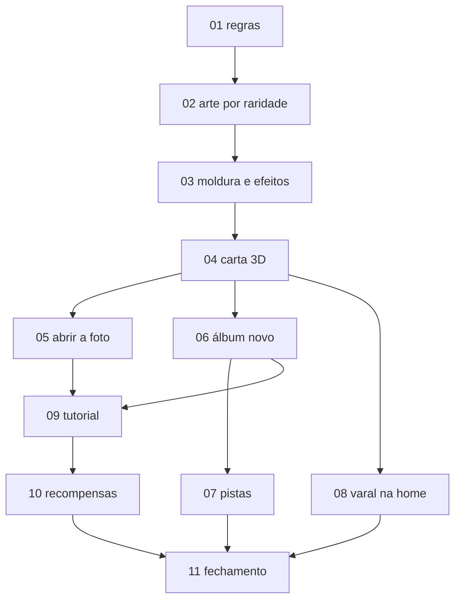

# Plano "Fotos do Tiro" — cartas colecionáveis

> Pedido do Vitor (06/11/2026): as fotos viram uma parte principal do jogo, instigante de colecionar. Hoje o
> álbum mostra as fotos encolhidas e "zoadas", as pistas não são claras, ganhar uma foto não tem festa e o
> lugar delas na Casa "está horrível". Ele produziu **quatro versões ilustradas de cada foto** (simples, meio
> simples, rara e especial) e quer raridade, abrir a foto nova como uma carta surpresa, tentar a sorte de novo /
> melhorar, ver a carta em 3D com brilho, coleção de versões, três fotos na home e um tutorial bem feito.
> "Faz o plano daquele jeito que a gente faz, em várias etapas bem explicadas, que eu vou mandar para
> outros agentes."

Estado: **etapas 01–11 concluídas (07/11/2026); plano encerrado localmente, nada publicado** (fechamento em [RESULTADOS.md](RESULTADOS.md)). Já existe no código uma base de raridade
feita antes deste plano ("etapa 1 antiga", `01_DESENHO.md` §9): a etapa 01 deste plano a revisa.
A proposta anterior (antes da arte por raridade) ficou em [HISTORICO_PROPOSTA_06_11.md](HISTORICO_PROPOSTA_06_11.md).

## A ideia em uma linha

> **Cada foto é uma carta com quatro versões.** Você ganha a carta fechada, abre e descobre a versão;
> depois pode **tentar a sorte** de novo (moedas) ou melhorar um nível (materiais) até ter as quatro. A Rara brilha, a
> Holográfica tem o reflexo arco-íris de carta especial; tudo se vê grande, inclinando a carta com o dedo.

## Decisões do Vitor — fechadas

| # | Decisão |
|---|---|
| 1 | **4 níveis**: 1 Comum · 2 Brilhante · 3 Rara · 4 Holográfica (no catálogo de arte: `common`, `shiny`, `rare`, `holographic`). Chances **mais generosas**: 45 / 30 / 18 / 7%, garantias a cada 10 sem Rara+ e 30 sem Holográfica. |
| 2 | **Arte própria por nível** (`tools/art/album_rarities/`, catálogo pelo `id` da foto). Nível sem arte revisada usa a ilustração atual da própria foto e muda só moldura/efeito. Instruções do Vitor em [INTEGRACAO_RARIDADES.md](INTEGRACAO_RARIDADES.md). |
| 3 | **Efeitos**: níveis 1 e 2 **sem efeito** (a arte e a moldura simples). Nível 3 = moldura mais rara + **brilho**. Nível 4 = **cromo/foil arco-íris na carta inteira**, de carta rara. |
| 4 | **Carta em 3D**: no álbum e na home, tocar abre a carta grande; arrastar **inclina** a carta para os lados e o brilho acompanha. |
| 5 | **Abrir**: foto nova chega **fechada** ("Nova foto surpresa!"); tocar em **Abrir** vira a carta e revela a versão sorteada, com festa do tamanho da raridade. **Sem roleta** (o Vitor estava brincando: "girar a sorte" é só o botão Tentar a sorte). |
| 6 | Dentro da carta: **Tentar a sorte** (só moedas; sorteia entre os 4 níveis) e **Melhorar** (materiais; sobe **sempre um nível** acima do melhor que você tem; cada nível mais caro, com materiais mais difíceis). |
| 7 | **Coleção de versões**: a carta mostra as 4 versões; as que você tem coloridas, as que faltam escuras. Você escolhe qual mostrar. |
| 8 | Momentos que se repetem sorteiam de novo naturalmente e a foto **nunca piora**. |
| 9 | **Home**: **varal na parede** com 3 polaroides presas por pregadores, acima do Tiro; tocar abre a carta 3D. O mapa da Casa fica para depois. |
| 10 | **Recompensas de coleção**: seção completa, as 4 versões de uma foto, marcos de Rara+ e a primeira Holográfica. |
| 11 | **Tutorial** com a foto da chegada (a da caixinha), na primeira visita ao Álbum pela missão da Laís: abre → sempre Comum → primeiro Tentar a sorte grátis (Brilhante) → primeiro Melhorar com materiais dados de graça (Rara). |
| 12 | Pistas mais claras e "Quase lá" no álbum. |

## Documentos (ler nesta ordem)

| Arquivo | O que decide |
|---|---|
| [01_DESENHO.md](01_DESENHO.md) | regras completas: estados da carta, sorteio, rolar/melhorar e custos, coleção, varal, recompensas, tutorial roteirizado, visual de cada nível, carta 3D, revelação |
| [02_REGRAS_E_TESTES.md](02_REGRAS_E_TESTES.md) | contrato do executor, o que preservar, padrão "madeira ilustrada", desempenho no celular, testes, capturas |
| [INTEGRACAO_RARIDADES.md](INTEGRACAO_RARIDADES.md) | instruções do Vitor sobre a arte por raridade (catálogo, estados, fallback, validação) |
| [etapas/](etapas/) | **um arquivo por etapa**: ler antes, como está hoje, passo a passo, não fazer, armadilhas, testes numerados, pronto quando |

## Etapas

| # | Etapa | Tamanho | Resultado que o Vitor vê |
|---|---|---|---|
| 01 | [Regras da carta](etapas/ETAPA_01_REGRAS.md) | médio | nada na tela; carta fechada, rolar (moedas), melhorar (materiais), varal e tutorial no motor |
| 02 | [Arte por raridade](etapas/ETAPA_02_ARTE.md) | médio | as fotos aparecem na versão certa (ou na ilustração atual, se a arte ainda não existe) |
| 03 | [Moldura e efeitos](etapas/ETAPA_03_EFEITOS.md) | médio | prancha com a mesma foto nos 4 níveis: simples, simples, rara com brilho, holográfica com cromo |
| 04 | [A carta em 3D](etapas/ETAPA_04_CARTA.md) | grande | tocar numa foto abre a carta grande que inclina com o dedo, versões, Tentar a sorte e Melhorar |
| 05 | [Abrir a foto nova](etapas/ETAPA_05_ABRIR.md) | grande | "Nova foto surpresa!" → Abrir → a carta vira e revela → festa → carta |
| 06 | [Álbum novo](etapas/ETAPA_06_ALBUM.md) | grande | o álbum com cartas grandes, versões, "para abrir" e "Quase lá" |
| 07 | [Pistas claras](etapas/ETAPA_07_PISTAS.md) | médio | cada foto que falta diz o que fazer, com ícone, progresso e Ir |
| 08 | [Varal na home](etapas/ETAPA_08_VARAL.md) | médio | três polaroides na parede da home; tocar abre a carta 3D |
| 09 | [Tutorial](etapas/ETAPA_09_TUTORIAL.md) | médio | a Laís ensina com a foto da chegada: abrir, rolar grátis, melhorar grátis |
| 10 | [Recompensas de coleção](etapas/ETAPA_10_RECOMPENSAS.md) | pequeno | prêmios por seção, por carta completa e por marcos de raridade |
| 11 | [Fechamento](etapas/ETAPA_11_FECHAMENTO.md) | médio | tour nas 3 resoluções, toque real no navegador, docs; nada publicado |



Ordem: uma etapa por sessão, nesta sequência: 01 → 02 → 03 → 04 → 05 → 06 → 07 → 08 → 09 → 10 → 11.
A 02 pode ser **repetida a qualquer momento** para instalar lotes novos de arte (o instalador é idempotente);
basta rodar o instalador e o teste da etapa.

## Prompt para mandar a um agente

```
Projeto: C:\Users\Vitor\Documents\ClaudeGame (Godot 4.7.2, jogo Tiro Adventure).
Leia AGENTS.md (ou CLAUDE.md), depois docs/plans/fotos/README.md, 01_DESENHO.md, 02_REGRAS_E_TESTES.md e
INTEGRACAO_RARIDADES.md. Execute SOMENTE a etapa docs/plans/fotos/etapas/ETAPA_NN_<nome>.md, do começo ao
fim, seguindo o passo a passo, os "não fazer" e os testes numerados. Preserve alterações locais de outros
agentes. Ao terminar: preencha o "Registro" no README do plano, atualize a parte do álbum no AGENTS.md e no
CLAUDE.md (mesmo conteúdo nos dois) e o "Estado atual" de docs/ROADMAP.md. Não faça commit, push nem
publicação sem pedido do Vitor. Por último, entregue ao Vitor um resumo curto (o que mudou, testes, capturas,
pendências) e o PROMPT PRONTO da próxima etapa (este mesmo modelo com o número/nome dela e as pendências que
ela precisa saber).
```

## Registro (cada etapa preenche ao terminar)

Continuação: [validação da etapa 07](VALIDACAO_07.md) e [prompt pronto da etapa 11](PROMPT_11.md).

| Etapa | Data | Quem | Resultado | Pendências |
|---|---|---|---|---|
| 11 | 07/11/2026 | Claude | Fechamento: instalador de arte repetido (216/216, `check` PASS); portão 120/122 (`photo_art_test` ajustado para 54/54 completas e PASS; `drag_scroll_test` passa isolado, não tocado); tour `--fotos-only` (15 PNGs × 3 resoluções, abertos); toque real no Chrome emulado com tutorial inteiro, varal e Holográfica (~52 fps na média); roteiro do celular em `RESULTADOS.md`. | Celular físico pendente; nada publicado. |
| 10 | 07/11/2026 | Claude | Recompensas de coleção: `GameState._check_album_rewards()` (chamado no fim de `_apply_photo_roll`: abrir, tentar a sorte, melhorar, tutorial e DEV) paga cada marco uma vez por `_grant_automatic("album:section:<seção>" / "album:styles:<foto>" / "album:rare:<n>" / "album:holo:first")` com os valores de `album.json → cards.rewards` (60 / 25 / 40-80-150 / 100 moedas; itens sem espaço viram recibo "Álbum de fotos" em "Presentes para guardar"). `Events.album_milestone(kind, key)` → `Celebration.show_album_milestone` na fila modal (só abre depois da carta/revelação fechar), cartão de madeira com a carta de destaque (`PhotoCard`) e os prêmios. Álbum: `✓` no título da seção completa (`SectionComplete`), marca `StylesComplete` "4/4" na carta e `NextMilestone` "Mais N Raras"; consultas `album_milestones(seção)`, `album_section_complete`, `rare_plus_count`, `holo_owned`. Tutorial paga normalmente se atingir um marco. `album_rewards_test` (suite/área album) + lista fechada PASS; capturas `tests/fotos_10_shots.gd` (4 cartões + álbum × 3 resoluções, auditoria OK, abertas). `photo_rarity_test` desliga os prêmios (mede só custos) e `photo_line_test` para o timer modal (festa cobria o toque). | Próxima 11: fechamento. Web/celular físico pendentes; sem mudança de sorteio, custos, obtenção, arte, save ou missões; prêmios só em moedas por ora (valores ajustáveis no JSON). |
| 09 | 07/11/2026 | Claude | `AlbumTutorial` (véu em quatro retângulos, balão da Laís, destaque, seta/mão, selos Grátis/Presente e custo riscado) conduz a carta `h_arrival`: Abrir (Comum) → Tentar a sorte grátis (Brilhante) → Melhorar de presente (Rara) → inclinar (≥ 60 px) → escolher versão → pôr no varal; passo salvo e retomada, sem pular; só o alvo recebe toque; começa só com a fila modal vazia; abre a carta no Álbum (`CodexSections._album` → `maybe_start`). Guardas: abrir a chegada fora da tela conta como passo 1; `_queue_photo` ignora a chegada até o fim. Fim fecha tudo e mostra o varal; aviso de cartas fechadas restantes. `album_tutorial_test` + lista fechada 10/10 PASS (161,6 s); capturas `tests/fotos_09_shots.gd` (9 × 3 resoluções, auditoria OK). | Próxima 10: recompensas de coleção. Web/celular físico pendentes; sem mudança de regra, save, custos, sorteio, arte ou missão `lais_album`. |
| 08 | 06/11/2026 | Claude | `PhotoLine` (`scripts/ui/photo_line.gd`, nó `PhotoLine` filho da `PetScreen`): varal de madeira desenhado em código (cordinha com barriga + pregadores, sem PNG novo) com 3 espaços `PhotoLine_<id>` (polaroide `PhotoCard` 72–84 px, ângulos −4°/2°/−2°, balanço por tween lento, parado em Menos animação) ou `PhotoSlot_<i>` ("+" que abre o Álbum). Aparece só com alguma carta aberta; some no passeio e, dormindo, se cobrir a cabeça/Zz. Faixa livre = abaixo do HUD (`Hud.HEIGHT`+6), à esquerda do balão do desejo (`PetScreen.photo_line_right`); atualiza por assinatura (ids + versão mostrada + tamanho) em `PetScreen._refresh/_layout_corner`, sem reconstruir o quarto. Toque consumido pelo botão (não vira carinho). `photo_line_test` (suite/album/care) + lista fechada 9/9 PASS (143,5 s); capturas `tests/fotos_08_shots.gd` (vazio, 1, 3 com Holográfica, dormindo, passeando; 3 resoluções, auditoria OK). | Próxima 09: tutorial. Web/celular físico pendentes; sem mudança de regra, save, custos, sorteio ou arte. |
| 07 | 06/11/2026 | Codex | `goal_hint` nas 54 fotos, `GameState.photo_hint/near_photos`, pistas com ícone/progresso/Ir e PhotoHint em madeira; poesia até lupa, concreto depois, Conversar via hint_npc. Quase lá usa os contadores reais. Lista fechada 6/6 PASS (65,6 s); 27 capturas nativas nas três resoluções conferidas. Detalhes em `VALIDACAO_07.md`. | Próxima 08: varal na HOME; Web/celular pendentes. Sem mudanças de obtenção/save/sorteio/arte, lotes, rolagem ou publicação. |
| 06 | 06/11/2026 | Codex | Livro em duas colunas de `AlbumCard_<id>`, `AlbumSummary`, versões/níveis, `AlbumSealed` sem consumo antecipado; faltantes cinza/desfocadas, segredos no verso e pista em madeira; `AlbumNear` barato e rolagem independente por seção. Lista fechada PASS; 27 capturas nativas nas três resoluções conferidas. Detalhes em `VALIDACAO_06.md`. | Pistas concretas/consulta geral e conteúdo de Quase lá = 07 (atualmente só fixture combina hint e contador útil); Web/celular pendentes. Sem alteração de regras/save/arte, lotes ou publicação. |
| 05 | 06/11/2026 | Codex | `CardReveal`: verso de madeira, abertura única, flip/revelação e festa por nível; resultado de Tentar a sorte/Melhorar no mesmo visualizador. Fila modal de fotos após capítulo/Novo!, lembrete durante atividade, boas-vindas e DEV. Lista fechada PASS; 48 PNGs nas três resoluções conferidos. Detalhes em `VALIDACAO_05.md`. | Álbum novo = 06; tutorial = 09; Web/celular físico ainda sem conferência. Sem mudança de regras/save, instalação de lotes ou publicação. |
| 04 | 06/11/2026 | Claude + Codex | `CardViewer` com `CardStage`/`CardSurface` e perspectiva, arrasto/foil/mola e Menos animação; versões, Tentar a sorte, Melhorar, ajuda dos materiais (alvos 44 px), varal/substituição, Antes e depois e coleção completa. Ligado a `AlbumView.open_photo`; fila de prêmios espera fechar. **10 testes distintos PASS** (`card_viewer_test`, lista fechada e art/house, após reexecução focada); 51 capturas conferidas em três resoluções, auditorias OK e desempenho nativo medido. Validação e reexecuções em `VALIDACAO_04.md`. | Revelação e substituição da abertura automática das cartas fechadas = 05; varal na home = 08. Teste de arte antigo instalou 100 variantes revisadas novas (144/216 instaladas, 36 fotos); agora verifica idempotência em destino isolado, sem instalar novos lotes. Celular/Web ainda sem medição desta tela. |
| 01 | 06/11/2026 | Claude | Motor das cartas: `album.json → cards`; foto nova chega fechada (`sealed`), `open_photo_card`, `reroll_photo` (40 moedas +20, teto 160), `upgrade_photo` (+1 nível, custo do destino), varal de 3, tutorial forçado e grátis (`_tutorial_level`), `Events.photo_sealed`, `SAVE_VERSION` 19. `photo_rarity_test` (10 grupos) + album/album_secrets/house PASS. | Sem tela nova (`AlbumView.open_photo` só abre as fechadas); tutorial só guarda o passo; fechadas acumulam sem limite; `tools/photo_frames_art.gd` segue para a etapa 03. |
| 02 | 06/11/2026 | Claude | Instalador idempotente `tools/album_rarity_install.gd` (reviewed → 768×768 + `manifest.json` + mipmaps), `PhotoCard.art_for/art_path` e `make` por nível (`options.level` ou versão mostrada), fallback na ilustração da própria foto. 44/216 instaladas (11 fotos completas, 43 pendentes); `check` do pipeline PASS. `photo_art_test` (6 grupos) + photo_rarity/album/album_secrets/house PASS; captura `fotos_02/niveis.png` olhada. | Carta fechada (nível 0) ainda usa a ilustração base (verso na etapa 05); 43 fotos aguardam arte (rodar o instalador de novo); `tools/photo_frames_art.gd` segue para a etapa 03 decidir. |
| 03 | 06/11/2026 | Claude | Moldura por nível (`CardFrame`, `frame_1..4.png`), selo (`CardSeal`) e `CardFoil` nos níveis 3–4 (`photo_foil.gdshader` aditivo, sem amostrar textura; uniforms `level/tilt/strength/still`); `options.effects/still/tilt`, `Motion.reduced` para o efeito, `PhotoCard.rarity_badge`. Fechada/bloqueada/segredo sem moldura de nível. `tools/photo_frames_art.gd` REAPROVEITADA (aro do nível 2 afinado). `photo_frames_test` + lista fechada PASS (71 s); pranchas 360/390/412 olhadas. | Prancha aguarda aprovação do Vitor (`build/screenshots/fotos_03*`); `tilt` do dedo e `SubViewport` na etapa 04; 43 fotos ainda sem arte por raridade. |

**Nota (07/11/2026):** o Álbum saiu do caderninho e ganhou botão próprio na home (`AlbumButton`, abaixo do caderninho) e tela inteira (`AlbumScreen`); `PetNotebook.open("album")` redireciona. Detalhes em `docs/ROADMAP.md` (Estado atual).
