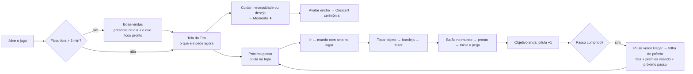

# 02 — Jornada: como o jogador anda, decide, ganha e volta

> As missões, falas, prêmios e regras **não mudam**. Muda **como** o jogador encontra o que fazer, como
> entrega e como sente o prêmio. Cada fluxo diz: gatilho → o que aparece → o que o toque faz → o que
> sobra na tela. Peças da bíblia (01 §F); tempos de 01 §G.

## 1. A sessão típica (o mapa da jornada)

O jogador nunca precisa abrir a aba Missões para seguir a história: o **próximo passo** leva, mostra o
progresso e entrega o prêmio. A aba Missões vira o lugar de **ver tudo** e pegar várias coisas de uma vez.

## 1.1 Mapas sem texto (decisão do Vitor, 24/10/2026)

Os mundos ficam **sem as etiquetas com nomes** ("Bancada", "Galinheiro", "Vender colheita"...). O jogador
sabe onde tocar por:
- **o próprio objeto** (o fogão parece fogão; tudo que é tocável tem área de toque generosa);
- **balões de estado** (andando, pronto ✓, comprar + preço, "!" de personagem) — só quando há algo;
- **alfinete** quando uma missão ou o `Ir` leva até lá (§2.1);
- **brilho ✦ de novidade**: um lugar que acabou de abrir brilha até ser tocado a primeira vez;
- **tocar e segurar** em qualquer objeto mostra o nome num balãozinho (1,5 s) — para quem quiser saber;
- o **título da bandeja/folha** sempre diz o nome do lugar.

Áreas fechadas mostram só o cadeado e o balão de preço, sem nome. Personagens andando continuam sem nome
(o rosto basta; o nome aparece na conversa).

## 2. Próximo passo da história (rastreador) — peça nova `NextStep`

Decisão do Vitor (24/10/2026): **sempre no topo, só da missão principal** (a linha da Laís). Missões de
personagem, diárias e semanais **não** entram na pílula.

**Onde:** segunda linha do HUD, à esquerda (52 de altura, a 76 px do topo), **nas quatro abas** (Tiro,
Mapa, Missões, Mochila). Some só enquanto uma folha (`Sheet`), uma bandeja, a barra da horta, a roleta de
cuidados ou um cartão modal estiver aberto, e durante a viagem entre mundos. Na tela do Tiro divide a linha
com os anéis das necessidades; na aba Missões divide com "Pegar tudo (N)".

**De onde vem:** `GameState.progress.displayed_main_quest()` (já existe em `progression_state.gd:330`): o
passo atual da história ou, quando ele aponta para um marco de personagem (`shared_with`), o passo atual
daquela linha. Com a história concluída (`chapter_index() > capítulos`), a pílula **some**.

**O que mostra:** rosto de quem pede (retrato 40 em disco; `npc` da missão exibida) + ícone do objetivo que
falta (32; o mesmo de `ProgressionUi.goal_row`) + `valor/alvo` daquele objetivo + `›`. Missão com vários
objetivos: mostra o **primeiro que ainda falta** (`ProgressionUi.current_goal`).

| Estado | Quando | Visual | Toque |
|---|---|---|---|
| `progress` | objetivo andando | pílula `CARD`; número `INK` | abre o **mini-cartão** (§2.2) |
| `talk` | objetivo `talk:<npc>` | ícone do objetivo = balão de fala vetor | mini-cartão; `Ir` leva até o personagem (alfinete) |
| `ready` | `quest_error(id) == ""` e é missão da história (não `shared_with`) | pílula `GO`, "Pegar" branco + ✓, pulinho a cada 4 s (parado em Menos animação) | pega na hora (`ProgressionUi.claim_quest_fx`) → **folha de prêmio** (§4) |
| `shared_ready` | a missão exibida é de personagem e está pronta | igual a `ready` | pega a missão do personagem (prêmio pequeno: só voo), e a história avança sozinha (`_sync_shared_quests`) |
| `blocked_storage` | `quest_reward_shortage(id)` não vazio | pílula `ALERT_SOFT` com o ícone do depósito | mini-cartão com "Liberar espaço" (`Places.go({"storage": depósito})`) |
| oculta | história concluída ou sem passo | — | — |

**Animações:** o número conta (`Motion.count_up`) e a pílula dá um pulinho quando o valor sobe (sem aviso
de texto); ao concluir e pegar, a pílula encolhe e volta com o passo seguinte (pop 0,2 s).

### 2.2 Mini-cartão do próximo passo

`Popover` ancorado na pílula (fica até tocar fora, como o resumo do avatar): retrato + fala curta do passo
(`dialogue`, cortada em uma linha com "…"), cada objetivo com ícone, nome curto e barra, prêmios em chips mel,
e embaixo `?` (Como fazer: `TaskHelp.open("quest", id)`) + **`Ir`** verde (`Places.go(Places.quest_target(id))`,
fecha o cartão). Tocar no nome do capítulo abre a aba Missões na História.

### 2.1 Seta até o lugar (alfinete) — substitui a seta amarela poligonal (`RoomView.point_at`)

Protótipo `horta_seta.png`. Quando o `Ir` leva a um lugar (missão, Como fazer, Novo!):
- **Alfinete** sobre o objeto: disco branco 52 com anel mel de 4 px e o **ícone do destino** dentro (a
  estação, o personagem, a semente), rabinho mel apontando para baixo, sombra suave. Balança devagar
  (6 px, 1,4 s); parado em Menos animação.
- **Anel no chão** em volta da base do objeto: elipse mel 3 px com fundo mel a 18% e uma segunda elipse
  mais larga e fraca que pulsa (escala 1 → 1,25, alfa 0,5 → 0, 1,2 s).
- A câmera vai até o lugar como hoje (`_reveal`). Tamanho constante na tela (escala `1/zoom`, como hoje).
- Some ao tocar no objeto (a ação acontece) ou depois do tempo de hoje (`seconds`, padrão 5 s); tocar em
  outro lugar só esconde.
- Na tela do Tiro, o mesmo alfinete (menor, 40) aponta para o botão Cuidar e para o disco certo da roleta
  quando o `Ir` de um desejo pede um cuidado (substitui o `CarePointer`).

## 3. Missões (aba) — três abas separadas

Decisão do Vitor (24/10/2026): **continuam separadas** ("meu medo de tudo num lugar só ficar ruim").
Protótipos `missoes2_historia.png`, `missoes2_personagens.png`, `missoes2_diarias.png`.

**Topo da tela:** linha do HUD + linha 2 com a pílula do próximo passo (esquerda) e, só nas abas Pessoas e
Diárias, **"Pegar tudo (N)"** verde pequeno (N ≥ 2, só o que é daquela aba). Sem título "Missões" (a aba
ativa do rodapé já diz) e sem a legenda "! = prêmio pronto para pegar".

**Abas internas** (`UiKit.segmented` novo: trilho afundado, opção ativa em pílula branca): ícone + nome +
selo vermelho com o número de prêmios prontos daquela aba.
- **História** (ícone `tab_tasks`) — sempre a primeira e a aberta por padrão.
- **Pessoas** (rosto do personagem com prêmio pronto; senão o da Bloblo) — aparece quando existir a
  primeira missão de personagem (como hoje: some se vazia).
- **Diárias** (ícone de relógio) — aparece quando `routines_unlocked("daily")`.
A aba escolhida fica guardada na sessão. Abrir a tela com prêmio pronto numa aba que não é a atual não
troca de aba: o selo mostra.

**História:**
1. Cartão grande do passo atual (`StoryCard`): rótulo CAPÍTULO + nome, tracinhos (`UiKit.steps`), retrato
   56 + balão com a fala, objetivo(s) com barra e número, prêmios em chips, `?` e **uma** ação: `Ir →` verde
   (andando) ou `Pegar` verde (pronto). Quando o passo aponta para um personagem (`shared_with`), o cartão
   mostra a missão daquele personagem com o rosto dele e o botão "Ver em Pessoas".
2. Seção **NESTE CAPÍTULO** (`n de m`): os passos do capítulo em linhas — feitos com ✓ verde e texto
   suave; o atual destacado (fundo `HONEY_SOFT`); os próximos apagados com cadeado (só o nome, sem
   detalhe).
3. `História completa ›` (fantasma) → folha com todos os capítulos (`ProgressionUi.story_panel`).

**Pessoas:** um cartão-lista; **uma linha por missão ativa** de personagem (retrato 44 · nome da missão ·
ícone do objetivo + `n/m` · chip de prêmio + `›`, ou `Pegar` verde). Prontas sobem com fundo `GO_SOFT`.
Tocar na linha **expande ali mesmo** (sanfona, 0,2 s; uma por vez): objetivos com barras, prêmios, `?` e
`Ir`. Substitui os cartões por personagem com "Abrir/Fechar".

**Diárias:** seção HOJE (chip de tempo) e SEMANA (chip de tempo); linhas com anel (ícone do objetivo
dentro), nome curto (sem a descrição que repetia o título), chip de prêmio, `›` ou `Pegar`. Tocar na linha
expande igual (mostra a descrição de uma linha e `Ir`). Tudo feito: linha única "Tudo feito por hoje!"
com ✓.

**Selos:** o selo vermelho da aba Missões no rodapé = soma dos prêmios prontos (como hoje,
`ready_quest_count() + ready_routine_count()`). Linha nova (missão que acabou de chegar): selo `Nova` mel
no retrato por uma sessão (`progress.seen["ui:quest_new:<id>"]`).

## 4. Prêmios — quatro tamanhos

| Tamanho | Quando | O que acontece | Janela? |
|---|---|---|---|
| **Micro** | colher, pegar produção, cavar, coletar na Natureza, vender | ícones +N saltam do objeto e voam em arco até o destino (§4.1); número do destino conta | não |
| **Pequeno** | diária, semanal, missão de personagem, encomenda, desejo atendido, momento | a linha encolhe e some; prêmios voam do lugar da linha; aviso só se tiver coisa rara | não |
| **Médio** | passo da história; marco de personagem que abre algo novo (`shared_with`, apresenta lugar/estação); compra de construção | **folha de prêmio** (protótipo `missoes_premio.png`): fita verde "Passo concluído!", retrato + fala de quem deu, chips grandes que contam, **Próximo passo** em cartão e dois botões (`Depois` calmo · `Ir para <lugar>` verde) | folha baixa, fundo escurecido, fecha arrastando |
| **Grande** | fim de capítulo, crescimento (cerimônia), tesouro, obra concluída, truque, seda, raro do passeio | `ModalCard` (fita, ícone com raios, confete, vibração forte) — o que existe hoje, no visual novo | sim |

Regras:
- **Nunca dois de uma vez:** se o passo concluído também fecha o capítulo, só sai o **grande** (o cartão do
  capítulo já mostra o próximo passo no rodapé). Se um prêmio pequeno destrava um "Novo!", o Novo! vem
  depois, na fila (como hoje).
- **A fala vem de quem deu** (`dialogue` do passo seguinte, ou `done_speech`), nunca "Missão concluída!".
- **Prêmio que não cabe** (recibos de `_grant_automatic`): os chips aparecem com um cadeado pequeno e a
  linha "Guardado em Presentes" com Ir para a Mochila.

### 4.1 Para onde cada coisa voa (`RewardFx`, evolução do `CollectFx`)

| Coisa | Destino | Reação do destino |
|---|---|---|
| moedas | pílula de moedas do HUD | contorno mel por 0,6 s + número conta |
| itens | aba **Mochila** (ou a própria Mochila, se aberta) | selo da aba pula; a almofada da aba pisca `TAB_ON` |
| momento (✦) | avatar do Tiro | anel do avatar enche com mola |
| coleção/roupa | botão do caderninho (tela do Tiro) ou aba Tiro | pulinho |
| XP de rota/local | etiqueta do local no mundo | pulinho |

Hoje só as diárias voam: `ProgressionUi.claim_routine_rows` lê os prêmios, chama o `GameState` e, se deu
certo, emite `Events.items_gained` com a origem na linha. Na etapa 05, o pegar de missão (linha, pílula do
próximo passo, conversa) passa a usar o mesmo caminho (`ProgressionUi.claim_quest_fx(id, origem)`); o
`GameState` não muda.

## 5. Avisos — uma central, uma fila, uma posição

Hoje há oito jeitos de avisar. Fica **uma central** (`Notice`, etapa 03) com prioridade, sempre logo
abaixo da segunda linha do HUD (ou abaixo da pílula do mundo no Mapa), **um por vez**:

| Tipo | Visual | Tempo | Toque |
|---|---|---|---|
| erro ("Falta 1 cenoura") | pílula `ALERT_SOFT` + ícone do que falta + texto `ALERT_INK`; o botão que falhou treme; vibração de erro | 2,0 s | abre o Como fazer do que falta |
| momento ("Momento de Coragem!") | pílula `HONEY_SOFT` + ícone do pilar; depois o ícone voa ao avatar (já existe) | 1,0 s | — |
| foto nova | pílula `CARD` + miniatura da foto | 2,4 s | abre a foto (já existe) |
| info ("Plantado!", "Fila cheia") | pílula `CARD`, só texto | 1,6 s | — |
| passo da história andou (+1) | **não é aviso**: a pílula do próximo passo conta | — | — |

Ordem quando vários chegam juntos: erro > momento > foto > info. Erros substituem o que está na tela;
os outros esperam. Folha de prêmio e cartões grandes continuam na fila modal (`main.gd._queue_modal`), e
avisos esperam enquanto um modal estiver aberto.

**Orçamento de atenção** (vale para todas as telas):
- vermelho = só "tem coisa para pegar" ou "ele está pedindo";
- no máximo **um** elemento pulando por tela (o mais importante: pronto para pegar > pedindo > novo);
- "Novo" só na primeira vez que a coisa aparece e só até ser vista (a Mochila deixa de marcar tudo);
- balões "!" dos personagens só quando há missão nova ou pronta deles.

## 6. Produzir (o laço do minuto)

1. **Tocar o objeto** (fogão, canteiro, galinheiro, local da Natureza): a câmera sobe se o objeto ficaria
   atrás da bandeja (já existe `_lift_for_sheet`); a bandeja abre **presa ao objeto** com a setinha
   (0,18 s), larga 336, altura máxima até o rodapé.
2. **Escolher:** a última receita usada vem selecionada (já existe `last_recipe`); receitas que faltam
   ingrediente aparecem apagadas com o **ingrediente que falta** num mini-disco vermelho (sem "!").
3. **Fazer:** detalhe embaixo (nome, tempo, entra → sai) + seletor `− ×N +` + botão verde. A bandeja
   **continua aberta**; a vaga começa o anel e o número da fila conta. Sem vaga: o botão vira
   `lock_hint` "Fila cheia" com a próxima vaga trancada (preço) tocável.
4. **Sair:** tocar fora, arrastar a câmera ou trocar de aba fecha (como hoje).
5. **Esperar:** balão do objeto no mundo com anel azul; pronto = anel verde + ✓ com pulinho.
6. **Pegar:** tocar o objeto pronto pega direto (como hoje) → prêmio **micro** voando à Mochila.
7. **Falta algo:** tocar o mini-disco vermelho abre o Como fazer daquele ingrediente com `Ir`.
8. **Ver tudo:** ícone ≡ no cabeçalho da bandeja (no lugar do texto "Ver tudo").

### 6.1 Horta: escolher embaixo, arrastar em cima (protótipos `horta_plantar.png`, `horta_colher.png`)

Problema de hoje: tocar num canteiro abre a bandeja de sementes **em cima dos outros canteiros**, e o
arrasto tem que começar exatamente no ícone dentro da bandeja. Proposta — a **barra da horta**:
1. **Tocar em qualquer canteiro vazio** (ou na etiqueta Canteiros) abre a barra da horta **embaixo**,
   apoiada no rodapé (mesmo bloco claro e translúcido da tela do Tiro), e a câmera sobe para deixar os
   canteiros no meio da tela. O canteiro tocado já recebe a semente selecionada (a última usada).
2. **Barra:** sementes em tiles 52 (ícone + tempo; bloqueada = cadeado; rola na horizontal se não couber),
   separador, **Regar**, e `✓` para fechar. A selecionada tem contorno de tinta.
3. **Arrastar em cima:** com a barra aberta, **o dedo que começa num canteiro planta** em todo canteiro
   vazio por onde passar (não precisa começar na barra). Dedo que começa fora dos canteiros mexe a câmera,
   como sempre. A ficha da semente segue 56 px acima do dedo com o número de plantados (`3`), um rastro
   claro marca o caminho e os canteiros vazios ganham um losango tracejado branco (alvos).
4. **Tocar** num canteiro vazio também planta (um por vez) — o toque simples continua valendo.
5. **Regar:** escolher o regador na barra e arrastar/tocar do mesmo jeito.
6. **Colher:** quando há prontos, a barra abre no modo colher: **foice + "Colher tudo (6)" verde**. Tocar
   no verde colhe todos os que cabem; arrastar com a foice colhe por onde passar; tocar num pronto colhe
   só ele (como hoje). Depósito cheio: o verde vira `lock_hint` com o ícone do silo.
7. **Fechar:** `✓`/`X`, tocar fora dos canteiros e da barra, trocar de aba ou de mundo. Mexer na câmera **não**
   fecha a barra da horta (aprovado pelo Vitor em 25/10/2026): ela é presa ao rodapé, não ao objeto, e plantar em
   canteiros fora da tela pede arrastar a câmera sem perder a semente escolhida. A regra "arrastar a câmera fecha"
   (§6 item 4) vale para as bandejas presas ao objeto. A pinça cancela o gesto da ferramenta sem fechar a barra.
8. **Dica** "Arraste pelos canteiros" (pílula escura acima da barra) só nas três primeiras vezes
   (`progress.seen["ui:farm_drag_hint"]`, que já existe com outro nome: reaproveitar).

Regras do jogo não mudam: as mesmas `GameState.plant/water/harvest` e os mesmos `*_error`; só muda de onde
o gesto começa. Estufa: a barra mostra só as sementes de estufa quando o canteiro tocado é de estufa.

## 7. Cuidar do Tiro (o laço do coração)

**Botão Cuidar + roleta** (escolha do Vitor, 24/10/2026; protótipos `tiro_cuidar.png` fechado e
`tiro_roleta.png` aberto). Some a fileira de cinco botões: embaixo fica só **um** botão redondo "Cuidar"
(coração pixel num disco branco 72 com anel mel), centrado acima das abas.

- **Fechado:** se ele está pedindo algo, o botão mostra no canto o ícone do que ele pede (pote, esponja...)
  num disquinho rosado. Tocar **nesse disquinho** já faz o cuidado pedido (atalho de um toque).
- **Tocar no botão:** a roleta abre em leque acima dele — cinco discos 64 **meio transparentes** (branco
  82%) com o nome embaixo em pílula clara, espaçados por igual (35° entre eles, raio 150), sobre uma faixa
  clara a 30% que dá a forma da roda; o resto da tela escurece só um pouco (véu radial 10–26%). Os discos
  saem do botão um depois do outro (30 ms, 0,22 s, mola). O humor e o caderninho se escondem enquanto a
  roleta está aberta; o Tiro continua visível.
- **Ordem fixa** da esquerda para a direita, a mesma de hoje: Comida · Banho · Escovar · Brincar · Dormir
  (Escovar só aparece com a `basic_brush`; com quatro, os ângulos abrem para 155/112/68/25°). O protótipo
  pôs Brincar no meio só para ilustrar; vale a ordem de hoje (os testes a conferem). O que ele pede ganha disco rosado e
  pontinho; o que vale momento ganha o ✦ mel.
- **Escolher** fecha a roleta e começa o gesto de hoje daquele cuidado: Comida abre a guia vertical de
  comidas saindo do botão; Banho põe a esponja na mão (esfregar no Tiro); Brincar põe a bola (jogar para
  cima); Escovar põe a escova (pentear as costas); Dormir/Acordar age na hora.
- **Fechar:** tocar fora, no botão de novo, ou arrastar para baixo.
- Dormindo: o botão vira a lua ("Acordar") e a roleta não abre. Passeando: o botão some (`AwayView`).

1. **Ele pede:** o anel da necessidade fica vermelho com pontinho (na segunda linha do HUD da tela do
   Tiro) **e** o botão Cuidar mostra o ícone do pedido. O avatar mostra o ícone do que ele pede (já existe
   `AvatarAsk`).
2. **Ele deseja:** balão sobre ele com o ícone do desejo e o ✦ mel ("vale um momento"). Tocar no balão
   abre o cartão do desejo (já existe), no visual novo: ícone grande, uma linha, `Dar`/`Ir`.
3. **Cuidar:** os gestos de hoje, começando pela roleta. O cuidado que vale momento mostra o ✦ (no lugar
   da frase "Brincar pode render um momento").
4. **Ganhar o momento:** aviso de momento (§5) → ícone voa ao avatar → anel do avatar enche.
5. **Pronto para crescer:** avatar brilha mel; a pílula do próximo passo mostra o objetivo de crescimento
   (`growth`) e, quando todos os requisitos estão feitos, "Crescer!" → painel de crescimento → cerimônia
   (grande).

## 8. Falar com um personagem

Tocar no personagem (mundo ou rosto na barra do mundo) abre a **folha do personagem**: retrato 96 animado
à esquerda + balão de fala (`SpeechBubble`), depois **o cartão da missão dele** (mesmo cartão da aba
Missões) e, embaixo, os **lugares que ele cuida** como linhas com ícone e `›` (hoje são botões grandes).
Apresentação (`introduction`) avança tocando no balão; o botão "Continuar" vira só `›` no canto do balão,
e "Vamos!" verde no fim.

## 9. Voltar ao jogo (boas-vindas)

Mantém o conteúdo (presente do dia + uma linha por tipo), muda a forma: **folha de prêmio** (médio) com o
Tiro acenando no topo, o presente do dia em chips grandes (pega ao fechar ou no botão verde "Pegar"), e
as linhas "3 prontos no Sítio" como linhas com `›` (Ir). Crescimento pronto continua indo para a
cerimônia depois.

## 10. Comprar e abrir coisas

1. Balão "+ preço" no mundo (já existe) → **folha de compra**: figura grande da construção (pixel 64–96 no
   disco), nome, uma linha do que ela faz, ganho em chip (`16 → 32`), materiais em chips, preço no botão
   verde ("Construir · 40").
2. Sem moedas/materiais: o botão vira `lock_hint` com o que falta ("Faltam 12" + moeda), tocável →
   onde conseguir.
3. Comprou: a folha fecha, a câmera mostra o objeto aparecendo com pop + poeirinha, prêmio **médio** só
   se a compra abrir um lugar novo (o Novo! de hoje); senão, nada além do objeto aparecendo.

## 11. Bloqueios e erros

- Nada de botão cinza: bloqueio é `lock_hint` (cadeado + ícone do que falta + uma linha), tocável.
- Erro de ação = aviso de erro (§5) + o botão treme + vibração; nunca uma folha.
- Lugar fechado no mundo: cadeado + nome no centro da área (como hoje), no visual novo.

## 12. Primeira sessão

Igual em conteúdo (chegada da Laís, revelar aos poucos). Diferenças: a pílula do **próximo passo** aparece
assim que a primeira missão existe e substitui o pulsar da aba Missões; o primeiro prêmio de passo da
história usa a folha de prêmio, que ensina "Próximo passo → Ir" na prática (ensinar fazendo).
