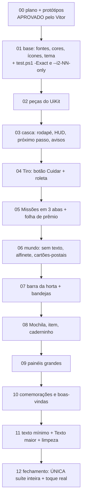

# Plano "Interface 2 — aconchego moderno"

> Pedido do Vitor (24/10/2026): "a interface está muito no estilo pixel, feia, botão muito grande, lista,
> muito texto. Quero um jogo moderno, com interface moderna, rápida e intuitiva, ainda com os sprites em
> pixel. Gosto do lado B (moderno e limpo), mas com um pouco do A (aconchegante, temático). Não só a
> interface: todo o fluxo da jornada — não quero mexer nas missões, mas em como você interage com elas,
> recompensa, essas coisas." E, no fim: "faça um plano bem estruturado, bem detalhado, testes que façam
> sentido, seja o mais detalhista possível, porque vão ser outros modelos que vão fazer."

## A ideia em uma linha

> **Pixel é o que está no mundo; liso é o que você toca.** O Tiro, os personagens, os mapas e os itens
> continuam pixel art; botões, letras, painéis e ícones de controle ficam lisos, arredondados e calmos, com
> cores quentes de casa. Cada tela mostra uma coisa principal, e cada ação responde na hora.

## Decisões do Vitor (24/10/2026) — fechadas

| # | Decisão |
|---|---|
| 1 | **Direção geral aprovada**: moderno e limpo (B) com toque aconchegante (A); Fredoka + Nunito; paleta creme/mel/verde; pixel no mundo, liso nos controles. |
| 2 | **Rodapé claro**, preso à borda, um pouco transparente sobre o mundo; nome embaixo de todas as abas. (A barra branca solta foi reprovada: "ícones flutuando".) |
| 3 | **Próximo passo sempre no topo, só da missão principal** (a história da Laís), em todas as abas. |
| 4 | **Folha de prêmio** ao concluir passo da história. |
| 5 | **Missões continuam separadas**: História · Pessoas · Diárias ("meu medo de tudo num lugar só ficar ruim"). |
| 6 | **Tiro: botão Cuidar que abre uma roleta**, bem espaçada e meio transparente. (Objetos no cenário e barra apoiada foram comparados e não escolhidos.) |
| 7 | **Mapas sem as etiquetas de nome** ("deixa sem texto mesmo"): o objeto, os balões, o alfinete e o brilho de lugar novo guiam; tocar e segurar mostra o nome. |
| 8 | **Horta**: manter o arrastar, mais fácil — sementes numa barra embaixo e o arrasto começa em qualquer canteiro. |
| 9 | **Seta de direção lisa** (não pixel) → alfinete com o ícone do destino e anel no chão. |
| 10 | **Lista de mundos mais confortável** → cartões-postais com a foto de cada mundo. |
| 11 | **Testes enxutos e direcionados**: lista fechada por etapa (≤ 3 min; a 07 tem exceção registrada), suíte inteira só no fim, nada de campanha. |

## Documentos (ler nesta ordem)

| Arquivo | O que decide |
|---|---|
| [00 Visão](00_VISAO.md) | diagnóstico com números, referências (o que pegar de cada), princípios, o que muda e o que não muda |
| [01 Bíblia visual](01_BIBLIA_VISUAL.md) | fontes, tamanhos, cores (com contraste medido), espaçamento, cantos, sombras, ícones, peças, movimento |
| [02 Jornada](02_JORNADA.md) | os fluxos: sessão, mapa sem texto, próximo passo, alfinete, Missões, prêmios, avisos, produção, horta, cuidar (roleta), conversa, boas-vindas, compra, bloqueios |
| [03 Telas](03_TELAS.md) | tela por tela: como é hoje → como fica, nós preservados |
| [04 Regras e testes](04_REGRAS_E_TESTES.md) | contrato do executor, checklist de revisão, orçamento de texto, capturas, **filosofia e listas de teste**, modelo de teste, toque real |
| [05 Etapas](05_ETAPAS.md) | índice das 12 etapas |
| [etapas/](etapas/) | **um arquivo por etapa**, com o código de hoje, passo a passo, testes numerados e critério de pronto |
| [prototipo/](prototipo/) | protótipos em HTML com os sprites reais + PNGs e pranchas antes × depois |
| [ORQUESTRACAO.md](ORQUESTRACAO.md) | prompt do orquestrador (Grokbot): executores Codex GPT 6.1 / Claude Sonnet 5.5 com reserva mútua, conferência, passagem para sessão nova; prompt da etapa 01 pronto |

## Protótipos (`prototipo/`, renderize com `sh docs/plans/interface2/prototipo/render.sh <tela> [variação]`)

| Prancha / PNG | O que mostra |
|---|---|
| `estilo.png` | a bíblia visual numa folha só |
| `prancha_rodape.png` | rodapé preso: clara (**escolhida**) × madeira |
| `prancha_tiro.png`, `prancha_roleta.png` | tela do Tiro hoje × proposta; **botão Cuidar fechado × roleta aberta** (escolhido) |
| `prancha_cuidados.png` | as três ideias de cuidados que foram comparadas (histórico) |
| `prancha_missoes2.png` | Missões hoje × **História · Pessoas · Diárias** × folha de prêmio (escolhido) |
| `prancha_missoes.png` | a lista única que foi descartada (histórico) |
| `prancha_horta.png` | horta hoje × barra da horta (plantar arrastando) × colher tudo |
| `prancha_seta.png` | alfinete com o ícone do destino e anel no chão |
| `prancha_mundos.png` | lista de mundos hoje × cartões-postais |
| `prancha_fogao.png` | bandeja do fogão hoje × presa ao fogão, mundo visível |

## Ordem de execução



| Feita | Etapa | Entrega | Tamanho |
|---|---|---|---|
| [x] | 00 | plano, bíblia, jornada, telas, regras/testes, 12 etapas, protótipos e pranchas; decisões do Vitor | — |
| [ ] | [01](etapas/ETAPA_01_BASE.md) | fontes, `Palette`, ícones vetoriais, tema; ferramentas enxutas de teste/captura | médio |
| [ ] | [02](etapas/ETAPA_02_PECAS.md) | peças do `UiKit` | médio |
| [ ] | [03](etapas/ETAPA_03_CASCA.md) | rodapé claro preso, HUD em 2 linhas, `NextStep`/`QuestGuide`, `Notice` | grande |
| [ ] | [04](etapas/ETAPA_04_TIRO.md) | cenário aproximado, anéis no topo, botão Cuidar + roleta | grande |
| [ ] | [05](etapas/ETAPA_05_MISSOES.md) | Missões em 3 abas, `claim_quest_fx`, `QuestReward` | grande |
| [ ] | [06](etapas/ETAPA_06_MUNDO.md) | mapa sem texto, balões, `WorldPin`, cartões-postais, conversa, compra | grande |
| [ ] | [07](etapas/ETAPA_07_HORTA_BANDEJAS.md) | `FarmDock`, bandejas das estações | grande |
| [ ] | [08](etapas/ETAPA_08_MOCHILA.md) | Mochila, detalhe, caderninho, Coleção, Álbum | médio |
| [ ] | [09](etapas/ETAPA_09_PAINEIS.md) | painéis grandes | grande |
| [ ] | [10](etapas/ETAPA_10_FESTA.md) | `ModalCard` novo, `RewardSheet`, boas-vindas, Novo! | médio |
| [ ] | [11](etapas/ETAPA_11_TEXTO.md) | orçamento de texto, Texto maior, limpeza | médio |
| [ ] | [12](etapas/ETAPA_12_FECHAMENTO.md) | suíte inteira, toque real, desempenho, docs | médio |

## Como passar para o próximo agente

Copie e troque só o número e o nome do arquivo:

```text
Execute somente a etapa NN do plano Interface 2: docs/plans/interface2/etapas/ETAPA_NN_<NOME>.md.
Leia, nesta ordem: CLAUDE.md; docs/ROADMAP.md (Estado atual); docs/plans/interface2/README.md (decisões);
00_VISAO.md §3; 01_BIBLIA_VISUAL.md; 04_REGRAS_E_TESTES.md inteiro; as seções de 02_JORNADA.md e
03_TELAS.md que o arquivo da etapa indicar; o arquivo da etapa inteiro; e os protótipos que ele citar
(abra os PNGs em docs/plans/interface2/prototipo/).
Confirme que a etapa anterior está marcada como feita neste README.
Antes de mexer, rode as capturas "antes" da etapa; no fim, as "depois" nas 3 resoluções e ABRA os PNGs.
Testes: SÓ a lista fechada da etapa (tools\test.ps1 -Level etapa -Exact -Tests <lista>); confira com -DryRun.
Nada de regra do jogo muda (tempos, preços, prêmios, requisitos, ids, falas, save).
Atualize: registro deste README (modelo no fim do arquivo da etapa), Estado atual do docs/ROADMAP.md e, se
criou peça/arquivo/comando, CLAUDE.md e AGENTS.md (idênticos).
Commit local "feat(ui2): etapa NN — <resumo>"; sem push, sem publicar. Não execute a etapa seguinte.
```

Pelo pedido do Vitor (23/10/2026), quem executa é um modelo mais barato (subagente Sonnet ou Codex), com o
Claude Code acompanhando: escreve o pedido acima, confere diff, capturas e testes e pede correções.

## Registro

**Etapa 00 (24/10/2026, Claude Code):** plano escrito; tour "antes" com 114 capturas em
`build/screenshots/interface2_antes`; fontes Fredoka e Nunito (OFL) baixadas em `prototipo/fonts/`;
protótipos de Tiro, Missões (+ prêmio) e bandeja do fogão com os sprites reais; primeira versão do rodapé
(barra branca solta) reprovada pelo Vitor ("ícones flutuando") e refeita como base presa à tela em duas
versões. Nenhum arquivo do jogo foi alterado.

**Etapa 00, segunda rodada (24/10/2026):** o Vitor escolheu o rodapé **claro** (gostou de ele ficar meio
transparente) e pediu para repensar a horta, a seta, a lista de mundos, os cuidados do Tiro e os testes.
Novos protótipos: `horta_plantar/colher/seta.png`, `mundos.png`, `tiro_objetos.png`, `tiro_arco.png`.
Paleta escurecida onde o contraste não passava. Testes refeitos em lista fechada por etapa.

**Etapa 00, terceira rodada (24/10/2026):** mapas sem os textos aprovados; **botão Cuidar com roleta**
escolhido e refeito mais espaçado e transparente (`tiro_cuidar.png`, `tiro_roleta.png`, `prancha_roleta.png`).

**Etapa 00, fechamento (24/10/2026):** o Vitor aprovou a direção geral, a pílula de próximo passo **só da
história, sempre no topo**, a folha de prêmio, e pediu Missões **separadas** (História · Pessoas · Diárias,
protótipo `missoes2_*.png`). Plano reescrito para execução por outros modelos: um arquivo por etapa em
`etapas/` com o mapeamento do código atual (arquivos, funções, nós e testes que dependem, com linhas),
passo a passo, armadilhas, testes novos com casos numerados, listas fechadas com tempos medidos
(`build/test_logs/times.csv`), modelo de teste e de registro. Achados que entraram no plano: `test.ps1`
puxa áreas inteiras sozinho (→ `-Exact` na 01); etiquetas do mapa também são alvo de toque (→ auditoria na
06); `pet_care_test`/`brush_taste_test` conferem a ordem dos cuidados e `wish_guide_test` exige
`CarePointer` como `Polygon2D` (→ roleta mantém ordem e raiz); `tasks_groups_test` espera personagens
recolhidos e diárias/semanais separadas (→ testes mudam na 05 com a mesma garantia). Nenhum arquivo do
jogo alterado; sem testes, commit, push ou publicação. **Pronto para a etapa 01.**
