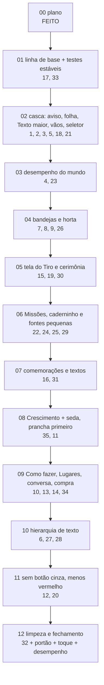

# Plano "Interface 2 — ajustes" (pós-revisão Opus)

> Origem: [`docs/plans/interface2/REVISAO_OPUS.md`](../interface2/REVISAO_OPUS.md), revisão escrita pelo
> Claude Opus 5.5 em 25/10/2026 depois do fechamento local do plano Interface 2 (etapas 01–12). Ela lista
> **35 ajustes** (P0, P1 e P2). O Vitor pediu: "transforme a revisão num plano de ajustes por etapas no
> mesmo estilo do plano Interface 2". Depois, **aprovou os 35 itens como o revisor sugeriu, inclusive as
> decisões**. Nenhuma decisão fica pendente.

**Estado:** etapas 01–08 concluídas. **Próxima: etapa 09.**

## A ideia em uma linha

> **Acabamento, não redesenho.** A direção do Interface 2 está aprovada e chegou ao jogo; este plano conserta
> o que ficou "meio feio": hierarquia de texto achatada, painéis meio migrados, regras da bíblia furadas
> (botão cinza, vermelho fora do lugar) e defeitos de composição (aviso sobre o título, folha cortada,
> fogão escondido, HUD com Texto maior, engasgos no Sítio).

## Decisões (todas aprovadas pelo Vitor em 25/10/2026)

| Item | Decisão | Etapa |
|---|---|---|
| 1–6, 10–34 | Executar como descrito na revisão. | ver tabela abaixo |
| **7** | **Reverter**: a bandeja do fogão (e das outras estações) não cobre o objeto; o fogão fica visível **acima** da bandeja. Aprovado pelo Vitor. | 04 |
| **8** | **Reverter**: o "Tudo ×N" volta, agora como opção do `UiKit.stepper` usada em estações, Feira e obras. Aprovado pelo Vitor. | 04 |
| **9** | **Manter** o comportamento da barra da horta (mexer na câmera NÃO fecha o `FarmDock`) e **documentar**. Aprovado pelo Vitor. | 04 |
| **31** | **Usar os textos propostos**: Novo! de mundo = "Já está no Mapa"; de lugar = "No Sítio" (o `in_name` do mundo); de amizade = "Na Praça"; botão "Ir para a Vila" (nome do destino) em vez de só "Ir". Fita do passeio "De volta!" → **"Voltou do passeio!"**. Aprovado pelo Vitor. | 07 |
| **35** | **Refazer a tela de Crescimento**, com a **prancha HTML primeiro** em `docs/plans/interface2/prototipo/` e implementação **em seguida, na mesma etapa, sem parar para aprovação**. Aprovado pelo Vitor. O item é **sugestão do revisor**, não pedido original do Vitor. | 08 |

Regras que continuam valendo (do plano Interface 2): só interface e fluxo de interface — nada de mudar
tempos, preços, prêmios, requisitos, ids, falas da história ou formato do save. A única troca de texto
permitida é a do item 31 (aprovada), e as linhas de bloqueio do item 5 (texto de interface, não fala).

## Documentos

| Arquivo | Para quê |
|---|---|
| [ORQUESTRACAO.md](ORQUESTRACAO.md) | dinâmica Sonnet ⇄ Codex, ciclo da etapa, **§4.4 conferência e handoff**, prompts de etapa, continuação e passagem |
| [etapas/](etapas/) | **um arquivo por etapa**: objetivo, itens, arquivos, como está hoje, passo a passo, testes, capturas, pronto quando, handoff, registro |
| [`../interface2/REVISAO_OPUS.md`](../interface2/REVISAO_OPUS.md) | a revisão com os 35 itens (o "por quê" e as capturas de evidência de cada um) |
| [`../interface2/01_BIBLIA_VISUAL.md`](../interface2/01_BIBLIA_VISUAL.md), [`02_JORNADA.md`](../interface2/02_JORNADA.md), [`03_TELAS.md`](../interface2/03_TELAS.md), [`04_REGRAS_E_TESTES.md`](../interface2/04_REGRAS_E_TESTES.md) | as regras visuais e de teste continuam as do plano Interface 2 |
| [`../interface2/prototipo/`](../interface2/prototipo/) | protótipos aprovados (`fogao.png`, `horta_*.png`, `missoes2_*.png`, `mundos.png`, `tiro_*.png`) e onde nasce a prancha do Crescimento (etapa 08) |

## Ordem das etapas

A ordem segue dependências, risco e arquivos em comum (nunca dois executores ao mesmo tempo; uma etapa por
vez). Primeiro os testes estáveis (para que todo o resto tenha um portão confiável), depois a casca
(aviso/folha, que as bandejas e painéis consultam), depois o mundo (desempenho antes das bandejas, ambos em
`room.gd`), depois as telas por área e, por fim, as mudanças sistêmicas que tocam quase todos os painéis
(hierarquia de texto, bloqueios) e a limpeza.



| Feita | Etapa | Itens da revisão | Entrega | Tamanho |
|---|---|---|---|---|
| [x] | 00 | — | este plano | — |
| [x] | [01](etapas/ETAPA_01_BASE_E_TESTES.md) | 17, 33 | capturas e medição "antes" do plano; `world_pin_test`/`world_life_test` 10/10; fixtures `g01`/`t03`; bloco `--aj-NN-only` | médio |
| [x] | [02](etapas/ETAPA_02_CASCA.md) | 1, 2, 3, 5, 18, 21 | aviso nunca sobre o título; folha acompanha o conteúdo; HUD/Configurações com Texto maior; "Depois de:"; sem título "Mochila" e sem vão; `WorldBar` escondida atrás do seletor | médio |
| [x] | [03](etapas/ETAPA_03_DESEMPENHO.md) | 4, 23 | tique de 8 Hz enxuto, brilho do álbum em cache, balões sem redesenho parado, aquecimento de glifos; um balão pulando por vez | grande |
| [x] | [04](etapas/ETAPA_04_BANDEJAS_HORTA.md) | 7, 8, 9, 26 | fogão visível acima da bandeja; "Tudo" no `stepper`; barra da horta documentada; tile Regar | grande |
| [x] | [05](etapas/ETAPA_05_TIRO.md) | 15, 19, 30 | humor em pílula translúcida; selo Animado; cardápio sem vermelho e sem cobrir o focinho; cerimônia sem Tiro repetido e régua melhor | médio |
| [x] | [06](etapas/ETAPA_06_MISSOES_CADERNINHO.md) | 22, 24, 25, 29 | "Neste capítulo" leve; segmentado de uma opção some; caderninho legível; fontes < 12 resolvidas; história concluída | médio |
| [x] | [07](etapas/ETAPA_07_COMEMORACOES_TEXTOS.md) | 16, 31 | cartão de capítulo com grade de novidades; textos do Novo! e do passeio | médio |
| [x] | [08](etapas/ETAPA_08_CRESCIMENTO.md) | 35, 11 | prancha HTML do Crescimento → implementação na mesma etapa; seda no padrão do Crescimento | grande |
| [ ] | [09](etapas/ETAPA_09_PAINEIS_MUNDO.md) | 10, 13, 14, 34 | Como fazer com peças novas; Lugares em `list_card`; conversa sem repetições; compra bloqueada nítida | grande |
| [ ] | [10](etapas/ETAPA_10_HIERARQUIA.md) | 6, 27, 28 | `SectionLabel` revisada (nomes em 18); passeios e Feira; regra nova no `ui_style_test`; **portão** | grande |
| [ ] | [11](etapas/ETAPA_11_BLOQUEIOS_VERMELHO.md) | 12, 20 | nenhum botão cinza com texto em folha/bandeja; obras e encomendas com um chip e uma barra | grande |
| [ ] | [12](etapas/ETAPA_12_LIMPEZA_FECHAMENTO.md) | 32 | limpeza de apelidos e tema; **portão**, tour completo nas 3 resoluções, toque real, desempenho, docs | médio |

Cobertura: 17, 33 · 1, 2, 3, 5, 18, 21 · 4, 23 · 7, 8, 9, 26 · 15, 19, 30 · 22, 24, 25, 29 · 16, 31 ·
35, 11 · 10, 13, 14, 34 · 6, 27, 28 · 12, 20 · 32 = **35 itens**, cada um em exatamente uma etapa.

## Regras de execução (resumo; detalhes em ORQUESTRACAO.md)

1. **Uma etapa por vez, na ordem.** Sem subagentes paralelos, sem worktrees. Um executor por vez na pasta.
2. **Executores:** Claude Code **Sonnet 5.5** (`claude-sonnet-5-5`) executa até bater o limite; o **Codex**
   (`gpt-6.1-sol`, esforço médio) continua **a mesma etapa** a partir do disco; e vice-versa. Quem continua lê
   o handoff (§4.4 da ORQUESTRACAO e §9 do arquivo da etapa) e o `git diff`, e não desfaz o que está certo.
3. **Commit local por etapa** (`fix(ui2-aj): etapa NN — <resumo>`). **Sem push, sem publicar.**
4. **Testes enxutos:** só a lista fechada da etapa com `tools\test.ps1 -Level etapa -Exact -Tests <lista>`
   (confira antes com `-DryRun`). **Portão** (`tools\test.ps1 -Level portao`) só nas etapas **10** e **12**.
   Campanha/simulador nunca. Verde é verde: falha da lista é consertada na etapa.
5. **Capturas:** bloco `--aj-NN-only` do `game/tests/ui_tour.gd` (criado na 01 para a 01; cada etapa acrescenta
   o seu), "antes" em `build/screenshots/aj_NN_antes` e "depois" em `aj_NN_depois`, `aj_NN_depois_390`,
   `aj_NN_depois_412`. O executor **abre** os PNGs e compara com a evidência da revisão e com o protótipo.
6. **Docs:** registro neste README + `[x]`; bloco no topo do "Estado atual" do `docs/ROADMAP.md`;
   `CLAUDE.md` = `AGENTS.md` quando criar peça, nó, função ou comando que outro agente precise achar.
7. **UTF-8** sempre (acentos). No PowerShell, nunca `Set-Content`/`Out-File` sem `-Encoding utf8`.

## Como passar para o próximo executor

```text
Execute somente a etapa NN do plano "Interface 2 — ajustes":
docs/plans/interface2_ajustes/etapas/ETAPA_NN_<NOME>.md.
Leia, nesta ordem: CLAUDE.md (ou AGENTS.md); docs/ROADMAP.md (só "Estado atual");
docs/plans/interface2_ajustes/README.md (decisões e registro); docs/plans/interface2_ajustes/ORQUESTRACAO.md §2 e §4.4;
docs/plans/interface2/01_BIBLIA_VISUAL.md; docs/plans/interface2/04_REGRAS_E_TESTES.md §A, §B e §E;
os itens da etapa em docs/plans/interface2/REVISAO_OPUS.md; o arquivo da etapa inteiro.
Confirme que a etapa anterior está [x] neste README. Se a etapa já foi começada por outro executor,
leia o "Handoff" do arquivo da etapa e o git diff antes de mexer.
Capturas "antes" (--aj-NN-only) antes de mexer; "depois" nas 3 resoluções; ABRA os PNGs.
Testes: só a lista fechada (tools\test.ps1 -Level etapa -Exact -Tests <lista>; confira com -DryRun).
Nada de regra do jogo muda. Atualize registro + [x], Estado atual do ROADMAP e CLAUDE.md = AGENTS.md se preciso.
Commit local "fix(ui2-aj): etapa NN — <resumo>"; sem push, sem publicar. Não execute a etapa seguinte.
```

## Registro

**Etapa 00 (25/10/2026, Claude Opus 5.5):** plano escrito a partir da `REVISAO_OPUS.md` (35 itens), no estilo do
plano Interface 2: README, ORQUESTRACAO (dinâmica Sonnet ⇄ Codex, §4.4) e 12 arquivos de etapa. Decisões
7, 8, 9, 31 e 35 aprovadas pelo Vitor; item 35 corrigido na revisão para "sugestão do revisor". Nomes de teste
conferidos com `game/tests/` (a revisão citava `npc_test` e `places_test`, que não existem: viraram
`npc_lines_test` e `worlds_test`/`navigation_test`). Tempos de teste de `build/test_logs/times.csv`. Nenhum
código alterado; sem testes, commit, push ou publicação. **Próxima: 01.**

**Etapa 01 (25/10/2026, Claude Sonnet 5.5):** linha de base `aj_base`, `aj_base_390`, `aj_base_412` com 114 PNGs cada
(tour completo, já com as fixtures corrigidas); Sítio na Web (roteiro `touch_steps_i2_12.json`, duas rodadas):
média 28,4 / 28,2 ms, p95 66,6 / 66,6 ms, 123 / 114 quadros > 33 ms, pico 183 / 217 ms (a etapa 03 compara com isto).
`world_pin_test` e `world_life_test` (e `world_view_test`) 10/10 PASS em 10 rodadas com `-Jobs 3`
(`build/estabilidade_aj01.txt`; logs em `build/test_logs/r20261025_115846_de00bcd0` … `r20261025_120553_1411de22`).
Mudanças só em `game/tests/`: `world_pin_test` (antes: toca o centro de cada zona com NPCs/Tiro/montinho/balões
vivos; agora `_quiet` os esconde e para, e `_zone_points` tenta até 9 pontos internos — a garantia "toda zona/lugar
visível é tocável e leva ao lugar certo" continua igual); `world_life_test` (relógio fixo meio-dia local via
`economy_clock.gd`; espera por condição com limite de 180 quadros em vez de `create_timer(0.3)`; a referência
"não reage em mapa oculto" é lida depois de trocar de tela e assentar 4 quadros — mesmas asserções);
`ui_tour.gd` (`--aj-01-only`, `_aj_01_shots`, `_g01_tasks_ready_many` a partir do capítulo 5 com 7 de 8 passos
prontos e restauro do estado do tour, `_t03_growth_ready` por `dev_complete_growth_reqs`). Capturas
`aj_01_antes` (fixtures antigas) e `aj_01_depois`/`_390`/`_412`. Pendências: o aviso "Momento de Coragem!"
ainda cobre o título da folha de mundos em `b05_map_list` (item 1, etapa 02). Sem push.

**Etapa 02 (25/10/2026, Claude Sonnet 5.5):** aviso na faixa da linha 2 recolhida com folha/seletor/bandeja
(`main._row2_hidden`, `Notice.retarget`); folha alta até o HUD (`Sheet._tall_height`) + folga de 16 px
(`SheetBottom`); causa da folha cortada: não eram as guardas do `_queue_fit` (o caso novo do `sheet_test`
passa sem mudá-las) e sim o cartão `NpcServices` vazio da conversa sem serviços, agora removido; Texto maior
sem sobreposição (`Hud._fit_profile`, saves em `flow`); "Depois de:" e dicas próprias (Praça, Vila, Sítio);
sem título na Mochila e linha 2 recolhida sem pílula (`set_content_top`); `WorldBar` oculta com seletor.
Testes notice/sheet/hud/text_budget/next_step/world_selector/worlds/lists/texts/tasks PASS. Capturas
`aj_02_antes|depois[_390|_412]`. Pendências: a captura `b17` mostra o aviso a 136 porque no Mapa com o
seletor fechado ele fica abaixo da pílula (por desenho). Sem push.

**Etapa 03 (25/10/2026, Claude Sonnet 5.5):** Sítio Web antes 28,2–28,4 ms (p95 66,6, 114–123 quadros > 33 ms, pico
183–217 ms) → depois 17,4–17,8 ms (p95 16,8, 11 quadros > 33 ms, pico 83–117 ms; 613–633 quadros no mesmo roteiro, quatro
rodadas pós-mudança). Profiler desktop (antes de mexer): `_place_labels` ≈ 17 ms por chamada (dentro dele
`_refresh_sparks` ≈ 12 ms e regiões ≈ 3 ms), rodando 8×/s; o resto do tique ≈ 2–5 ms. Feito: `GameState.album_hint_glow_map()`
(uma passada nas 54 fotos; `album_hint_glow(objeto)` consulta o mapa) guardado em `RoomView._glow_map`; o tique de 8 Hz
(`_animate_fast`) só anima (`idle_offset`, quadros `busy_frames`, piscar do brilho) e recalcula uma fatia de 1/8 dos
objetos por tique (indicadores, canteiros, estações; cada um 1×/s); `_refresh_world(full)` refaz tudo em `state_changed`
(e `full` também etiquetas, regiões e brilhos de lugar novo), na volta da sala à vista e em `_animate_objects()` (atalho de
testes/capturas); `_layout_balloons` removida; `WorldBalloon` só redesenha quando a assinatura visível muda (anel em 1/48),
com `_process` ligado só enquanto há pulinho, `StyleBox` da legenda em cache; `WorldPin` desenha base e balão uma vez,
balanço em tween de posição e só o anel que se expande redesenha; um balão `ready` pula por sala (`bounces`/`ready_since`,
`RoomView._update_bouncer`: o pronto há mais tempo), os outros ficam verdes e parados; glifos aquecidos em `main._warm_glyphs`
(rótulo 1×1 px quase invisível com o alfabeto em cada par fonte/tamanho do tema, 3 quadros). Pico da roleta/folha
83–150 ms → 66–117 ms (aquecimento não eliminou: resta provável compilação de shader/primeiro desenho; não investigado
além de 1 h). **Restante medido:** os 11 quadros > 33 ms do Sítio são 1/s e vêm do tique de 1 s do próprio `GameState`
(`update_finds` ≈ 10 ms e `update_wishes` ≈ 2,5 ms no desktop, medidos por `get_ticks_usec`); não faziam parte do plano e
ficaram para depois (ver pendências). Testes balloon/world_view/world_life/album_secrets/tray/farm_dock/effects_layer/garden
PASS em 104 s. Desvios: a escolha do balão que pula é "o mais antigo pronto" (sem preferência pela missão ativa: não há API
que ligue a missão a um balão); `balloon_test` perdeu só a chamada de `_layout_balloons` e ganhou a conferência de um só
pulando. Pendências: `GameState.update_finds` (requirement_error e `tiro_animated` a cada segundo) para zerar o último
quadro lento por segundo. Sem push.

**Etapa 04 (25/10/2026, Claude Sonnet 5.5):** bandejas `pick` sobem o objeto ao terço de cima e não o cobrem
(`RoomView._raise_for_tray`: topo ≥ 150 px, base ≤ 250 e ≤ `size.y − 92 − ActionTray.PICK_HEIGHT (440) − 20`, com
overscroll quando a sala é menor que a tela, como a Casa; `_watch_tray` devolve a câmera ao limite ao fechar; a espera é
`_camera_tween.finished` porque um temporizador de 0,3 s deixava o último quadro da câmera fechar a bandeja recém-aberta;
`ActionTray._place` abre embaixo do objeto, com o corpo rolando, quando não cabe em cima); grade de 2 linhas
(`PICK_ROWS_SHOWN` 2.0), "entra → sai" numa linha sem chip ×1; `UiKit.stepper(max_label)` com `QuantityMax` em estações,
Feira e obras (`Qty_all` e o botão da Feira saíram); barra da horta: câmera/pinça não fecham (comentário no `FarmDock` e
`02_JORNADA.md` §6.1); tile Regar com "Regar" + selo `Count` e separador `LINE`. Testes (11, 169 s, PASS):
scripts_check, content, texts, station_tray (caso novo `_test_tray_below_object`: fogão, liquidificador e bancada),
queue (QuantityMax leva a ×máx), tray (água = "Regar" + selo "×3", mesma garantia), farm_dock (caso novo: câmera e pinça
não fecham; pinça cancela o gesto), market, bench (acha `QuantityMax`), ui2_kit (stepper com `max_label`), garden.
Capturas `aj_04_antes|depois[_390|_412]` (o fogão passou de coberto para visível acima da bandeja). Pendências: a bandeja do
Galinheiro (dois animais + fila) ainda precisa rolar o corpo; o botão Lugares não ficou escondido nas capturas (nenhum ajuste
na `WorldBar` foi necessário). Sem push.

**Etapa 05 (25/10/2026, Codex):** itens **15, 19 e 30** concluídos. `MoodBubble` já era contêiner:
preservado o `Label` interno `MoodLabel`, agora com CARD a 85%, margens 12/6 e âncora nos pés do Tiro;
`_show_mood` reinicia a entrada e `_hide_mood` usa `Motion.pop_out` após 3 s, instantâneo em Menos animação.
`AnimatedBadge` mudou de Label para PanelContainer: `UiKit.spark(18)`, disco mel com estrela branca no canto
inferior do avatar; ajuda do avatar preservada. `spark(px := 22)` conserva a construção anterior quando
chamado sem argumento (incluindo os selos da roleta/desejo); só o tamanho explícito remove as margens
automáticas e reajusta o mínimo depois de o tema assentar na árvore.

`FoodMenu` usa o espaço entre o fim de `head_rect()` + 8 e Cuidar − 12; a lista encolhe e rola sem cruzar
o alvo de soltar. `NewTaste` mudou de Label para PanelContainer (chip mel, estrela vetorial e "Nova! ×N");
`Quantity` continua Label, agora dentro do chip, e `FavoriteHeart` foi preservado. Os nomes das comidas
ficam numa linha, com reticências se necessário. Cerimônia: `CeremonyHero` contém raios recortados ao herói
e `BeforeAfter`; sem `BigIcon` adicional. `HeightMark` tem marcas a cada 10 px, destaque da fase e
`HeightPhase` com o nome existente. Não existe altura em `growth.json`; nenhum número foi inventado.

**Provas/pronto:** ✓ 15: `i2_04_pet`, `f07_pet_low_needs`, `aj_05_hud_animated`; ✓ 19: os dois cardápios,
cabeça livre nas três resoluções; ✓ 30: as duas cerimônias, par único e régua marcada; ✓ testes verdes.
Checklist visual/celular nas telas tocadas: ✓ Fredoka/Nunito e tokens; ✓ controles vetoriais; ✓ itens
em superfícies; ✓ semântica mel/verde; ✓ um primário na cerimônia; ✓ margens/contraste; ✓ sem conteúdo
atrás do rodapé; ✓ Menos animação. Roleta, regras, save e falas preservados.

**Testes:** lista fechada, com `-DryRun` antes (10, contando scripts_check/content/texts). Primeira execução
restrita parou por acesso aos certificados do Windows (`r20261025_142525_fe4afcc2`); reexecutada com acesso
normal do sistema. Falha real do tamanho provisório do selo (37 px antes de o tema assentar) encontrada e
corrigida; registros `r20261025_142657_f0deaae8` e `r20261025_142832_a3fa9dd7` preservados. Lista completa
10/10 PASS em 143,4 s (`build/test_logs/r20261025_142936_f2b5ac7f`); depois `care_ui_test` ganhou garantia
determinística de aparecer até 3 s, sumir depois, não reaparecer no tique e reaparecer ao tocar: PASS
(`r20261025_143214_58f03347`, 35,5 s com o rápido). **Execução final: 10/10 PASS em 146,1 s**
(`build/test_logs/r20261025_143347_6f001cef/results.csv`): scripts_check 10,1; content 7,3; texts 3,4;
care_ui 17,0; care_wheel 17,1; mood 10,5; brush_taste 11,6; pet_care 31,8; ceremony 23,2; hud 12,4 s.
Reexecução completa após limitar a adaptação de tamanho de `spark` ao selo explícito, preservando os
selos originais da roleta; as capturas finais também foram regeneradas.
Outros testes alterados: `mood_test` verifica disco de 18 px + ícone em vez da antiga legenda em uma linha;
`pet_care_test` troca cinco linhas fixas pela lista adaptável, acrescenta cabeça livre nas três resoluções
e preserva a garantia de rolar sem alimentar; `ceremony_test` acrescenta ausência de duplicação, raios
no mesmo herói e nome correto da fase. Nenhuma garantia apagada ou teste fora da lista.

**Capturas:** oito PNGs em cada `build/screenshots/aj_05_antes`, `_antes_390`, `_antes_412`, `_depois`,
`_depois_390`, `_depois_412`; abertos em seis pranchas `aj_05_*_prancha.png`. Comparadas com a evidência
`aj_base`/revisão e com `tiro_roleta.png`/`prancha_roleta.png`. Diferenças do protótipo: texto original
do humor mantido (o mock usa "Feliz da vida"), lista mostra cerca de uma linha e meia antes de rolar
para preservar a cabeça; a cerimônia mantém seus textos/arte existentes e régua relativa por fase.
O recorte novo usa o adulto em `f07_pet_low_needs` (a evidência `aj_base` usava o filhote), tanto no antes
quanto no depois; a comparação desse estado cobre humor/necessidades, sem alterar a arte de nenhuma fase.
Nenhum desvio de regra ou escopo. A roleta não foi redesenhada.

**Pendências/próxima 06:** nenhuma desta etapa. Permanecem as pendências herdadas da 04 (corpo da bandeja
do Galinheiro rolável, tique de finds/wishes e pílula Tudo encostada à direita). Exclusões preexistentes
em `assets/pixellab_character/tiro_bebe/python_libs/` preservadas e fora do commit. Atenção aos tipos
novos de `AnimatedBadge`/`NewTaste` e ao `Quantity` aninhado. `--aj-05-only` acrescentado ao tour.
Sem push/publicação; etapa 06 não iniciada.

**Etapa 06 (25/10/2026, Codex):** itens **22, 24, 25 e 29** concluídos localmente.
Capítulo com ✓/cadeado vetoriais de 20 px, linhas de 56 e atual em HONEY_SOFT sem seta/disco.
`ChapterSteps`/`ChapterStep_<id>` preservados. Pessoas/Diárias usam `UiKit.row_chevron` (vetor 20,
sem disco; a linha inteira é tocável), espaçamento 4 e nomes em uma linha. Prêmios passaram para a
linha de progresso; nas Pessoas prontas, Pegar também fica nessa linha. Isso libera os nomes reais
mais longos em 360, inclusive com Texto maior, sem reduzir fonte nem mudar objetivo/recompensa.
História/Pessoas/Diárias e Hoje/Semana conservam o agrupamento e a sanfona.

`UiKit.segmented` com zero/uma opção devolve o contêiner invisível, vazio e sem mínimo; `GroupTabs`
também recolhe. Caderninho com **opção A**: `NotebookTabs` em `NotebookTabScroll`, nomes sempre
presentes e ícones de 20, com rolagem e revelação da aba ativa. `_fit_notebook_tab` reserva largura
real para texto + ícone e acompanha `theme_changed`. Coleção e Álbum usam `UiKit.section_links`,
links sem trilho para não empilhar outro segmentado. `NotebookTab_<id>`/`AlbumSections` preservados;
seção única do Álbum recolhe também `AlbumSectionScroll`. Novidades do Álbum viraram pontos mel,
sem número vermelho/∞; os nós NewBadge e a novidade por foto/seção continuam existindo.

Fontes locais saíram de AlbumView, PhotoCard, NpcWorld e Motion. Variações novas no tema:
`PhotoRibbonLabel` 12, `PhotoCaptionLabel` 13 (base existente), `PhotoDateLabel` 12,
`WorldBadgeLabel` 28 e `FloatLabel` 22. Todas passam pelo LargeText existente, sem motor novo.
**Lista branca documentada:** só `main._warm_glyphs` pode usar override de tamanho, pois copia
fontes >=12 do tema para aquecer glifos. Polaroide é texto do mundo: a geometria escala junto da
foto; as fontes são do tema e acompanham Texto maior, inclusive em foto já montada. Essa exceção
geométrica está comentada em PhotoCard e no teste; não há override <12 visível. O selo de 6 px saiu.
`text_budget_test` agora recusa overrides fora da lista branca, tamanhos de tema <12 e verifica
as cinco variações e uma polaroide já aberta ao ligar Texto maior.

História concluída tem cartão `StoryCard` próprio: "Nosso lugar no mundo" em StrongLabel + check
verde, `StoryFull` abre os capítulos existentes e `StoryAlbum` abre `PetNotebook.open("album")`.
**Decisão de apresentação:** o arquivo pede simultaneamente small_go e "Sem botão verde"; usei
`UiKit.soft(..., true)` no atalho Álbum, mantendo tamanho pequeno e ação calma, como o objetivo pede.
Nenhuma regra, fala, dado, save ou prêmio mudou.

**Provas / pronto quando:** ✓ 22: `i2_05_story/people/people_open/daily` nas três resoluções;
✓ 24: `aj_06_tasks_first`, `i2_08_notebook_manual/collection/album`, nomes ativos inteiros,
links sem segundo trilho e ponto mel; ✓ 25: variações + guardas do text_budget e capturas com Texto maior;
✓ 29: `aj_06_story_done` e teste do atalho real. ✓ capítulo 20/56 e nomes em uma linha;
✓ nenhum segmentado único visível; ✓ fontes resolvidas e escaláveis; ✓ cartão final próprio;
✓ testes verdes. Checklist das mudanças: Fredoka/Nunito e Palette, controles vetoriais, sem novo
primário grande, seleção neutra, linhas tocáveis, conteúdo rolável acima do rodapé, sem novo movimento.
As telas foram conferidas em 360×780, 390×844 e 412×915; testes usam Menos animação.

**Testes:** -DryRun antes; só a lista fechada + rápido obrigatório. Final **11/11 PASS, 164,7 s**:
scripts_check 10,2; content_test 7,2; texts_test 2,8; tasks_test 24,6; tasks_groups_test 17,1;
quest_reward_test 27,9; album_test 15,4; album_secrets_test 11,5; lists_test 19,7;
text_budget_test 24,2; ui2_kit_test 2,3 s.
Log: `build/test_logs/r20261025_145321_e627044f/results.csv`.
Primeira rodada `r20261025_144621_9a3229cc` interrompida no tasks_groups: teste buscava o botão da
aba única removida. Agora garante contêiner recolhido + aviso real na aba Missões; as três abas,
recompensas e agrupamento continuam conferidos. Rodada `r20261025_145016_6a35bcaf`: 10 PASS e
fixture nova de ui2_kit com Array sem tipo (o script imprimia PASS, mas o runner corretamente acusou
SCRIPT ERROR). Corrigido para Array[Dictionary]; execução final inteira verde. tasks_test ganhou
linha 56, início sem seletor e navegação real do Álbum no final; album_test ganhou seção única e
ponto mel; ui2_kit ganhou contêiner único vazio e nomes dos links secundários. Nenhuma garantia foi
apagada; as buscas foram adaptadas à apresentação aprovada. Sem suíte inteira/campanha/simulador.

**Capturas:** bloco `--aj-06-only`, nove PNGs por pasta:
`build/screenshots/aj_06_antes`, `_antes_390`, `_antes_412`, `_depois`, `_depois_390`, `_depois_412`.
Todos abertos em seis pranchas `aj_06_*_prancha.png`, com detalhes abertos individualmente.
Também `aj_06_texto_maior` (`--i2-11-only`, nove telas) e `aj_06_listas_texto_maior`
(`--aj-06-only --i2-11-only`, nove telas, preferência só em memória).
Comparados com as três pranchas `missoes2_*`, `aj_base/a02_tasks`, `aj_base/f05_notebook_manual`
e `i2_08_depois/i2_08_album` da evidência da revisão. Diferenças do mock: textos/objetivos reais
preservados; prêmios junto do progresso e Pegar abaixo do nome para acomodar os nomes longos;
abas do caderninho rolam (opção A aprovada), deixando abas vizinhas parcialmente fora da janela,
com nome/ícone da ativa inteiros. O Manual mantém seus seletores Recursos/Estações e conteúdo;
a revisão da sua hierarquia fica na etapa 10. Aviso Nova foto e silhuetas vêm da fixture existente.
Capturas apresentam avisos de liberação de RIDs/ObjectDB no encerramento do tour, sem erro de script;
a lista fechada terminou verde. As capturas antes foram corrigidas ainda sem mudar o jogo para
fechar a folha de prêmio pendente da fixture; duas imagens de tour completo iniciadas por engano
antes de instalar o filtro foram removidas da pasta gerada. Sem alteração de arte.

**Pendências / próxima 07:** nenhuma da 06. Permanecem Galinheiro com corpo rolável, custo do tique
finds/wishes e pílula Tudo junto da borda direita (fora desta etapa). Fontes da polaroide são texto
do mundo, com escala geométrica documentada; não reintroduzir overrides. `NewBadge` continua Label
com texto invisível nas bolinhas do Álbum; `NotebookTab_<id>` continua nos seletores com escolhas.
Com uma opção existe só o contêiner, não o botão. Exclusões preexistentes de python_libs preservadas
fora do commit. AGENTS/CLAUDE idênticos byte a byte. Etapa 07 não iniciada. Sem push/publicação.

**Etapa 07 (25/10/2026, Codex):** itens **16 e 31** concluídos localmente. Capítulo com fita e
herói fixos: opção `fixed_body` do ModalCard e `add_scroll_area(content)` reservam a rolagem só
para a grade `ChapterUnlocks` (nó `CelebrationScroll` preservado). Prêmios, próximo passo e botões
também ficam fora da rolagem. Grade de três colunas com UiKit.tile afundado, ícone 40 e legenda
SmallLabel numa linha com reticências, sem Novo! em cada ficha. `ChapterUnlock_<chave>` guarda
metadados target/unlock_name; toque fecha e usa Places.go. Mundos têm prioridade ao juntar targets
iguais ou mundo/lugar do mesmo mundo com o mesmo nome visível. O fluxo real do capítulo 1 junta
Desejo do Tiro/Crescimento (mesmo target); porta "Ir para o sítio" e "Sítio da Bloblo" continuam
separados porque seus nomes e targets são diferentes, conforme o critério aprovado.

Novo! usa `_unlock_line`: mundo = "Já está no Mapa"; lugar/npc/passeio consultam o mundo do
Places.unlock_view(key).target e capitalizam seu in_name; demais = "Uma novidade". Botão
`UnlockGo` preservado: `_unlock_go_text(target)` transforma na/no em a/o, e `_fit_unlock_go`
compara a largura real da fonte + margens com o espaço depois de Depois. Nenhum mundo fixo novo.
Passeio mudou para "Voltou do passeio!"; "Roupa pronta!" e o nome do caminho permanecem.
A fila modal e os prêmios não mudaram.

**Provas por item:** ✓ **16**: i2_05_chapter agora mostra a fita e o herói completos mesmo após
mandar rolar até o fim; h02_chapter_card/i2_10_chapter com grade compacta. festa_test cobre seis
novidades, fita/herói dentro do cartão e imóveis após rolar, nomes únicos, ausência de Novo! por
chip, alvo >=44, Menos animação, repetição com mundo vindo depois do lugar e navegação real do chip.
✓ **31**: i2_10_unlock = Já está no Mapa/Ir para a Vila; aj_07_unlock_place = No Sítio/Ir para o Sítio;
aj_07_unlock_npc = Na Praça/Ir para a Praça; i2_10_walk e c04_walk_result com Voltou do passeio!.
Passeio como novidade também coberto no festa_test com Na Praça/Ir para a Praça.

**Pronto quando:** ✓ fita e herói sempre visíveis, novidades em grade sem destinos repetidos;
✓ Novo! informa onde e o botão informa o mundo de destino; ✓ passeio com título aprovado;
✓ testes verdes e nenhuma fala da história alterada. Checklist das telas tocadas: ✓ fontes do tema
Fredoka/Nunito e Palette; ✓ controles vetoriais; ✓ fichas de novidade com superfície lisa;
✓ semântica mel/verde/azul preservada; ✓ um primário por cartão; ✓ alvos >=44 e legendas numa linha;
✓ sem cortes/sobreposição nas três resoluções; ✓ Menos animação imediato e sem confete.
Cartão grande continua modal, acima da casca; nenhum elemento novo pulando fora dos efeitos existentes.

**Testes:** DryRun confirmou oito (lista fechada + scripts_check/content obrigatórios). Final
**8/8 PASS, 125,3 s**: scripts_check 10,7; content_test 7,7; texts_test 2,8; festa_test 12,4;
quest_reward_test 27,2; walk_return_ui_test 25,0; welcome_test 12,5; text_budget_test 25,8 s.
Log: `build/test_logs/r20261025_150725_4408f80c/results.csv` (cada log contém seu TEST: PASS).
Primeira rodada `r20261025_150549_b56e15f0` parou no teste do destino artificial comprido:
a fixture usava a janela padrão do runner, não 360. Corrigida para 360x780 nos casos novos; a lista
inteira passou depois. walk_return_ui_test só trocou a busca pelo novo título, mesma garantia;
festa_test ganhou as garantias acima, sem apagar as antigas. Nenhum teste fora da lista,
suíte inteira, campanha ou simulador. Glossário: `tools/list_texts.ps1 -ByScreen`, saída em
`build/aj_07_glossario.log`, tabela `build/texts.csv`; verbos preservados.

**Capturas:** bloco `--aj-07-only` com oito PNGs por pasta:
`build/screenshots/aj_07_antes`, `_antes_390`, `_antes_412`, `_depois`, `_depois_390`, `_depois_412`.
Todos abertos em seis pranchas `aj_07_*_prancha.png`; detalhes de capítulo/Novo!/passeio abertos
individualmente. Comparados com `i2_05_depois/i2_05_chapter`, `aj_base/h02_chapter_card` e
`i2_10_depois/i2_10_unlock` da evidência. Antes, i2_05_chapter escondia a fita e cortava o herói;
depois, ambos ficam inteiros e cinco linhas grandes viram quatro fichas após deduplicar o target.
O cartão curto do capítulo 2 fica menor. A grade substitui as linhas da evidência por decisão do item 16;
arte, raios, confete, prêmios, próximo passo e fundo continuam os mesmos. O plano não cita mock novo
para esta etapa; foram usados os cartões reais anteriores como referência. Novo!/passeio mantêm
a composição, mudando os textos aprovados. Variações da pose do Tiro/confete são animação da fixture.
As primeiras duas capturas restritas tiveram erros de acesso a user:// e certificados; todas as
pastas antes foram regeneradas com acesso normal antes de alterar o jogo. Seis execuções finais
com saída 0, sem erro de script; avisos de RIDs/ObjectDB ao encerrar o tour já existiam no antes.

**Decisões / casos de Ir:** nenhum dos destinos mundo/lugar/npc capturados precisou abreviar em 360.
O teste usa um in_name artificial comprido só em memória para provar o fallback de largura; ele
vira Ir. Targets sem mundo/in_name (features wishes, bag, daily, weekly, finds, dress, tricks, growth_tab e
personality:revealed) conservam Ir porque não existe in_name para derivar o destino; nenhuma frase
nova foi inventada para esses casos. Features com mundo usam o in_name normalmente. Sem desvio de
escopo, regras, falas, JSON, save ou arte. Sem export/push/publicação.

**Pendências / próxima 08:** nenhuma desta etapa. Permanecem as herdadas: Galinheiro com corpo da
bandeja rolável, custo de update_finds/update_wishes no tique de 1 s e Tudo junto da borda direita.
CelebrationScroll no capítulo agora contém só ChapterUnlocks; nos outros cartões mantém o corpo
anterior. `fixed_body` só é usado no capítulo. AGENTS/CLAUDE idênticos byte a byte; exclusões
preexistentes de python_libs preservadas fora do commit. Etapa 08 não iniciada.


**Etapa 08 (25/10/2026, Codex):** itens **35 e 11** concluídos localmente. Prancha feita primeiro,
renderizada e aberta antes da implementação, seguindo direto pela aprovação prévia do Vitor:
`../interface2/prototipo/crescimento.html#filhote|pronto`, `crescimento_filhote.png`,
`crescimento_pronto.png` e `prancha_crescimento.png` (`prancha.html#crescimento`, três estados antes
× duas propostas). Item 35 é sugestão do revisor aprovada; nenhuma aprovação adicional foi pedida.

**✓ 35 / provas:** `GrowthHero` tem CurrentDog e NextSilhouette em discos de 96, nomes StrongLabel
e seta vetorial. A silhueta do herói começa preenchida sem interrogação; o shader original e a
apresentação dos outros consumidores de `silhouette` foram preservados. `_fit_static` enquadra
os pixels opacos sem trocar UVs/arte. `GrowthDetails`/`GrowthHistoryButton` no Header do Sheet,
discos sunken de 32, alvos de 44 e um CloseButton. `GrowthSummary` contém só UiKit.steps e n/m;
`GrowthProgress` preservado. Tiles com ícone 40, anel 4, NumberLabel e bolinhas 10; seleção em tinta,
concluído em verde com check. `GrowthDetail` com StrongLabel 18, `GrowthPath_<id>` derivado do
destino da ajuda, GrowthHelp ctl 32 e uma ação primária na largura. `_select_detail` garante que
só o detalhe escolhido tenha botão primário, inclusive após reconstrução. `GrowthQuick_*` e
compact_steps não mudaram de fluxo; t05_hud_popover e care_ui_test confirmam o resumo do avatar.

Sheet ganhou dois opt-ins: `sheet_actions` (Callable que cria os botões no Header, limpos por
`_clear_actions`) e `sheet_fit_content` (altura medida até o limite do HUD). Só GrowthPanel os usa;
as outras folhas mantêm o cálculo anterior. Sem sheet_size fixo no crescimento. Os textos já
existentes de Ao crescer viraram chips mel em NextUnlocks, separados pelo delimitador existente
“ · ” e sem alterar o conteúdo. O título Ao crescer fica na dica dos chips para poupar uma linha.

**✓ 11 / provas:** b19_skills/t_phase_adult mostram SilkRequirements com três colunas e SilkReq_*
usando `_step_tile`, ícone do pilar/escova/xampu, anel, n/m e check. SilkSilhouette agora é prévia
do corpo adulto com material independente tiro_coat e sheen de silk.next, sem alterar o estado.
SilkLock usa lock_hint com cadeado e ícone do requisito. SilkButton/SilkCard_n preservados.

**Pronto quando:** ✓ prancha PNG + entrada no HTML abertas e registradas; ✓ duas fases/nomes,
consultas no título, indicador único, anéis e um verde; ✓ folha medida pelo conteúdo sem metade
vazia e sem rolagem nas fases com próxima fase em 360×780; ✓ seda na mesma grade, brilho seguinte
e bloqueio com ícone; ✓ testes verdes. Checklist das telas tocadas: ✓ Fredoka/Nunito/Palette;
✓ controles vetoriais; ✓ ícones pixel em discos/tiles/chips; ✓ cores semânticas e seleção em tinta;
✓ uma ação verde visível; ✓ nomes/valores hierarquizados; ✓ alvos 44 (inclusive ajuda); ✓ nenhuma
sobreposição/corte nas três resoluções; ✓ Menos animação funcional, sem nova animação bloqueante.

**Testes:** -DryRun confirmou a lista fechada de sete + três rápidos obrigatórios. Final
**10/10 PASS, 129,3 s** em `build/test_logs/r20261025_152707_2d858ff2/results.csv`:
scripts_check 10,6; content_test 7,1; texts_test 2,7; growth_ui_test 16,7; growth_story_test 10,9;
ceremony_test 23,9; care_ui_test 15,1; silk_test 8,5; hud_growth_test 16,8; growth_visual_test 15,4 s.
Cada log tem seu TEST: PASS. Nenhum teste fora da lista, portão, campanha ou simulador.

growth_ui_test usa explicitamente 360×780, troca a busca da frase antiga pelo indicador n/m único
e acrescenta consultas no Header, X único, altura pelo conteúdo, seleção por toque preservada após
state_changed e primário único. A garantia anterior de não rolar continua e passou nas seis fases.
silk_test ganhou grade de três colunas, ícones/anel, próximo sheen sem mudar o estado e bloqueio com
dois ícones. Entregas parciais, repetição, navegação da ajuda e Crescer pela entrada real continuam.
Primeiras rodadas r20261025_152046_814cbe4a e r20261025_152242_38d92046 encontraram quebras indevidas
no indicador/prêmios e altura excessiva nas fases com duas linhas; corrigidas. Rodada intermediária
r20261025_152443_e1509a7a: 10 PASS em 132,5 s. A final inclui as garantias novas e o ícone correto
do xampu. Avisos de RIDs/ObjectDB ao encerrar alguns processos permanecem nos logs, sem SCRIPT ERROR.

**Capturas:** bloco `--aj-08-only`, onze PNGs por pasta, em
`build/screenshots/aj_08_antes`, `_antes_390`, `_antes_412`, `_depois`, `_depois_390`, `_depois_412`.
Todos abertos em seis pranchas `aj_08_*_prancha.png`; detalhes abertos individualmente. Conferidos
com os três renders do protótipo e com t01/t02/i2_09/b19 da evidência anterior. As seis execuções
finais do tour terminaram com saída 0, sem erro de script. A primeira tentativa restrita teve
erros de user:// e certificados; os três antes foram regenerados com acesso normal antes do jogo mudar.

**Diferenças/decisões:** o protótipo usa retratos HUD; o jogo conserva o corpo inteiro animado atual
e o corpo inteiro futuro no mesmo enquadramento de 96. O n/m fica ao lado do anel (em vez de abaixo)
e os tiles têm 88 de altura para as duas linhas caberem sem rolar; ícone 40, fonte 18 e bolinhas 10
preservados. A ajuda visível de 32 fica em alvo de 44 com folga sobre o caminho não tocável. O detalhe
da fixture segue recommended: Argolinha já em mãos, em vez do Carinho escolhido no mock. Caminhos
aparecem quando o destino real tem mundo/lugar, como Casa › Cozinha e Casa › Tigela do Tiro;
não se inventa destino para consultas sem mundo. Prêmios usam os nomes reais e dividem os chips
na largura disponível. Nada de regra, requisitos, dados, save, arte ou fala da história mudou.

**Pendências / próxima 09:** nenhuma desta etapa. Permanecem as herdadas: corpo da bandeja do
Galinheiro rolável, custo de update_finds/update_wishes no tique de 1 s e Tudo junto da borda direita.
GrowthDetails/GrowthHistoryButton agora são filhos do Header do Sheet, não do GrowthPanel; busque
na folha. SilkSilhouette é um Control com TextureRect/material de prévia. `silhouette(..., filled_hero)`
mantém o padrão antigo nos demais consumidores. AGENTS/CLAUDE idênticos byte a byte; exclusões
preexistentes de python_libs fora do commit. Etapa 09 não iniciada. Sem push/publicação.
