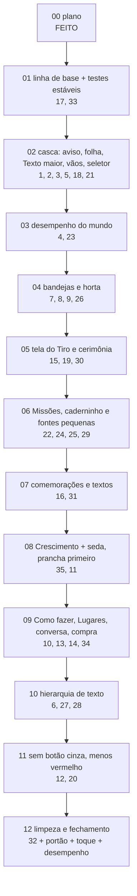

# Plano "Interface 2 — ajustes" (pós-revisão Opus)

> Origem: [`docs/plans/interface2/REVISAO_OPUS.md`](../interface2/REVISAO_OPUS.md), revisão escrita pelo
> Claude Opus 5.5 em 25/10/2026 depois do fechamento local do plano Interface 2 (etapas 01–12). Ela lista
> **35 ajustes** (P0, P1 e P2). O Vitor pediu: "transforme a revisão num plano de ajustes por etapas no
> mesmo estilo do plano Interface 2". Depois, **aprovou os 35 itens como o revisor sugeriu, inclusive as
> decisões**. Nenhuma decisão fica pendente.

**Estado:** etapa 01 concluída (testes estáveis, linha de base medida). **Próxima: etapa 02.**

## A ideia em uma linha

> **Acabamento, não redesenho.** A direção do Interface 2 está aprovada e chegou ao jogo; este plano conserta
> o que ficou "meio feio": hierarquia de texto achatada, painéis meio migrados, regras da bíblia furadas
> (botão cinza, vermelho fora do lugar) e defeitos de composição (aviso sobre o título, folha cortada,
> fogão escondido, HUD com Texto maior, engasgos no Sítio).

## Decisões (todas aprovadas pelo Vitor em 25/10/2026)

| Item | Decisão | Etapa |
|---|---|---|
| 1–6, 10–34 | Executar como descrito na revisão. | ver tabela abaixo |
| **7** | **Reverter**: a bandeja do fogão (e das outras estações) não cobre o objeto; o fogão fica visível **acima** da bandeja. Aprovado pelo Vitor. | 04 |
| **8** | **Reverter**: o "Tudo ×N" volta, agora como opção do `UiKit.stepper` usada em estações, Feira e obras. Aprovado pelo Vitor. | 04 |
| **9** | **Manter** o comportamento da barra da horta (mexer na câmera NÃO fecha o `FarmDock`) e **documentar**. Aprovado pelo Vitor. | 04 |
| **31** | **Usar os textos propostos**: Novo! de mundo = "Já está no Mapa"; de lugar = "No Sítio" (o `in_name` do mundo); de amizade = "Na Praça"; botão "Ir para a Vila" (nome do destino) em vez de só "Ir". Fita do passeio "De volta!" → **"Voltou do passeio!"**. Aprovado pelo Vitor. | 07 |
| **35** | **Refazer a tela de Crescimento**, com a **prancha HTML primeiro** em `docs/plans/interface2/prototipo/` e implementação **em seguida, na mesma etapa, sem parar para aprovação**. Aprovado pelo Vitor. O item é **sugestão do revisor**, não pedido original do Vitor. | 08 |

Regras que continuam valendo (do plano Interface 2): só interface e fluxo de interface — nada de mudar
tempos, preços, prêmios, requisitos, ids, falas da história ou formato do save. A única troca de texto
permitida é a do item 31 (aprovada), e as linhas de bloqueio do item 5 (texto de interface, não fala).

## Documentos

| Arquivo | Para quê |
|---|---|
| [ORQUESTRACAO.md](ORQUESTRACAO.md) | dinâmica Sonnet ⇄ Codex, ciclo da etapa, **§4.4 conferência e handoff**, prompts de etapa, continuação e passagem |
| [etapas/](etapas/) | **um arquivo por etapa**: objetivo, itens, arquivos, como está hoje, passo a passo, testes, capturas, pronto quando, handoff, registro |
| [`../interface2/REVISAO_OPUS.md`](../interface2/REVISAO_OPUS.md) | a revisão com os 35 itens (o "por quê" e as capturas de evidência de cada um) |
| [`../interface2/01_BIBLIA_VISUAL.md`](../interface2/01_BIBLIA_VISUAL.md), [`02_JORNADA.md`](../interface2/02_JORNADA.md), [`03_TELAS.md`](../interface2/03_TELAS.md), [`04_REGRAS_E_TESTES.md`](../interface2/04_REGRAS_E_TESTES.md) | as regras visuais e de teste continuam as do plano Interface 2 |
| [`../interface2/prototipo/`](../interface2/prototipo/) | protótipos aprovados (`fogao.png`, `horta_*.png`, `missoes2_*.png`, `mundos.png`, `tiro_*.png`) e onde nasce a prancha do Crescimento (etapa 08) |

## Ordem das etapas

A ordem segue dependências, risco e arquivos em comum (nunca dois executores ao mesmo tempo; uma etapa por
vez). Primeiro os testes estáveis (para que todo o resto tenha um portão confiável), depois a casca
(aviso/folha, que as bandejas e painéis consultam), depois o mundo (desempenho antes das bandejas, ambos em
`room.gd`), depois as telas por área e, por fim, as mudanças sistêmicas que tocam quase todos os painéis
(hierarquia de texto, bloqueios) e a limpeza.



| Feita | Etapa | Itens da revisão | Entrega | Tamanho |
|---|---|---|---|---|
| [x] | 00 | — | este plano | — |
| [x] | [01](etapas/ETAPA_01_BASE_E_TESTES.md) | 17, 33 | capturas e medição "antes" do plano; `world_pin_test`/`world_life_test` 10/10; fixtures `g01`/`t03`; bloco `--aj-NN-only` | médio |
| [x] | [02](etapas/ETAPA_02_CASCA.md) | 1, 2, 3, 5, 18, 21 | aviso nunca sobre o título; folha acompanha o conteúdo; HUD/Configurações com Texto maior; "Depois de:"; sem título "Mochila" e sem vão; `WorldBar` escondida atrás do seletor | médio |
| [ ] | [03](etapas/ETAPA_03_DESEMPENHO.md) | 4, 23 | tique de 8 Hz enxuto, brilho do álbum em cache, balões sem redesenho parado, aquecimento de glifos; um balão pulando por vez | grande |
| [ ] | [04](etapas/ETAPA_04_BANDEJAS_HORTA.md) | 7, 8, 9, 26 | fogão visível acima da bandeja; "Tudo" no `stepper`; barra da horta documentada; tile Regar | grande |
| [ ] | [05](etapas/ETAPA_05_TIRO.md) | 15, 19, 30 | humor em pílula translúcida; selo Animado; cardápio sem vermelho e sem cobrir o focinho; cerimônia sem Tiro repetido e régua melhor | médio |
| [ ] | [06](etapas/ETAPA_06_MISSOES_CADERNINHO.md) | 22, 24, 25, 29 | "Neste capítulo" leve; segmentado de uma opção some; caderninho legível; fontes < 12 resolvidas; história concluída | médio |
| [ ] | [07](etapas/ETAPA_07_COMEMORACOES_TEXTOS.md) | 16, 31 | cartão de capítulo com grade de novidades; textos do Novo! e do passeio | médio |
| [ ] | [08](etapas/ETAPA_08_CRESCIMENTO.md) | 35, 11 | prancha HTML do Crescimento → implementação na mesma etapa; seda no padrão do Crescimento | grande |
| [ ] | [09](etapas/ETAPA_09_PAINEIS_MUNDO.md) | 10, 13, 14, 34 | Como fazer com peças novas; Lugares em `list_card`; conversa sem repetições; compra bloqueada nítida | grande |
| [ ] | [10](etapas/ETAPA_10_HIERARQUIA.md) | 6, 27, 28 | `SectionLabel` revisada (nomes em 18); passeios e Feira; regra nova no `ui_style_test`; **portão** | grande |
| [ ] | [11](etapas/ETAPA_11_BLOQUEIOS_VERMELHO.md) | 12, 20 | nenhum botão cinza com texto em folha/bandeja; obras e encomendas com um chip e uma barra | grande |
| [ ] | [12](etapas/ETAPA_12_LIMPEZA_FECHAMENTO.md) | 32 | limpeza de apelidos e tema; **portão**, tour completo nas 3 resoluções, toque real, desempenho, docs | médio |

Cobertura: 17, 33 · 1, 2, 3, 5, 18, 21 · 4, 23 · 7, 8, 9, 26 · 15, 19, 30 · 22, 24, 25, 29 · 16, 31 ·
35, 11 · 10, 13, 14, 34 · 6, 27, 28 · 12, 20 · 32 = **35 itens**, cada um em exatamente uma etapa.

## Regras de execução (resumo; detalhes em ORQUESTRACAO.md)

1. **Uma etapa por vez, na ordem.** Sem subagentes paralelos, sem worktrees. Um executor por vez na pasta.
2. **Executores:** Claude Code **Sonnet 5.5** (`claude-sonnet-5-5`) executa até bater o limite; o **Codex**
   (`gpt-6.1-sol`, esforço médio) continua **a mesma etapa** a partir do disco; e vice-versa. Quem continua lê
   o handoff (§4.4 da ORQUESTRACAO e §9 do arquivo da etapa) e o `git diff`, e não desfaz o que está certo.
3. **Commit local por etapa** (`fix(ui2-aj): etapa NN — <resumo>`). **Sem push, sem publicar.**
4. **Testes enxutos:** só a lista fechada da etapa com `tools\test.ps1 -Level etapa -Exact -Tests <lista>`
   (confira antes com `-DryRun`). **Portão** (`tools\test.ps1 -Level portao`) só nas etapas **10** e **12**.
   Campanha/simulador nunca. Verde é verde: falha da lista é consertada na etapa.
5. **Capturas:** bloco `--aj-NN-only` do `game/tests/ui_tour.gd` (criado na 01 para a 01; cada etapa acrescenta
   o seu), "antes" em `build/screenshots/aj_NN_antes` e "depois" em `aj_NN_depois`, `aj_NN_depois_390`,
   `aj_NN_depois_412`. O executor **abre** os PNGs e compara com a evidência da revisão e com o protótipo.
6. **Docs:** registro neste README + `[x]`; bloco no topo do "Estado atual" do `docs/ROADMAP.md`;
   `CLAUDE.md` = `AGENTS.md` quando criar peça, nó, função ou comando que outro agente precise achar.
7. **UTF-8** sempre (acentos). No PowerShell, nunca `Set-Content`/`Out-File` sem `-Encoding utf8`.

## Como passar para o próximo executor

```text
Execute somente a etapa NN do plano "Interface 2 — ajustes":
docs/plans/interface2_ajustes/etapas/ETAPA_NN_<NOME>.md.
Leia, nesta ordem: CLAUDE.md (ou AGENTS.md); docs/ROADMAP.md (só "Estado atual");
docs/plans/interface2_ajustes/README.md (decisões e registro); docs/plans/interface2_ajustes/ORQUESTRACAO.md §2 e §4.4;
docs/plans/interface2/01_BIBLIA_VISUAL.md; docs/plans/interface2/04_REGRAS_E_TESTES.md §A, §B e §E;
os itens da etapa em docs/plans/interface2/REVISAO_OPUS.md; o arquivo da etapa inteiro.
Confirme que a etapa anterior está [x] neste README. Se a etapa já foi começada por outro executor,
leia o "Handoff" do arquivo da etapa e o git diff antes de mexer.
Capturas "antes" (--aj-NN-only) antes de mexer; "depois" nas 3 resoluções; ABRA os PNGs.
Testes: só a lista fechada (tools\test.ps1 -Level etapa -Exact -Tests <lista>; confira com -DryRun).
Nada de regra do jogo muda. Atualize registro + [x], Estado atual do ROADMAP e CLAUDE.md = AGENTS.md se preciso.
Commit local "fix(ui2-aj): etapa NN — <resumo>"; sem push, sem publicar. Não execute a etapa seguinte.
```

## Registro

**Etapa 00 (25/10/2026, Claude Opus 5.5):** plano escrito a partir da `REVISAO_OPUS.md` (35 itens), no estilo do
plano Interface 2: README, ORQUESTRACAO (dinâmica Sonnet ⇄ Codex, §4.4) e 12 arquivos de etapa. Decisões
7, 8, 9, 31 e 35 aprovadas pelo Vitor; item 35 corrigido na revisão para "sugestão do revisor". Nomes de teste
conferidos com `game/tests/` (a revisão citava `npc_test` e `places_test`, que não existem: viraram
`npc_lines_test` e `worlds_test`/`navigation_test`). Tempos de teste de `build/test_logs/times.csv`. Nenhum
código alterado; sem testes, commit, push ou publicação. **Próxima: 01.**

**Etapa 01 (25/10/2026, Claude Sonnet 5.5):** linha de base `aj_base`, `aj_base_390`, `aj_base_412` com 114 PNGs cada
(tour completo, já com as fixtures corrigidas); Sítio na Web (roteiro `touch_steps_i2_12.json`, duas rodadas):
média 28,4 / 28,2 ms, p95 66,6 / 66,6 ms, 123 / 114 quadros > 33 ms, pico 183 / 217 ms (a etapa 03 compara com isto).
`world_pin_test` e `world_life_test` (e `world_view_test`) 10/10 PASS em 10 rodadas com `-Jobs 3`
(`build/estabilidade_aj01.txt`; logs em `build/test_logs/r20261025_115846_de00bcd0` … `r20261025_120553_1411de22`).
Mudanças só em `game/tests/`: `world_pin_test` (antes: toca o centro de cada zona com NPCs/Tiro/montinho/balões
vivos; agora `_quiet` os esconde e para, e `_zone_points` tenta até 9 pontos internos — a garantia "toda zona/lugar
visível é tocável e leva ao lugar certo" continua igual); `world_life_test` (relógio fixo meio-dia local via
`economy_clock.gd`; espera por condição com limite de 180 quadros em vez de `create_timer(0.3)`; a referência
"não reage em mapa oculto" é lida depois de trocar de tela e assentar 4 quadros — mesmas asserções);
`ui_tour.gd` (`--aj-01-only`, `_aj_01_shots`, `_g01_tasks_ready_many` a partir do capítulo 5 com 7 de 8 passos
prontos e restauro do estado do tour, `_t03_growth_ready` por `dev_complete_growth_reqs`). Capturas
`aj_01_antes` (fixtures antigas) e `aj_01_depois`/`_390`/`_412`. Pendências: o aviso "Momento de Coragem!"
ainda cobre o título da folha de mundos em `b05_map_list` (item 1, etapa 02). Sem push.

**Etapa 02 (25/10/2026, Claude Sonnet 5.5):** aviso na faixa da linha 2 recolhida com folha/seletor/bandeja
(`main._row2_hidden`, `Notice.retarget`); folha alta até o HUD (`Sheet._tall_height`) + folga de 16 px
(`SheetBottom`); causa da folha cortada: não eram as guardas do `_queue_fit` (o caso novo do `sheet_test`
passa sem mudá-las) e sim o cartão `NpcServices` vazio da conversa sem serviços, agora removido; Texto maior
sem sobreposição (`Hud._fit_profile`, saves em `flow`); "Depois de:" e dicas próprias (Praça, Vila, Sítio);
sem título na Mochila e linha 2 recolhida sem pílula (`set_content_top`); `WorldBar` oculta com seletor.
Testes notice/sheet/hud/text_budget/next_step/world_selector/worlds/lists/texts/tasks PASS. Capturas
`aj_02_antes|depois[_390|_412]`. Pendências: a captura `b17` mostra o aviso a 136 porque no Mapa com o
seletor fechado ele fica abaixo da pílula (por desenho). Sem push.
