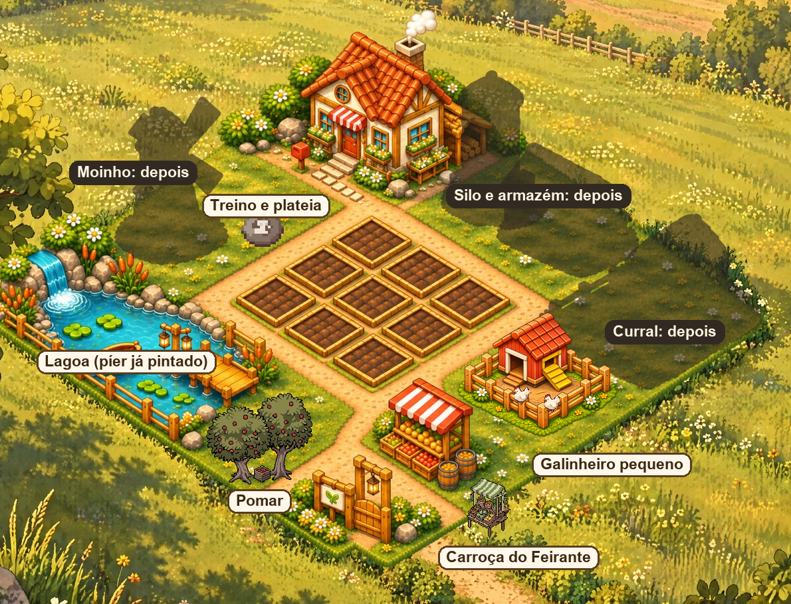

# Primeira semana do Tiro: plano de desenvolvimento

Plano para transformar o desenho da primeira semana (Recém-chegado e Filhotinho, dias 1 a 7, só no Sítio da vovó) em jogo.
São **17 etapas (E00 a E16) em 5 marcos**. O jogo já tem boa parte da base: pesca, banca, álbum, cerimônia e a casca da cozinha.
O trabalho maior é novo: **relógio de refeições, motor de pratos, Cozinhar junto, Aula do Tiro, Bolinha no quintal, Livro de receitas e a história nova**.

**Estratégia (pedido do Vitor, 18/11/2026): estrutura primeiro.** As etapas E00 a E15 usam só os assets que já existem, em lugares provisórios. Arte nova e posicionamento final ficam para a E16.

Situação em 19/11/2026: E00–E15 executadas localmente. A E15 fechou com ressalvas de ritmo e interface. A E16 ficou para outra sessão. Andamento no fim deste arquivo.

## 1. Fontes

Este plano diz **o que construir e em que ordem**. Regras, números e textos continuam nos documentos abaixo.

| Fonte | Para que serve |
|---|---|
| [Tiro filhote: plano da primeira semana](https://claude.ai/artifact/PGotpZMqcevCDB5kogmMpZ) | Regras, história, preços, pratos, missões, tutoriais |
| [Revisão da primeira semana](https://claude.ai/artifact/BgGJF2y89mkugnpxU5aKg9) (Parte A) | 12 ajustes ainda não aplicados ao plano |
| [Canvas: Primeira semana do Tiro](https://claude.ai/artifact/WKz4a9Tj95yQz3xGAFX38Q) | Roteiro, dias 1 e 2, tutoriais, truques, minigames, banca, livro, Para crescer |
| [Canvas: Cozinha interativa do Tiro](https://claude.ai/artifact/JEStTKGrBTHPReDVAdM5tX) | Telas do Cozinhar junto, hora de comer, Hoje, catálogo de sprites |
| [Catálogo de pratos do filhote](https://claude.ai/artifact/NjNSgP5VP8BwGC9Ye6w6hD) | As 538 combinações, com nutrientes e duplas |
| [Alimentação: sistema completo](https://claude.ai/artifact/QhnD6Yt2cdZuzoJ2xoriL2) e [design completo](https://claude.ai/artifact/U5HaGggnMLE9W4WZMwH6mg) | Fórmula de nutrientes. A E00 define qual dos dois vale |
| [Sítio da vovó e quintal do Tiro](https://claude.ai/artifact/3baJBRChf6ukg35HHcssda) | Mapa isométrico e posição das áreas |
| Figma `P7Z4cRwe49bHtmG67CG23z` | Layout real do Sítio, da cozinha e da pesca |

## 2. Quando a semana está pronta

1. Um save novo joga do dia 1 ao dia 7 sem ferramenta DEV e chega a Dentinhos.
2. Quem joga certinho cresce no dia 7. O jogador regular cresce entre os dias 7 e 9.
3. Dias 1 e 2 têm de 35 a 40 minutos de jogo sem espera vazia. Dias 3 a 7 têm de 15 a 25 minutos.
4. Nenhum ponto trava por falta de moeda no caminho obrigatório (190 moedas na semana).
5. Quem perde um dia cresce depois, sem perder nada.
6. Depois de Dentinhos o jogo continua: a Vila abre e a história seguinte funciona.
7. Todas as telas funcionam por toque e cabem em 360×780, 390×844 e 412×915.
8. Depois da E16, nenhum asset provisório continua no jogo sem a sua aprovação.

**Fora deste plano:** a segunda semana (geladeira, Vila nova, Nina, Pipoca, feira), a Casa que cresce e o rebalanceamento das fases depois de Dentinhos.

## 3. Decisões do Vitor antes de cada etapa

Cada decisão trava só a etapa indicada. A recomendação é o que será feito se você aprovar sem mudar.

| Nº | Decisão | Recomendação | Trava |
|---|---|---|---|
| D1 | Aplicar os 12 ajustes da revisão ao plano | Aprovar todos | E00 |
| D2 | Botão **Deixar pronto** (almoço na tigela com tampa) | Aprovar: sem ele, quem só joga à noite nunca cresce | E01 |
| D3 | Castigo do dia fraco (não conta e ele acorda fraquinho) | Manter leve, como está | E01 |
| D4 | Conferir com o veterinário: aveia, banana, maçã, abobrinha, arroz, melancia e batata-doce | Conferir antes de produzir a arte | E02 |
| D5 | Vagas da panela: documento (legume + livre) ou Figma (legume, legume, grão) | Documento: as 538 combinações dependem dele | E02 |
| D6 | Um Mingau só: grão + (fruta ou laticínio) + livre | Aprovar | E02 |
| D7 | Estrelas na fila: tabela de maestria ou "1 a 2 pela variedade" (canvas) | Tabela de maestria: receita nova sai com 1 estrela | E03 |
| D8 | Terceiro passo da papinha: Servir (documento) ou Amassar (canvas) | Semana 1 só com Picar, Mexer e Servir | E04 |
| D9 | Pratos diferentes em Recém-chegado: 4 ou 3 (o plano traz os dois) | 4, e o simulador confirma | E05 |
| D10 | Pedir "8 pratos de pelo menos 3 tipos" | Aprovar | E05 |
| D12 | Casa e Sítio: manter a cena interna da Casa (fogão e tigela) e abrir o Sítio no dia 1 | Manter: reaproveita o que existe | E06 |
| D13 | Galinheiro, caminha e mordedor em kit na banca | Aprovar. Preços finais saem do simulador | E06 |
| D14 | Treino só na Aula do Tiro, com 1 biscoito por aula | Aprovar | E07 |
| D15 | Senta, Dá a pata e Deita com a vovó; Nina fica com os seguintes | Aprovar | E07 |
| D16 | Feirante com a carroça no portão a partir do dia 5 | Aprovar | E10 |
| D17 | Vila só depois de Dentinhos, com capítulos renumerados | Aprovar | E12 |
| D18 | Dia 1 em duas sessões, com o Inventar no jantar | Aprovar | E12 |

**Decisões respondidas em 18/11/2026 (E00):** D1 a D3 e D5 a D18 aprovadas com a recomendação; D4 é uma conferência do Vitor com o veterinário, até a E16. Detalhes em `REGRAS.md`.

**Já decidido:**
- Quando o formato muda, subir `SAVE_VERSION` e zerar os saves anteriores. A E10 usa a versão 29.
- D11, posição das áreas novas do Sítio: provisória, com os assets atuais (seção 8). O ajuste fino fica para a E16.

## 4. O que já existe e o que falta

| Sistema | Hoje no jogo | O plano pede | Situação |
|---|---|---|---|
| Horário de refeição | Não existe | Almoço, jantar, patinha, dia fraco, marmita | **Novo** |
| Capítulo por dia | Capítulos não esperam o dia seguinte | Um capítulo por dia real | **Novo** |
| Pratos | 50 receitas fixas; `invented_dish` provisório | 538 combinações com nome, nutrientes e duplas | **Novo** |
| Nutrientes, estrelas, maestria da receita | Não existem (só maestria por estação) | Força, Brilho, Foco, Ânimo; 1 a 3 estrelas; 4 níveis | **Novo** |
| Tela da cozinha | `CookPanel` e `CookInvent` iguais ao Figma | Mesma tela com regras reais | Adaptar |
| Cozinhar junto | Botão avisa "Em breve!" | Minigame de 3 passos | **Novo** |
| Crescimento | `GrowthUi`, cerimônia, requisitos genéricos | 6 tipos novos de requisito | Adaptar |
| Sítio | Figma com 9 canteiros e construções | Áreas por dia, silhuetas, kits | Adaptar |
| Sítio no dia 1 | Abre só depois de `growth_1_puppy` | Aberto desde o dia 1 | Adaptar |
| Banca | `SellUi` com Vender e Comprar, motor de lojas | Kits que constroem, canteiro extra | Adaptar |
| Galinheiro | 260 moedas, pede escritura e bancada | Kit de 60 moedas no dia 2 | Adaptar |
| Pomar | 400 moedas, dentro da estufa | Grátis no dia 4, macieira e bananeira | Adaptar |
| Pesca | Completa, com tutorial da vovó | Dia 3, vara de bambu, 3 iscas grátis por dia | Reaproveitar |
| Truques | 5 truques com a Nina, treino de um toque | Senta e Deita novos, níveis, Aula de 3 passos | **Novo** |
| Brincar | Ação única de bola | Bolinha no quintal, cabo de guerra, "Tiro!" | **Novo** |
| Esconde-esconde | `HideSeekUi` pronto | Abrir no dia 6 | Reaproveitar |
| Encomendas | `OrdersUi` na Vila | Carroça com 2 pedidos por dia | Adaptar |
| Desejos, álbum, achados | Prontos | Reposicionar na semana, fotos novas | Reaproveitar |
| Boas-vindas | `WelcomeSheet` | Bom dia | Adaptar |
| Boa noite | Não existe | Resumo do dia e gancho de amanhã | **Novo** |
| Tutoriais | `AlbumTutorial` e `AnglerTutorial`, separados | 33 tutoriais em 5 formatos | Adaptar |
| Ingredientes | Cenoura, batata, abóbora, milho, ovo, peixes, maçã, batata-doce | Faltam **aveia, banana, abobrinha, arroz, melancia** | Adaptar |

## 5. Mapa de telas

| Tela | Tipo | Referência no canvas | Etapa |
|---|---|---|---|
| Reloginho no HUD e balão da hora de comer | Nova | Cozinha A7 | E01 |
| Hoje (almoço e jantar) | Nova | Cozinha B1 | E01 |
| Deixar pronto na tigela | Nova | Revisão, Parte A | E01 |
| Cozinha: aba Pratos | Adaptar | Figma, Cozinha A1 | E03 |
| Cozinha: aba Inventar com prévia | Adaptar | Figma, Cozinha D e A2 | E03 |
| Picar, Mexer e Servir | Nova | Cozinha telas 2 a 4 | E04 |
| Prato pronto | Nova | Cozinha tela 5 | E04 |
| O Tiro prova | Adaptar | Cozinha tela 6 | E04 |
| Para crescer | Adaptar | Semana, prancha E | E05 |
| Cerimônia com resumo da semana | Adaptar | Semana, T2 | E05 |
| Mapa do sítio com silhuetas | Adaptar | Sítio, Isométrico | E06 |
| Banca: Comprar com kits | Adaptar | Semana, T4 | E06 |
| Montar o kit no lugar marcado | Nova | Semana, T2 | E06 |
| Caderno de truques | Nova | Semana, T3 | E07 |
| Aula do Tiro e resultado | Nova | Semana, T6 | E07 |
| Pedir truque antes de comer | Nova | Semana, T3 | E08 |
| Show de truques | Nova | Semana, T3 | E08 |
| Bolinha no quintal | Nova | Semana, T6 | E09 |
| Cabo de guerra e botão "Tiro!" | Nova | Plano, Brincar | E09 |
| Carroça do Feirante | Nova | Semana, T4 | E10 |
| Banho com xampu | Adaptar | Plano, dia 5 | E10 |
| Livro: Com o que tenho, Todos, Segredos | Nova | Semana, T5 | E11 |
| Livro: página do ingrediente e da receita | Nova | Semana, T5 | E11 |
| Cartão Achado! (pedaço de receita) | Nova | Semana, T5 | E11 |
| Abrir a caixinha | Adaptar | Semana, T1 | E12 |
| Bom dia e Boa noite | Adaptar e nova | Semana, prancha E | E13 |
| Missões: lista do dia e próximo passo | Adaptar | Semana, T0 | E13 |
| Guia com a mão, balão e dica no lugar | Nova | Semana, T0 | E14 |

## 6. Marcos

| Marco | Etapas | O que dá para jogar ao final |
|---|---|---|
| **M1. Comer e crescer** | E00 a E05 | Cozinhar, inventar, servir na hora e crescer, com atalhos DEV |
| **M2. O sítio vivo** | E06 a E10 | Sítio completo, truques, brincadeiras e carroça, ainda fora da história |
| **M3. A semana contada** | E11 a E14 | Os 7 dias completos, guiados do começo ao fim |
| **M4. Pronta para testar** | E15 | Ritmo e economia medidos, ainda com arte provisória |
| **M5. Acabamento** | E16 | Arte final, posições definitivas e roteiro no celular |

Até a E12, os sistemas entram sem desligar a história atual. **A E12 é a virada:** só ali o começo antigo sai.

## 7. Etapas

Tamanho relativo: **P** pequena, **M** média, **G** grande (dividir em partes ao abrir a etapa).

### E00. Preparação · P

**Entrega:** regras fechadas em um lugar só e ferramentas para testar a semana.

- Aplicar as decisões da seção 3 e os 12 ajustes no documento da semana.
- Corrigir as divergências internas do plano: 30 passos de história (a ordem cita 22) e 4 receitas secretas (a ordem cita 2).
- Definir qual documento de alimentação vale.
- Criar a aba DEV **Semana**: ir para o dia N, mudar a hora, completar refeição, dar kit e pular capítulo.
- Registrar as áreas novas em `tools/test_areas.json`.

**Pronto quando:** não restar regra em conflito e o DEV levar a qualquer dia da semana.

### E01. Relógio do Tiro · G · depende de E00

**Entrega:** a rotina diária funciona de ponta a ponta.

- Janelas de almoço (11h às 15h) e jantar (18h às 22h), com opção Mais cedo, Normal e Mais tarde.
- Refeição na hora, dia bem alimentado e patinha.
- Dia fraco, Tiro fraquinho até a próxima refeição na hora e ração sozinho quando a janela fecha.
- Marmita da vovó após 2 dias fracos seguidos.
- Deixar pronto, inclusive com o jogo fechado.
- Regra do dia da chegada: uma refeição basta, em qualquer horário.
- O dia só avança, mesmo se o relógio do aparelho voltar.

**Telas:** reloginho no HUD, balão da hora de comer, Hoje e Deixar pronto.
**Dados:** novo estado do dia no save e seção `meals` em `config.json`. Sobe `SAVE_VERSION`.
**Pronto quando:** o teste `day_clock_test` cobrir dia cheio, dia fraco, jogo fechado, virada de dia e relógio atrasado.

### E02. Motor de pratos · G · depende de E00

**Entrega:** qualquer combinação válida vira um prato de verdade.

- 13 ingredientes com categoria, sabor e nutrientes.
- 5 tipos de prato com vagas, efeitos e dia de abertura.
- Regra de combinação e Gororoba.
- Nome automático, cerca de 25 pratos com nome e ícone próprios, e ícone por tipo para o resto.
- 13 duplas e cálculo de nutrientes.
- Lanche e refeição separados.
- Prato dinâmico no inventário, na venda, no depósito e na Mochila.

**Maior risco técnico do plano:** o inventário hoje só conhece itens fixos de `items.json`. Esta etapa começa provando o identificador de prato dinâmico em todos esses lugares.

**Dados:** `dishes.json` novo e `invent.json` definitivo.
**Pronto quando:** o teste `dish_engine_test` reproduzir os totais do plano por dia (23, 53, 308, 497 e 538) e um prato dinâmico puder ser guardado, vendido e dado ao Tiro.

### E03. Cozinha completa · M · depende de E01 e E02

**Entrega:** as abas Pratos e Inventar usam as regras reais.

- Pratos conhecidos, filtros Dá para fazer, Faltam e Do Tiro, e categorias reais.
- Selo Para crescer nos pratos-chave.
- Inventar com prévia ao vivo: "Prato novo!" e "Conta como prato com ovo".
- 2 vagas na panela, com a 3ª em Filhotinho.
- Tipos abrem conforme o dia.
- Estrelas reais nos cartões.

**Telas:** `CookPanel`, `CookInvent` e `CookInventPicker`.
**Pronto quando:** dá para descobrir um prato novo, cozinhar, recolher e dar ao Tiro sem nada provisório.

### E04. Cozinhar junto · G · depende de E03

**Entrega:** o minigame completo, do fogão à tigela.

- Passos Picar, Mexer e Servir, de 8 a 12 segundos cada.
- Brilhos por passo viram de 1 a 3 estrelas.
- Estrelas cortam o tempo na fila: 25%, 50% ou 75%.
- Pular sai com as estrelas da fila. Nada queima e nada se perde.
- Tiro espiando e reagindo.
- Prato pronto com Dar ao Tiro ou Guardar.
- Prova do Tiro com reação de paladar.
- Respeita Menos animação e Vibrar.

**Pronto quando:** os três passos funcionarem por toque real em 360×780 e o teste `cook_together_test` cobrir estrelas, pular e sair no meio.

### E05. Para crescer e cerimônia · M · depende de E01 a E03

**Entrega:** o painel novo controla a passagem de fase.

- Requisitos novos: dias bem alimentados, pratos diferentes por tipo, prato-chave com ingrediente, brincadeiras, truques com nível e prato inventado.
- Um botão Ir por linha.
- Crescer! do dia 2 só acende no jantar.
- Cerimônia com resumo da semana e o que abriu.
- Missão e requisito de prato-chave marcam juntos.

**Dados:** `growth.json`, fases `puppy` e `teething`.
**Pronto quando:** Recém-chegado → Filhotinho → Dentinhos funcionar com as listas do plano e o teste `growth_week_test` passar. **Portão M1:** você joga comer e crescer.

### E06. Sítio do filhote · G · depende de D12 e D13

**Entrega:** o sítio cresce dia a dia, sem materiais de fora.

- Sítio aberto no dia 1, com áreas futuras cercadas e placa "quando ele crescer".
- Kits na banca que constroem ao serem comprados: galinheiro, caminha e mordedor.
- Canteiros: 2 grátis e 2 por 20 moedas.
- Galinheiro pequeno com 2 galinhas e canteiro de milho.
- Tempos acelerados nos dias 1 e 2: batata 2 min, abóbora 6 min, milho 3 min e primeiro lote de ovos 2 min.
- Lagoa no dia 3, pelo píer já pintado na cena, com 3 iscas grátis por dia.
- Pomar no dia 4, com 2 frutas por árvore a cada 2 horas.
- Tapete do treino e plateia no lote provisório (seção 8).
- Montinhos do Tiro desde o dia 1.

**Telas:** mapa do sítio, banca, montagem do kit e bandejas do galinheiro e do pomar.
**Dados:** `tools/build_farm_figma.py`, `crops.json`, `progression.json`, `config.json`.
**Pronto quando:** cada área abrir no dia certo, o Tiro andar sem ficar preso e o teste `farm_week_test` passar.

### E07. Aula do Tiro e caderno de truques · G · depende de E03

**Entrega:** ensinar um truque vira um minigame de verdade.

- Truques Senta, Dá a pata e Deita com a vovó.
- Aula de 5 repetições: Mostrar, Marcar e Premiar.
- Um caminho do biscoito para cada truque.
- De 1 a 3 estrelas por aula, com 1 biscoito por aula.
- Níveis Aprendeu (3), Sabe bem (8) e Craque (15).
- Um treino por truque a cada período.
- Fraquinho não treina.

**Telas:** caderno de truques, Aula do Tiro e resultado.
**Pronto quando:** os três truques subirem de nível e o teste `trick_lesson_test` passar.

### E08. Usar os truques · M · depende de E07

**Entrega:** o que foi aprendido aparece no dia a dia.

- Pedir truque antes de comer, com mais Felicidade e 1 momento de Esperteza.
- Show de 3 a 5 truques, uma vez por dia, com a plateia na varanda.
- Desejo de treinar.

**Telas:** pedido sobre a tigela e Show de truques.
**Pronto quando:** o show completar, pagar uma vez por dia e o pedido funcionar no almoço e no jantar.

### E09. Brincadeiras · G · depende de E06

**Entrega:** quatro formas de brincar no quintal.

- Bolinha no quintal: 5 bolinhas, mira, alvos, Pula! e recorde.
- A fase da bolinha cresce com a semana: alvos no dia 2, bolinha que apita no dia 5, lagoa no dia 6.
- As 3 primeiras partidas do período rendem prêmio.
- Cabo de guerra e botão "Tiro!" (atender pelo nome).
- Esconde-esconde aberto no dia 6.

**Telas:** Bolinha no quintal, cabo de guerra e botão "Tiro!".
**Pronto quando:** cada brincadeira contar para crescer, respeitar o limite por período e o teste `play_week_test` passar.

### E10. Carroça do Feirante · M · depende de E06 e E08

**Entrega:** o sítio ganha clientes a partir do dia 5.

- Carroça no portão, uma vez por dia.
- 2 encomendas por dia, às vezes com pedido de truque e gorjeta.
- Venda de xampu, lacinho, bolinha que apita e oferta do dia.
- Banho caprichado com xampu.

**Telas:** Carroça do Feirante e banho com xampu.
**Pronto quando:** as encomendas renovarem por dia e o teste `cart_test` passar. **Portão M2:** você joga o sítio completo.

### E11. Livro de receitas · G · depende de E04

**Entrega:** consultar, colecionar e buscar segredos.

- Abas Com o que tenho, Todos e Segredos.
- Página do ingrediente e da receita.
- Estados: desconhecida, pista, descoberta, provada e dominada.
- Maestria com 4 níveis, porção de brinde e nível de cozinheiro.
- 4 receitas secretas, com páginas rasgadas garantidas e pistas.
- O Tiro fareja, ingrediente do dia e desejo de novidade.

**Corte recomendado se precisar:** a Receita do dia na banca.
**Pronto quando:** cada página tiver origem garantida e o teste `recipe_book_test` passar.

### E12. História da semana · G · depende de E05 a E11

**Entrega:** a virada. Os 7 capítulos substituem o começo atual.

- 30 passos, com um capítulo por dia ("a vovó volta amanhã").
- Abrir a caixinha, com o Tiro saindo aos poucos.
- Falas da vovó e da Laís.
- Prêmios ajustados à conta de moedas: 30 moedas no Bom dia do dia 2 e 20 ao comprar o galinheiro.
- Almoço de despedida no dia 7.
- Vila, Praça e Natureza fechadas até Dentinhos.
- **Ponte de saída:** ao virar Dentinhos, a história antiga continua da Vila em diante.
- Surpresas, desafios e fotos de cada dia.

**Atenção:** esta etapa quebra testes presos à história antiga, inclusive a campanha do `progression_test`. Atualizá-los faz parte da entrega.

**Pronto quando:** um save novo chegar a Dentinhos só pelas missões e seguir jogando depois.

### E13. Rotina do dia · M · depende de E12

**Entrega:** o jogador sempre sabe o que fazer hoje e por que voltar amanhã.

- Cartão Bom dia, normal e depois de dia fraco.
- Cartão Boa noite, com patinha, prato novo, selo das diárias e gancho de amanhã.
- Lista do dia e um único Próximo passo na aba Missões.
- Três diárias do filhote.
- Três linhas de missão: caderno da vovó, melhores amigos e relógio do Tiro.
- Semanais desligadas até Dentinhos.
- Aviso opcional de hora de comer, oferecido depois do primeiro dia fraco.

**Pronto quando:** Bom dia e Boa noite aparecerem uma vez por dia, na fila modal, sem cobrir a cerimônia.

### E14. Tutoriais · G · depende de E12 e E13

**Entrega:** os 33 tutoriais da semana.

- Peça única extraída do `AlbumTutorial` e do `AnglerTutorial`.
- Cinco formatos: guia com a mão, balão, cartão Novo!, dica no lugar e lista do dia.
- Pular a partir do segundo tutorial.
- Mãozinha volta depois de 20 segundos parado.
- Retomar no passo certo ao reabrir o jogo.
- Todos revisáveis no Manual.

**Pronto quando:** um jogador novo fizer os dias 1 e 2 sem ajuda externa e o teste `week_tutorial_test` passar. **Portão M3:** você joga os 7 dias.

### E15. Ritmo, economia e fechamento · M · depende de todas

**Entrega:** a semana medida e pronta para teste no celular.

- Robô do simulador joga a semana nova.
- Tabela de moedas dos 7 dias, sem travas.
- Medir três perfis: tranquilo, regular e dedicado.
- Conferir limites dos depósitos na semana.
- Suíte completa e campanha.
- Capturas nas três resoluções e toque real no navegador.

**Pronto quando:** os critérios 1 a 7 da seção 2 estiverem medidos em `RESULTADOS.md`.

### E16. Arte e posicionamento finais · G · depende de E15

**Entrega:** a semana com a cara definitiva, sem mudar nenhuma regra.

- Trocar cada item da lista de provisórios, lote por lote, com a sua aprovação.
- Ajustar as posições do Sítio no Figma e regenerar o mapa.
- Passar as telas estruturais para o acabamento final em madeira ilustrada.
- Roteiro para testar no celular físico.

**Pronto quando:** a lista de provisórios estiver vazia ou com cada item restante aprovado por você. Publicar continua dependendo do seu pedido.

## 8. Assets provisórios

Nas etapas E00 a E15, **nenhuma arte nova é produzida**. Cada caso abaixo usa o que já existe. O caminho da arte fica nos dados, para a troca na E16 não mexer nas regras.

*Montagem com os assets atuais. As posições são o ponto de partida da E06.*

| Precisa de | Provisório | Onde |
|---|---|---|
| Galinheiro pequeno | `figma_galinheiro` e 2 `chicken` | Lote atual do galinheiro |
| Canteiro de milho | Um dos 9 canteiros | Horta |
| Ponte e lagoa | Píer e lagoa já pintados na cena | Lagoa, fechada até o dia 3 |
| Pomar | `orchard` para a macieira e a bananeira | Lote da estufa |
| Tapete do treino e plateia | `paw_rug` ampliado, com vovó e Laís em pé | Lote da queijaria |
| Portão | Já pintado na cena | Entrada do sítio |
| Carroça do Feirante | `village/stall` e o retrato do Feirante | Estrada, ao lado do portão |
| Áreas futuras | Silhueta escura do próprio sprite | Silo, armazém, curral e moinho |
| Caixinha da chegada | `arrival_box` | Casa |
| Ingredientes novos | Aveia e arroz: trigo tingido. Banana: batata-doce tingida. Abobrinha: cenoura tingida. Melancia: maçã tingida | Mochila e cozinha |
| Pratos | Ícone do tipo: `puppy_mash`, `vegetable_soup`, `milk_porridge`, `carrot_snack` e `apple_biscuit` | Cozinha e livro |
| Cozinhar junto | Fundo de madeira, tábua e panela desenhadas por código, ícones dos ingredientes | Minigame |
| Fraquinho | Clipe `sad` | Tela do Tiro |
| Provar e reagir | `lick_paw`, `eat_*`, `pet_head`, `close_eyes` e `head_tilt` | Tela do Tiro |
| Senta, Dá a pata e Deita | `idle_breathe`, `lick_paw` e `belly_*` | Aula e show |
| Buscar, pular e cordinha | `play_ball_*` | Brincadeiras |
| Atender pelo nome | `head_tilt` | Botão "Tiro!" |
| Patinha | `tab_pet` cheia, apagada ou riscada por código | HUD, Para crescer e cartões |
| Kits | `station_coop`, `item_bed_gift` e `item_chew_ring` | Banca |
| Brinquedos e banho | `item_lost_ball`, `item_braided_toy`, `item_herb_shampoo` e `outfit_topknot_bow` | Mochila e carroça |
| Mãozinha do tutorial | `TutorialHand` do álbum | Tutoriais |

**Regras:**
- A tela do Tiro continua só com os clipes novos do filhote. A idle aprovada não muda.
- Cada provisório entra em `PROVISORIOS.md` ao ser usado, com o que precisa substituir.
- O tapete do treino some quando a queijaria for construída, depois da semana 1.

**Lotes da E16:** comida, Cozinhar junto, Sítio, Tiro filhote, interface, personagens e fotos.

## 9. Se precisar cortar

Em ordem, do mais dispensável para o menos:

1. Receita do dia na banca.
2. Aviso de hora de comer.
3. Linhas de missão 2 e 3.
4. Fase da lagoa na Bolinha no quintal.
5. Versão caprichada das receitas.
6. Nível de cozinheiro.
7. Show de truques com sequência de 5.

**Não cortar:** relógio de refeições, motor de pratos, Cozinhar junto, Para crescer, Aula do Tiro e história por dia.

## 10. Riscos

| Risco | Efeito | Como reduzir |
|---|---|---|
| Prato dinâmico no inventário | Pode afetar venda, depósitos, Mochila e missões | Provar primeiro, no início da E02 |
| Virada da história (E12) | Quebra testes e o começo atual do jogo | Sistemas entram antes; virada concentrada em uma etapa |
| Coerência das animações do filhote | Pode atrasar a E16 | A estrutura não depende delas: os clipes atuais seguram até lá |
| Provisório virar definitivo sem querer | Jogo fica com arte improvisada | Lista `PROVISORIOS.md` conferida na E16 |
| Excesso de novidades nos dias 1 e 2 | Jogador se perde | Ajustes 10 e 12 da revisão, e teste com pessoa real na E14 |
| Economia apertada nos dias 1 e 2 | Jogador trava no kit do galinheiro | Prêmios antecipados e simulador na E15 |

## 11. Como trabalhar

- Uma etapa por sessão, em ordem. Etapas G são divididas em partes ao abrir.
- Antes de cada etapa, criar `etapas/ETAPA_NN_*.md` com arquivos, passo a passo, testes e critério de pronto.
- Testes: `tools/test.ps1 -Level etapa` em cada etapa; `portao` em E05, E10 e E14; `campanha` só na E15.
- Telas novas usam as peças de madeira que já existem, com capturas nas três resoluções. Acabamento fino só na E16.
- Ao concluir uma etapa, atualizar "Estado atual" em `docs/ROADMAP.md`.
- Sem commit, push ou publicação sem pedido do Vitor.

## Andamento

Cada sessão termina atualizando esta seção. Regras fechadas: [`REGRAS.md`](REGRAS.md). Provisórios: [`PROVISORIOS.md`](PROVISORIOS.md). Arquivos de etapa em `etapas/`.

| Etapa | Situação | Data | Testes | Pendências |
|---|---|---|---|---|
| E00 Preparação | **Concluída** | 18/11/2026 | `week_clock_test` + `_prod`, `dev_tools_test` + `_prod`, área `saves` (15 testes), `content_test`, `texts_test`, `scripts_check`: todos PASS. Capturas da aba DEV nas 3 resoluções abertas | Nenhuma de código. D4 (veterinário) fica com o Vitor até a E16 |
| E01a Estado do dia e refeição na hora | **Concluída** | 18/11/2026 | `day_clock_test` (novo) + `week_clock_test`/`_prod`, `dev_tools_test`/`_prod`, área `saves`, `growth` (13 testes), `scripts_check`: PASS. `hud_growth_test` FALHA (avatar do HUD sem `ShaderMaterial`, linha 62; vem do HUD novo, não do relógio) | Ver `etapas/ETAPA_01_relogio.md` |
| E01b Dia fraco, marmita, Deixar pronto | **Concluída** | 18/11/2026 | `day_clock_test` ampliado, `week_clock_test`/`_prod`, `dev_tools_test`/`_prod`, áreas `week`, `saves`, `growth`, `scripts_check`, `content_test`, `texts_test`: PASS (`dev_tools_test_prod` falhou uma vez em paralelo e passou isolado; `hud_growth_test` segue falhando como na E01a) | Só estado e regra (sem tela, sem captura). `SAVE_VERSION` 22. Ver `etapas/ETAPA_01_relogio.md` |
| E01c Telas do relógio | **Concluída** | 18/11/2026 | `test.ps1 -Level etapa` (áreas `week` e `wishes` + `meal_ui_test`, `day_clock_test`): 38/38 PASS em 609 s; capturas nas 3 resoluções abertas. `hud_growth_test` segue falhando como antes (fora dessas áreas) | `MealUi`, reloginho no avatar, balão, folha Hoje, Deixar pronto, escolha de horário. Ver `etapas/ETAPA_01_relogio.md` |
| E02 Motor de pratos | **Concluída** | 18/11/2026 | `dish_engine_test` (novo) PASS: 23/53/308/497/538, linhas da planilha, Gororoba, nomes e prato dinâmico guardado/vendido/dado ao Tiro e depois de salvar/carregar. Etapa: 14 testes PASS (`cook_invent_test`, `manual_test`, `products_test`, `growth_meals_test`, `economy_transactions_test`, `day_clock_test`, `meal_ui_test`, `cook_panel_test`, `saves_test`, `dev_tools_test`, `content_test`, `texts_test`, `scripts_check`). Capturas do Inventar e da Mochila nas 3 resoluções abertas | `station_tray_test` e `hud_growth_test` seguem falhando (antigos). Pratos conhecidos, filtros e estrelas reais ficam na E03. Ver `etapas/ETAPA_02_motor_de_pratos.md` |
| E03 Cozinha completa | **Concluída** | 18/11/2026 | `cook_dishes_test` (novo) PASS; `cook_invent_test`, `cook_panel_test`, `dish_engine_test` PASS; etapa: ver relatório da sessão. Capturas `e03_cook_invent`/`e03_cook_panel` nas 3 resoluções abertas | Pratos conhecidos (`week.dishes`, `SAVE_VERSION` 23), prévia ao vivo, vagas por dia, tipos trancados, categorias/filtros/selo/estrelas reais, `invented_dish` removido. Ver `etapas/ETAPA_03_cozinha_completa.md` |
| E04 Cozinhar junto | **Concluída** | 18/11/2026 | `cook_together_test` (novo, toque real em 360×780: regras, sair/pular, 3 passos, 1/2/3 estrelas, Dar/Guardar, Gororoba) PASS; `cook_dishes_test`, `cook_invent_test`, `cook_panel_test`, `dish_engine_test`, `day_clock_test`, `content_test`, `texts_test`, `scripts_check` PASS; `station_tray_test` falha como antes. Capturas nas 3 resoluções abertas | Passos novos da prancha (Amassar, Tirar espinha, Arrumar, Abrir massa, Carimbar, Decorar) ficam para depois da semana 1; arte final na E16. Ver `etapas/ETAPA_04_cozinhar_junto.md` |
| E05 Para crescer e cerimônia | **Concluída** | 18/11/2026 | `growth_week_test` (novo) PASS; área `growth`/`dishes` e testes ajustados às listas novas (`growth_test`, `moments_test`, `courage_start_test`, `growth_ui_test`, `growth_meals_test`, `growth_foods_test`, `keys_test`, `cook_dishes_test`, `content_test`) PASS; portão M1 (`test.ps1 -Level portao`, 150 testes, 27 min): 130 PASS na primeira passada; as falhas causadas pelas listas novas (`wish_moments_test`, `growth_story_test`, `onboarding_test`) foram corrigidas e passam, `pet_care_test` e `card_reveal_test` só falharam sob carga e passam isolados; os 12 restantes são antigos sem relação (`food_order_touch`, `food_menu_bounds_touch`, `blender_position_touch`, `drag_scroll`, `hud_growth`, `tasks`, `tray`, `station_tray`, `photo_rarity`, `item_sources`, `world_selector`, `world_view`, `text_budget`). Capturas nas 3 resoluções abertas | Ganchos desligados até E07/E09 (`growth.json → hooks`). `SAVE_VERSION` 24. Falhas antigas sem relação: `hud_growth_test`, `station_tray_test`, `tray_test` (estufa). Ver `etapas/ETAPA_05_para_crescer.md` |
| E06 Sítio do filhote | **Concluída** | 18/11/2026 | `farm_week_test` PASS; etapa e retestes, 56/62 consolidados, seis falhas históricas. Capturas nas três resoluções e navegação conferidas. | Ver `etapas/ETAPA_06_sitio_do_filhote.md`; preços na E15 e arte final na E16. |
| E07 Aula do Tiro e caderno de truques | **Concluída** | 18/11/2026 | `trick_lesson_test` PASS. Capturas do caderno, dos três gestos, do resultado e do Para crescer nas três resoluções abertas. | `SAVE_VERSION` 26. Validação e roteiro do celular em [ETAPA_07_aula_do_tiro.md](etapas/ETAPA_07_aula_do_tiro.md). |
| E08 Usar os truques | **Concluída** | 18/11/2026 | `trick_use_test`, `trick_lesson_test` e `cook_together_test` PASS. Consolidado com retestes: 95 PASS, 10 falhas históricas e 1 timeout histórico. 24 capturas abertas. | Save 27. [Validação e roteiro no celular](etapas/ETAPA_08_usar_os_truques.md). |
| E09 Brincadeiras | **Concluída** | 18/11/2026 | `play_week_test` cobre calendário, toque, placar, recorde, limites e Para crescer. Capturas abertas nas três resoluções. | Save 28. [Validação e roteiro no celular](etapas/ETAPA_09_brincadeiras.md). |
| E10 Carroça do Feirante | **Concluída localmente** | 18/11/2026 | `cart_test`, `play_week_test`, `trick_use_test` e passada integrada do Sítio. Portão geral 134/155 após reteste. 24 capturas abertas. | Save 29. [Validação e roteiro M2](etapas/ETAPA_10_carroca_do_feirante.md). Conferência no celular pendente. |
| E11 Livro de receitas | **Concluída localmente** | 18/11/2026 | `recipe_book_test` PASS. Etapa com retestes 90/98, com oito resultados históricos. 15 capturas abertas. | Save 30. [Validação e roteiro do celular](etapas/ETAPA_11_livro_de_receitas.md). |
| E12 História da semana | **Percurso concluído localmente** | 18/11/2026 | Save novo até Dentinhos e primeira missão da Vila. Capturas nas três resoluções. | Save 31. [Validação, ressalvas e roteiro do celular](etapas/ETAPA_12_historia_da_semana.md). |
| E13 Rotina do dia | **Concluída localmente** | 19/11/2026 | Cartões diários, três diárias e três linhas. `week_routine_test`, `week_story_test` e `recipe_book_test` passaram. 15 capturas abertas e reabertura Web confirmada. | Save 32. Etapa consolidada 131/143. [Validação e roteiro no celular](etapas/ETAPA_13_rotina_do_dia.md). |
| E14 Tutoriais | **Concluída localmente, com ressalvas** | 19/11/2026 | `week_tutorial_test`, `week_story_test` e `week_routine_test` passaram no reteste. Etapa consolidada 132/144. Capturas nas três resoluções e reabertura em Web local. | Save 33. Conferência dos sete dias no aparelho fica para M3. [Etapa e validação](etapas/ETAPA_14_tutoriais.md). |
| E15 Ritmo, economia e fechamento | **Executada localmente com ressalvas** | 19/11/2026 | Nove percursos até Dentinhos e a Vila. Dedicado D7, regular D8, tranquilo D9. Portão 140/159 e campanha 6/6. | Save 33. Ritmo e toque integral pendentes de M3. [Medições, suíte e pendências](RESULTADOS.md). |
| E16 Arte e posicionamento | Pendente | — | — | Mantidos os provisórios e a revisão veterinária D4. |

### E00: o que foi feito
- Decisões D1–D18 respondidas (tudo aprovado) e registradas em `REGRAS.md`; 12 ajustes aplicados; divergências resolvidas (30 passos, 4 secretas); vale o documento "Alimentação do Tiro: design completo".
- `WeekState` (`started_day`, `clock_offset`, chave `week` do save, opcional; **sem subir `SAVE_VERSION`**: a E01 sobe ao criar o estado do dia) e relógio da semana no `GameState` (`week_day()`, `week_hour()`, `week_now()`).
- Aba DEV **Semana**: ir ao dia 1–7 ou 9, mudar a hora, ±1 h, voltar ao relógio real, pular o passo da história. "Completar almoço/jantar" e "kit" são ganchos (`dev_week_meal`, `dev_week_kit`) que a E01 e a E06 preenchem.
- Áreas de teste: `week` em `tools/test_areas.json`, alias `week_clock_test_prod` em `test.ps1`/`test_worker.ps1`.
- Os artifacts do claude.ai não foram editados; `REGRAS.md` prevalece.
