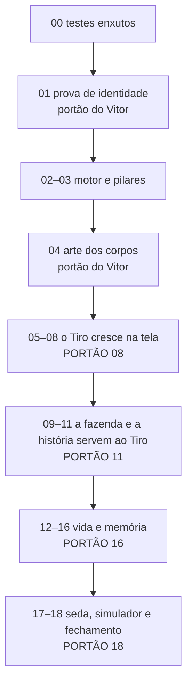

# Plano "Tiro no centro" — crescer é o objetivo do jogo

**Planejamento concluído em 19/10/2026 (Claude Code). Etapa 00 concluída em 19/10/2026; etapa 01 concluída e aprovada pelo Vitor em 19/10/2026; etapas 02 e 03 concluídas em 19/10/2026; etapa 04 concluída em 19/10/2026, com aprovação final e continuação autorizadas pelo Vitor na conversa: “Pode aprovar no final e continuar”. Etapas 05, 06, 07 e 08 concluídas em 19/10/2026 (08 com ressalvas históricas do portão). Etapas 09, 10 e 11 concluídas em 19/10/2026; etapa 12 concluída em 19/10/2026. Etapas 13 e 14 concluídas; arte PixelLab da Casa finalizada após o serviço voltar. Evidência: VALIDACAO_14. Etapa 15 concluída em 19/10/2026: seis seções/54 fotos (32 novas), pistas/lupa diária/câmera/falas/brilho, Penetra com garantia, datas e Dia do Tiro, bolo, chapéus, sono e visita da Pipoca. 19 testes distintos PASS; capturas 360×780 abertas. Evidência: VALIDACAO_15. Etapa 16 concluída; etapa 17 concluída em 19/10/2026. Etapa 18 concluída em 19/10/2026: PLANO CONCLUÍDO.**

> Pedido do Vitor: mudar o foco e o objetivo do jogo para o Tiro. As pessoas entram para ver o Tiro evoluir;
> a fazenda e as construções existem para isso. 5 fases casadas com os capítulos, atributos do Tiro, avatar do
> HUD mostrando o crescimento, fim do nível do jogador, álbum de cenas, casa que evolui, itens específicos de
> cada capítulo para ele crescer, tela de evolução com o futuro em silhueta. **O Tiro tem que continuar sendo o
> mesmo cachorro.** Testes enxutos: nada de simular economia a cada etapa.

Base: dossiê [`../TAMAGOTCHI_E_EVOLUCAO.md`](../TAMAGOTCHI_E_EVOLUCAO.md) e pesquisas desta sessão (resumidas
em [00_VISAO](00_VISAO.md)).

## Como passar para o próximo agente

Copie e troque só o número e o nome do arquivo da etapa:

```text
Execute somente a etapa NN de docs/plans/tiro/ETAPA_NN_NOME.md.
Leia CLAUDE.md (ou AGENTS.md), docs/ROADMAP.md (Estado atual), docs/plans/tiro/README.md,
docs/plans/tiro/00_VISAO.md, docs/plans/tiro/01_REGRAS_DE_EXECUCAO.md e o arquivo da etapa.
Confirme que a anterior está concluída (e aprovada pelo Vitor, se for portão de arte).
Testes enxutos: o teste novo da etapa + os afetados do MAPA_DE_TESTES; suíte inteira só nos portões
08, 11, 16 e 18; nenhuma simulação de economia (exceto onde a etapa manda).
Arte do Tiro: siga a seção E do 06 — o Tiro não pode parecer outro cachorro.
Atualize README (registro), DECISOES (se ajustou algo) e Estado atual do ROADMAP.
Não execute a etapa seguinte, não faça push na main nem publique. (O único reset de saves é o da etapa 02.)
Ao terminar, siga a seção "Sessões encadeadas" do README para abrir a sessão da próxima etapa.
```

## Sessões encadeadas (pedido do Vitor, 19/10/2026)

Cada etapa roda numa sessão própria. **Ao terminar uma etapa concluída** (todos os critérios marcados e o
registro atualizado), o agente abre uma sessão nova para a próxima com a ferramenta `create_session` (servidor
`claude-code-remote`), no **mesmo ambiente** (o computador do Vitor, mesma pasta do projeto; não precisa de
commit nem push), título `Tiro — Etapa NN` e, como mensagem inicial, o bloco "Como passar" acima com o número
e o arquivo da próxima etapa. Depois disso a sessão atual para de mexer em arquivos.

Não abrir a próxima sessão quando:
- a etapa não foi concluída (falhou, ficou em andamento ou tem bloqueio): registrar e avisar o Vitor;
- é **portão do Vitor** (01 e 04): a sessão termina "aguardando aprovação" e só abre a próxima **depois** que o
  Vitor aprovar nessa mesma conversa;
- o limite de profundidade de sessões encadeadas foi atingido (a ferramenta recusa): avisar o Vitor para abrir a
  próxima à mão com o bloco "Como passar";
- o Vitor pediu para parar.

A 18 é a última: não abre outra.

## Documentos de referência

| Arquivo | O que decide |
|---|---|
| [00 Visão](00_VISAO.md) | objetivo, diagnóstico, princípios, o que muda e o que não muda |
| [01 Regras de execução](01_REGRAS_DE_EXECUCAO.md) | contrato por agente, autoridade, **política de testes**, encerramento |
| [02 Fases e pilares](02_FASES_E_PILARES.md) | fases, pilares, requisitos para crescer, fontes de pontos, ritmo, `growth.json` |
| [03 Comidas e economia](03_COMIDAS_E_ECONOMIA.md) | comidas de crescimento, itens/receitas novos, paladar, fim do nível, moedas |
| [04 História](04_HISTORIA.md) | arcos, missões novas, falas, liberações por fase |
| [05 Álbum e Casa](05_ALBUM_E_CASA.md) | 54 fotos com gatilhos e dicas, motor de condições, objetos da Casa |
| [06 Interface e arte](06_INTERFACE_E_ARTE.md) | telas e nós, silhueta, cerimônia, **identidade e corpos do Tiro** |
| [07 Saves e estado](07_SAVES_E_ESTADO.md) | `GrowthState`, `AlbumState`, reset de saves (v13), eventos, ações, DEV |
| [Mapa de testes](MAPA_DE_TESTES.md) | área mudada → testes a rodar; portões |
| [Decisões](DECISOES.md) | decisões do Vitor, decisões de desenho e ajustes feitos |
| [Futuro](FUTURO.md) | ideias deixadas de fora |

## Ordem de execução



| Feita | Etapa | Entrega | Arte nova | Teste novo | Portão |
|---|---|---|---|---|---|
| [x] | [00](ETAPA_00_TESTES_ENXUTOS.md) | `test_all -Only/-Skip/-Fast`, tempos, simulador `-Quick`, linha de base | — | — | — |
| [x] | [01](ETAPA_01_IDENTIDADE_ARTE.md) | Prova: filhote e jovem = o mesmo Tiro; shaders de pelagem e silhueta | quadros base | — | **Vitor aprova** |
| [x] | [02](ETAPA_02_MOTOR_CRESCIMENTO.md) | Fases, requisitos, crescer; saves zerados (v13) | — | `growth_test` | — |
| [x] | [03](ETAPA_03_PILARES.md) | Quatro pilares com todas as fontes; aba Crescimento | 4 ícones | `pillars_test` | — |
| [x] | [04](ETAPA_04_ARTE_CORPOS.md) | Todos os clipes do filhote e do jovem, mundo e retratos | grande | — | **Aprovação final autorizada pelo Vitor, 19/10/2026** |
| [x] | [05](ETAPA_05_VISUAL_POR_FASE.md) | O Tiro aparece na idade certa em todo lugar; roupas no jovem | — | `growth_visual_test` | — |
| [x] | [06](ETAPA_06_TELA_CRESCIMENTO.md) | Painel de crescimento, silhueta, caderneta, selo | — | `growth_ui_test` | — |
| [x] | [07](ETAPA_07_HUD_SEM_NIVEL.md) | HUD do crescimento; fim do nível/XP/atributos do jogador | — | `hud_growth_test` | — |
| [x] | [08](ETAPA_08_CERIMONIA.md) | Cerimônia de crescer, antes e depois, "cresce dormindo" | — | `ceremony_test` | **suíte inteira** |
| [x] | [09](ETAPA_09_COMIDAS.md) | Comidas de crescimento, xampu, selos na guia | 8 ícones | `growth_foods_test` | — |
| [x] | [10](ETAPA_10_ITENS_CHAVE.md) | Itens-chave, argolinha da vovó, medalhinha, lacinho, "Dar" | ícones + lacinho | `keys_test` | — |
| [x] | [11](ETAPA_11_HISTORIA.md) | 9 missões novas, falas, liberações por fase, robô cresce | — | `growth_story_test` | **suíte inteira** |
| [x] | [12](ETAPA_12_ESCOVAR_PALADAR.md) | Escovar (5º cuidado), primeira prova, favorita, Guia de sabores | 1 ícone | `brush_taste_test` | — |
| [x] | [13](ETAPA_13_ALBUM_MOTOR.md) | Álbum: motor, fotos da história e primeiras vezes | moldura + adereços | `album_test` | — |
| [x] | [14](ETAPA_14_CASA.md) | Régua, prateleira, caminhas, cestos, parede de fotos | objetos da Casa | `house_test` | — |
| [x] | [15](ETAPA_15_ALBUM_SEGREDOS.md) | Travessuras, soninhos, amigos, datas, dicas, Dia do Tiro | adereços | `album_secrets_test` | — |
| [x] | [16](ETAPA_16_JEITO.md) | Jeito do Tiro, comportamentos por fase, diário | — | `personality_test` | **suíte inteira** |
| [x] | [17](ETAPA_17_SEDA_SIMULADOR.md) | Pelagem de seda; simulador mostra dia de cada fase (1 execução rápida) | — | `silk_test` | — |
| [x] | [18](ETAPA_18_FECHAMENTO.md) | Conferência da visão, docs, roteiro do celular | — | — | **suíte inteira + 3 resoluções** |

## O que será diferente para o jogador

- O Tiro chega filhotinho de orelhas caídas e cresce até o Tiro azul e dourado que todo mundo conhece.
- Uma tela mostra o que ele precisa para crescer, com o futuro em silhueta; o botão Crescer! espera você.
- Cada estação da fazenda faz algo para ele: papinha, cenoura gelada, ração com ovo, mingau, xampu, mordedor, escova, lacinho.
- A história termina cada arco com ele crescendo; truques e passeios longos chegam quando ele tem idade.
- Álbum com 54 fotos (história, primeiras vezes, travessuras secretas, soninhos, amigos, datas).
- A Casa guarda a vida dele: régua na parede, prateleira de lembranças, caminhas, fotos penduradas.
- Ele tem paladar, comida favorita e um jeito próprio. O nível do jogador some; o HUD mostra o Tiro crescendo.

## Falhas que já existiam antes do plano

Linha de base da etapa 00 (19/10/2026): `tools/test_all.ps1 -KeepGoing`, **37,7 min**, 61 de 68 passaram.
Log em `build/test_logs/tiro00/baseline.log`, tempos em `baseline.csv`. Tudo isto já falhava antes do plano:

| Teste | Primeira linha do erro | Observação |
|---|---|---|
| `progression_test` (24,5 min) | `Campanha deve concluir todos os capítulos` | a campanha simulada do teste não chega às missões `community_10_*`–`community_12_*` (9 erros) |
| `npc_lines_test` | `Recebe etapa da venda` | histórica conhecida |
| `onboarding_test` | `Onboarding: primeiro raro em até 60 min` | histórica conhecida (também ocioso 730 s > 240 s) |
| `finds_test` | `Faro: missão pronta` | histórica conhecida (1 erro) |
| `petshop_test` | `SCRIPT ERROR: Invalid access to property or key 'rare' on a base object of type 'Dictionary'.` | o script quebra no meio |
| `park_test` | `ERROR: 14 resources still in use at exit` | o teste imprime `PARK TEST: PASS`; cai no filtro de `ERROR:` do `test_all.ps1` |
| `ui_style_test` | `ERROR: 12 resources still in use at exit` | o teste imprime `UI_STYLE TEST: PASS`; mesmo motivo |

Fora da suíte (o arquivo existe mas não está no `test_all.ps1`): `festival_test` passa;
`economy_checkpoint_test` falha (`unexpected deficits: { "id": "chest", ... }`). Nenhum deles foi investigado
(regra 6 do [01](01_REGRAS_DE_EXECUCAO.md)).

## Registro de avanço

| Data | Etapa | Estado | Evidência / observação |
|---|---|---|---|
| 19/10/2026 | planejamento | concluído | plano em `docs/plans/tiro/`; etapas 00–18 pendentes |
| 19/10/2026 | 00 | concluída | `test_all.ps1 -Only/-Skip/-Fast/-KeepGoing` com tempos e `build/test_logs/last_run.csv`; `run_godot_test.ps1` com 5 min padrão; `economy_simulate.ps1 -Quick` (`-Quick -Days 1` em 0,2 min); linha de base 37,7 min com 7 falhas pré-existentes (acima); tempos no MAPA_DE_TESTES; 95 capturas em `build/screenshots/tiro00_antes/`; logs em `build/test_logs/tiro00/` |
| 19/10/2026 | 01 | (1ª rodada) | pranchas `build/art/tiro_fases/prancha_corpos.png`, `prancha_metodos.png`, `prancha_pelagem.png` (abertas e conferidas); método escolhido c + b (inpaint no corpo/orelhas + sela pelos pretos da paleta + `reduce_colors`), rosto idêntico ao adulto; `idle_front` 160 e mundo 64 por edição com referência; retrato 48 pelo recorte do adulto; shaders `tiro_coat`/`silhouette` (protótipos, sem uso); `coat = 1` idêntico (0/10090 pixels); `--quit-after 60` sem erro; arquivos ainda NÃO instalados nas pastas definitivas (item 8 espera a aprovação). Detalhes no `docs/ART_PIPELINE.md` |
| 19/10/2026 | 01 | **corpos aprovados pelo Vitor** (falta só confirmar o Mocinho) | Vitor escolheu, na conversa: **filhote = opção 1** (edição PixelLab; 160 e 64 refeitos com ela de referência, seeds 411/511, redução local para a paleta) e **jovem = opção 10** (inpaint + sela exata). Instalados com `.import`: `characters/tiro_pet_{puppy,young}/idle_breathe/frame_00.png`, `tiro_pet_{puppy,young}_idle_front.png`, `characters/tiro_world_{puppy,young}/rotations/south.png`, `ui/icons/hud_tiro_{puppy,young}.png`; nenhum código usa ainda; `--import` e `--quit-after 60` sem erro. Pendente: o Vitor confirmar a pelagem do Mocinho (`opcoes_mocinho.png`) |
| 19/10/2026 | 01 | **concluída — APROVADA PELO VITOR (19/10/2026)** | Vitor aprovou na conversa: filhote = opção 1, jovem = opção 10, e a pelagem do Mocinho refeita (sai do preto do jovem e azula até o Tiro atual; dourado não muda — "Perfeito!"). `coat = 1` idêntico (0/10090), `coat = 0` = adulto com a sela do jovem (0 diferenças). A pedido do Vitor, a sessão da etapa 02 **não** foi aberta ("nem manda o prompt da 2") |

| 19/10/2026 | 02 | **concluída** | `growth.json` com seis fases e requisitos provisórios; `GrowthState`/ações/validação/eventos/DEV Crescimento; save v13 zera <13, aviso após a introdução e preferências preservadas. `growth_test` (~2,4 s) + 9 execuções afetadas PASS (abaixo). Cópia do save real em dois slots; hashes dos nove JSONs pessoais idênticos antes/depois (`personal_saves_hashes.json`). Sem arte, ganhos reais de pilares, simulação, suíte completa, commit ou publicação. Próxima: 03 |

### Etapa 02 — arquivos e validação (19/10/2026)

Executados no mesmo código, com projeto espelho em `build/tiro02_game` e `user://` isolado
(`TiroEtapa02Tests`), timeout de 3 min por processo em `build/tiro02/run.ps1`.
Logs em `build/test_logs/tiro02/`. Fixture do teste novo usa somente `growth_test_fixture/`;
a cópia do save atual foi lida de `build/tiro02/vitor_save_copy.json`, nunca do original durante as ações.

| Arquivo mudado | Teste rodado | Resultado |
|---|---|---|
| `growth.json`, `growth_state.gd`, ações e eventos | `growth_test` | PASS; cinco transições, consultas puras, requisitos definitivos, reserva, entrega parcial, recarga, presente único, referências inválidas, reset v12 em dois slots |
| `database.gd`, `content_test.gd` | `content_test` | PASS |
| `save_manager.gd`, chave `growth` | `saves_test` | PASS |
| reset `<13`, fixtures da economia | `economy_transactions_test` | PASS; fixture v12 agora exige reset, fixtures v13 mantêm os asserts da economia |
| `dev_panel.gd`, três `dev_*` | `dev_tools_test` | PASS |
| guardas DEV | `dev_tools_test -- --prod` | PASS; estado do crescimento permanece idêntico |
| `main.gd` (aviso após a introdução) | `hud_test`, `festa_test`, `welcome_test` | PASS; `festa_test` ainda avisa sobre recursos ao sair, sem erro de script |
| textos novos | `texts_test` | PASS |

Capturas abertas/conferidas: `build/tiro02/dev_growth.png` e `reset_notice.png` (360×780).
A página DEV é nova, sem tela anterior equivalente; a arte do adulto e as telas de crescimento do jogador
continuam sem alterações. A execução gráfica do `growth_test -- --shot` também confere que o aviso espera
a introdução terminar. A primeira execução de `festa_test` encontrou preferências deixadas por uma fixture;
passou após reinicializar somente as preferências do ambiente descartável.

Suíte inteira, `progression_test`, `pillars_test` (ainda não existe), simulação e toque real não executados:
fora do escopo desta etapa e sem gesto novo para o jogador.

Encadeamento: `claude-code-remote.create_session` não está disponível nesta sessão. A próxima sessão será
aberta pela ferramenta nativa `create_thread`, no projeto local ClaudeGame, mesma pasta, título
**Tiro — Etapa 03**, com o bloco solicitado pelo Vitor. Nenhum trabalho da etapa 03 foi feito nesta sessão.


| 19/10/2026 | 03 | **concluída** | Todas as fontes da tabela 02 D ligadas pelo `_gain_pillar` (escovar fica na 12; xampu só API, conteúdo/interface na 09); comidas existentes com fase, Radiante, recargas/primeiras vezes persistidas, prêmio `pillars`, aba Crescimento após puppy e quatro ícones PixelLab. `pillars_test` 8,2 s; 20 testes PASS, mais a falha histórica de `npc_lines_test` reproduzida. Capturas 360×780 antes/depois abertas, logs `build/test_logs/tiro03/`. Sem reset, suíte inteira, simulação, commit, push ou publicação. Próxima: 04, em sessão própria; aguardar aprovação do Vitor ao concluir a arte |

### Etapa 03 — arquivos e validação (19/10/2026)

Testes executados no projeto espelho `build/tiro03_game`, mesmo código e `user://` separado
(`TiroEtapa03Tests`); relógio `friend_clock` no teste novo. Runner `build/tiro03/run.ps1`, limite
3 min por processo. Cada teste abaixo tem `.log` e `.err` em `build/test_logs/tiro03/`.

| Arquivo mudado / área | Teste rodado | Resultado |
|---|---|---|
| `growth.json`, fontes em `game_state.gd`, estado de primeiras vezes/recargas, `PillarUi` | `pillars_test` | PASS, 8,2 s: todas as fontes reais, comidas em seis fases, Radiante nas quatro necessidades, recargas/reload, retorno × bagagem, desejo normal/especial e feed único, obras, sono, prêmio automático, teto/reserva/grow e nós/textos da aba |
| motor e fixture de transferência isolada dos novos ganhos do feed | `growth_test` | PASS, 2,1 s; reserva transferida continua com assert exato; após novas refeições, reload compara a reserva salva |
| `pet_screen.gd`, `pet_notebook.gd` e fixture da liberação após puppy | `pet_care_test`, `wishes_test`, `manual_test`, `lists_test` | PASS; os quatro testes cobrem os gestos existentes e as consultas |
| retorno, truques e amigos em `game_state.gd` | `walks_test`, `tricks_test`, `friends_test` | PASS |
| `items.json` e validação em `database.gd` | `content_test`, `products_test`, `station_tray_test`, `fridge_test` | PASS |
| feature `growth_tab`, consulta do requisito em `progression_state.gd`, primeira visita no Mapa | `journey_test`, `tasks_test`, `navigation_test`, `world_selector_test` | PASS |
| `dev_add_pillar` usa a função central, quantidade exata, guarda preservada | `dev_tools_test`, `dev_tools_test -- --prod` | PASS |
| textos visíveis novos | `texts_test` | PASS |
| progressão — verificação extra de linhas de personagem | `npc_lines_test` | FALHA HISTÓRICA reproduzida: primeira linha `Recebe etapa da venda`, igual à linha de base da 00; também Guia/persistência em cascata. Não investigada (sem mudança nas linhas/história) |

20 testes PASS; uma falha histórica conhecida. A primeira execução de `pet_care_test` falhou porque a
fixture liberava só os recursos antigos: agora configura puppy para testar as quatro consultas. A primeira
rodada de `growth_test` também exigia reserva fixa após alimentar; ajustado para o novo comportamento real.
Falhas iniciais do teste novo (mundo de faro incorreto na fixture e feature sem consulta do crescimento) foram
corrigidas antes da rodada final. A tentativa final sem elevação passou os asserts mas teve bloqueio de logs/
certificados do Godot pelo sandbox; repetida com acesso autorizado, PASS e stderr vazio.

Capturas abertas/conferidas: `build/screenshots/tiro03_antes/notebook.png` e
`build/screenshots/tiro03_depois/notebook.png` (360×780). `ui_tour.gd` ganhou `t06_notebook_growth`.
Importação do projeto original sem erros de script (`import_original.log`); `.uid` e `.import` gerados.
Nenhum teste novo supera 3 min; as rodadas ficaram abaixo do orçamento de 15 min.

Não executados: suíte inteira/`progression_test` (somente nos portões e sem alteração da história),
simulação de economia (fora desta etapa), toque real (nenhum gesto novo) e outras resoluções (fora do portão).
O xampu ainda não tem receita/opção do jogador, escovar continua na 12, arte do Tiro e HUD continuam nas
etapas próprias. Saves pessoais preservados pelo uso do ambiente isolado; sem novo reset.

Encadeamento: `claude-code-remote.create_session` indisponível; abrir pela ferramenta nativa `create_thread`,
mesma pasta/projeto local, título **Tiro — Etapa 04**, com o bloco autorizado. A etapa 04 é portão do Vitor:
a sessão dela precisa aguardar aprovação escrita antes de abrir a 05. Nenhum trabalho da 04 nesta sessão.

Captura adicional conferida: `build/screenshots/tiro03_depois/gain.png`, ganho Radiante +3 Corpo acima da cabeça, sem cobrir a fala; número e ícone usam a mesma curva/tempo.


**Encadeamento da 03 superado (19/10/2026):** a tentativa anterior de `create_thread` foi recusada
(`MCP tool call requires approval, but approval policy is never`); nenhuma sessão foi criada naquela tentativa.
O Vitor autorizou nova tentativa e esta sessão **Tiro — Etapa 04** foi criada no mesmo projeto local.
Não resta bloqueio de encadeamento da 03. A arte final da 04 continua sujeita à aprovação escrita do Vitor
antes de abrir a 05. Sem push ou publicação.


| 19/10/2026 | 04 | **concluída — aprovação final autorizada pelo Vitor** | 22 clipes + `sleep_belly` do jovem (215 quadros), 21 + `sleep_belly` do filhote (206), 99 PNGs do mundo por corpo e `sleep_belly` adulto (1): 620 quadros, 616 PNGs novos; frontais/retratos e bases da 01 preservados. `growth.json.bodies` pronto, sem uso no jogo. Conferência PASS, 0 faltas; pranchas e 5 GIFs em `build/art/tiro_fases/`. Três testes afetados, importação e smoke isolado PASS. Sem reset, suíte inteira, simulação, commit/push/publicação. **Vitor autorizou por escrito a aprovação final e a continuação em 19/10/2026: “Pode aprovar no final e continuar”.** |

### Etapa 04 — produção e validação (19/10/2026)

Pré-requisito confirmado: etapa 03 concluída; a 01 foi aprovada pelo Vitor (filhote #1, jovem #10 e pelagem
do Mocinho). O bloqueio antigo de criação desta sessão foi superado pela autorização e abertura da 04.

Nada muda para quem joga nesta etapa: os novos corpos ainda não estão ligados ao `PetAnimator`, `DogWorld`,
HUD, intro ou boas-vindas. Roupas e âncoras ficam na 05. O adulto existente permanece idêntico; só foi
acrescentada a pose estática `tiro_pet/sleep_belly/frame_00.png`, permitida pelo plano para o álbum.

Produção: `tools/tiro_body_art.py` prepara folhas com recortes sem escala dos quadros originais, instala as
edições com referência aprovada, aplica a sela exata do jovem, reduz à paleta original, alinha a linha de
apoio de cada quadro e monta pranchas. Receita, sementes, ajustes e custo em `docs/ART_PIPELINE.md` e DECISOES.
`growth.json.bodies` guarda `dir.pet/world`, retrato, frontal, partes da silhueta em retângulos `[x,y,w,h]`
e o fallback `puppy.give_paw -> wag_excited`. Não foi necessário um `pet_feet` diferente do adulto.

| Arquivo mudado / área | Conferência executada | Resultado |
|---|---|---|
| PNGs dos corpos e metadados | `tools/tiro_body_art.py audit` | **PASS, 0 problemas**: 620 quadros esperados; nomes/quantidades/canvas/paleta/apoio/bordas, bases aprovadas pixel a pixel e hashes dos PNGs adultos existentes |
| `growth.json` (`bodies`, ainda sem uso) | `growth_test` | PASS, 2,2 s |
| mesma área, tabela do MAPA_DE_TESTES | `pillars_test` | PASS, 8,0 s |
| conteúdo | `content_test` | PASS, 5,2 s |
| importação dos recursos | Godot `--headless --path game --import` | PASS; registro `build/test_logs/tiro04/import_original.log` |
| abertura do jogo | `--headless --quit-after 60`, projeto espelho isolado | PASS, 8,8 s, código 0 e stderr vazio |

Logs em `build/test_logs/tiro04/`, tabela `results.csv`; espelho `build/tiro04_game` com nome
`TiroEtapa04Tests`. Os testes não carregaram nem gravaram os saves pessoais. A primeira importação no sandbox
teve erros de certificados/configuração do editor (`import_sandbox.log`); repetida com acesso autorizado,
sem esses erros. A primeira versão do runner registrou códigos de saída vazios apesar dos três PASS;
captura corrigida com `Diagnostics.Process` e rodada final com código 0 para todos. Nenhum timeout.

Pranchas de quadros comparando cada corpo com o adulto em `build/art/tiro_fases/clipes/`, geral em
`prancha_geral.png` (35 grupos; no filhote, `give_paw` mostra o fallback), GIFs lado a lado em `gifs/`:
`idle_breathe`, `eat`, `sleep`, `happy_jump`, `walk_east`, com os FPS atuais. Entradas, resultados brutos,
IDs PixelLab, auditoria e paleta em `producao04/`. Imagens abertas para revisão técnica; **a avaliação final
de identidade e continuidade visual é do Vitor neste portão**.

Não executados: suíte inteira, simulação, testes de roupas, toque real ou capturas de interface (não houve
mudança de interface, roupa ou gesto; o plano desta etapa pede pranchas de arte). Sem novo reset de saves.

**Portão concluído em 19/10/2026:** após receber as pranchas, GIFs e resultados da revisão, o Vitor autorizou
por escrito: “Pode aprovar no final e continuar”. Aprovação final registrada com base na revisão técnica e
visual concluída; esta autorização não significa que o Vitor inspecionou pessoalmente cada quadro.
Abrir `Tiro — Etapa 05` com o bloco de sessões encadeadas e `ETAPA_05_VISUAL_POR_FASE.md`;
não implementar a 05 nesta sessão. O registro anterior de espera abaixo/na tabela é histórico, superado por esta autorização.

Revisão final da 04: canvases reais do mundo preservados por arquivo (64/76/80/96; detalhe no ART_PIPELINE e DECISOES), em vez do 64 fixo presumido no plano. `idle/east` e `walk/east` dos dois corpos refeitos em quadros nativos após a revisão detectar cortes; auditoria inclui bordas. Sem mudança de código visual.

### Etapa 05 — visual por fase (19/10/2026)

| Data | Etapa | Estado | Evidência |
|---|---|---|---|
| 19/10/2026 | 05 | **concluída** | Aparência única em `dog_look`, três corpos em todas as aparições, shader dinâmico, roupas no jovem/ocultas no filhote; 18 testes PASS; capturas e pranchas abertas; adulto coat=1 com zero pixels diferentes. Próxima: 06, sessão própria. |

Etapa 04 confirmada concluída/aprovada pelo registro da autorização “Pode aprovar no final e continuar”.
`DogLook` liga materiais e imagens estáticas; os animadores e a caminhada usam as pastas do mesmo catálogo.
Nenhuma arte PNG, canvas, apoio, SAVE_VERSION ou regra de progressão foi alterada. O shader passou a
preservar modulate/alfa (entrada da introdução e `Motion.pop_in`). Roupas usam variantes já existentes e
âncoras por slot/clipe para o jovem; as 19 foram abertas nas poses idle_breathe/eat/sleep/head_tilt/sad.

| Arquivo/área mudada | Testes rodados | Resultado |
|---|---|---|
| `game_state.gd` (`dog_look`) e integração visual | `growth_visual_test`, `growth_test`, `pillars_test`, `content_test` | PASS; seis fases sem recriar a cena, todos os clipes pet e mundo, fallback, roupas, retratos/intro/passeio/HUD, materiais e limites 0,3/0,7 |
| `pet_animator.gd`, `pet_screen.gd`/`.tscn` | `pet_care_test`, `wishes_test`, `manual_test` | PASS |
| `overlay_anchors.json`, roupas | `petshop_test`, `festival_test` | PASS (inclusive o teste da loja antes listado como falha histórica) |
| `dog_world.gd` | `world_life_test`, `world_view_test`, `navigation_test` | PASS |
| `intro.gd` | `intro_test` | PASS |
| `hud.gd`, retratos de boas-vindas | `hud_test`, `welcome_test`, `festa_test` | PASS |
| `pet_notebook.gd`, aviso no filhote | `manual_test`, `lists_test`, `texts_test` | PASS |
| scripts/recursos | importação no projeto original | PASS, sem erros de script |

Rodada final dos 18: **204.0 s**; `results_affected.csv`. Teste novo reforçado após a rodada:
`growth_visual_test` **11,0 s**, PASS (`results.csv`). Todos com limite 180 s/processo no runner
`build/run_tiro05.ps1`, espelho com user:// separado (`TiroEtapa05Tests`). A primeira tentativa do teste
novo carregava classes visuais antes dos autoloads: erro de compilação, timeout de 180 s (não foi PASS);
passou a carregar os scripts após inicialização. Houve também erro de inferência de bool no pop,
corrigido antes da rodada final. Tentativas no sandbox acusaram certificados/configuração do Windows;
execuções finais com acesso autorizado. `festa_test` mantém apenas avisos de recursos ao sair, sem ERROR.

Capturas: `ui_tour.gd -- --growth-only --out=tiro05_visual` (no espelho, a saída relativa foi copiada
para `build/screenshots/tiro05_visual/`). t12/t13/t14, adulto e Sítio com filhote/adulto abertos.
`adult_before_after.png` compara com `tiro00_antes`; `adult_shader.png`/`adult_original.png` usam a mesma
pose/recorte renderizado, **0 diferenças** (`adult_comparison.txt`). Quatro pranchas
`build/art/tiro_fases/roupas05_poses_*.png`, 19×5, abertas (meio dos clipes; último quadro de sleep/sad).
Compositor reproduzível em `build/tiro05_clothes.py`; nenhuma roupa ou PNG fonte editado.

Não rodados: suíte inteira e economia (fora do portão); toque real (nenhum gesto novo); três resoluções
(ficam para a 06/portões). Nenhum reset adicional, commit, push ou publicação. Abrir **Tiro — Etapa 06**
no mesmo projeto local com o bloco de sessões encadeadas; a etapa 06 não foi iniciada nesta sessão.

**Encadeamento da 05 (19/10/2026):** a tentativa de abrir `Tiro — Etapa 06` no projeto local ClaudeGame
com `create_thread` foi recusada pela ferramenta: `MCP tool call requires approval, but approval policy
is never`. Nenhuma sessão foi criada, e a etapa 06 não começou. A etapa 05 permanece concluída; abrir a
06 manualmente com o bloco "Como passar", usando `ETAPA_06_TELA_CRESCIMENTO.md`. Não contornar a
restrição com outra ferramenta/host. O bloqueio é de criação da sessão, sem pendência de implementação.


## Etapa 06 — concluída (19/10/2026, Codex; local)

Confirmada a conclusão da 05 e a autorização da arte da 04. `GrowthUi.panel/open` usa a consulta
`growth_info` enriquecida com rótulos, catálogo de fases, datas disponíveis, arte e nomes dos atributos.
Selo de crescimento junto ao vínculo, anel 44, número, pílula Falta 1! e pulso pronto; caderninho leva ao
painel. Painel alto: seis pontos, Tiro animado, próxima fase só em silhueta, prévia de liberações,
requisitos 2×2 com n/m e ✓, ajuda Como fazer + Ir, quatro anéis com reserva, Crescer ou cadeado com o
primeiro motivo, caderneta passada/atual/futura. Entregar e crescer atualizam sem fechar o painel;
feedback provisório por pop e aviso. Mochila dá o item-chave pelo mesmo `deliver_growth` (fixture;
itens reais permanecem para a 10). Sem regra nova de progressão, migração ou reset.

Shader final lê exclusivamente alfa, usa os retângulos `bodies.parts`, revela contorno → orelhas →
rabo/pernas → brilho, mais forte pronto; Menos animação mantém brilho fixo. Contorno com amostragem
ajustada à escala evita desaparecer ao reduzir a imagem. Nenhum RGB da arte futura é usado. Adulto e
os canvases 64/76/80/96 do mundo não sofreram edição. Fotos passadas são retratos provisórios até a 13;
Recém-chegado sem data histórica diz Primeira chegada (não inventa data nem muda o save).

### Arquivo mudado → teste rodado → resultado

| Arquivo/área | Teste efetivamente rodado | Resultado |
|---|---|---|
| `growth_ui.gd`, silhueta, requisitos, Dar, painel e selo | `growth_ui_test` (novo) | PASS |
| `game_state.gd` (consulta), `growth.json` (prévia de liberações) | `growth_test`, `pillars_test`, `content_test` | PASS |
| `sheet_builder.gd` (Dar na Mochila, tick opcional) | `ui_style_test`, `sheet_test`, `lists_test` | PASS |
| `task_help.gd`, `places.gd` | `navigation_test`, `tasks_test` | PASS |
| `pet_screen.gd`, `pet_notebook.gd` | `pet_care_test`, `wishes_test`, `manual_test`, `lists_test` | PASS |
| Textos/glossário Crescer e Dar | `texts_test` | PASS |
| Scripts/recursos no projeto original | `--headless --import` | PASS, sem erros de script |

**13 testes distintos PASS.** Afetados: 121.5 s (`results_affected.csv`); teste novo na rodada final
em `retry.csv` (< 3 min), com limite de 180 s no runner. Rechecados após ajustes visuais: novo,
`pet_care_test`, `manual_test`, `texts_test` (46 s, `results.csv`). Tudo em `build/test_logs/tiro06/`,
no espelho `build/tiro06_game`, user:// `TiroEtapa06Tests`. A primeira tentativa do teste novo e do tour
usava `%Scroll`, que não é nome único na cena; corrigida para `find_child`. Essa tentativa falhou,
não foi contada como PASS. Primeiro enquadramento cortava Crescer em 360; topo compactado antes da
conferência final. Primeira silhueta tinha contorno claro demais; corrigida e recapturada.

Capturas abertas: `build/screenshots/tiro06_360x780`, `tiro06_390x844`, `tiro06_412x915`:
`t01_growth_panel`, `t02_growth_almost`, `t03_growth_ready`, selo normal/quase pronto, caderneta e todas
as fases. Pranchas `tiro06_<resolução>_board.png`; antes 360 em `tiro06_antes` (tela/caderninho).
Toque real emulado por `tools/touch_test.ps1`, Chrome headless 390×844: selo → requisito → Como fazer →
Ir → Dar (consome 2 gravetos do item-chave de teste) → pronto na mesma tela → Crescer → Filhotinho.
Console confirma `newborn sticks=0 ready=true` seguido de `puppy sticks=0 ready=false`.
Roteiro, PNGs e console em `build/test_logs/tiro06/touch/`. Fixture só no espelho/build Web descartável,
sem endpoint de teste no jogo original; sem aparelho físico. Os primeiros roteiros serviram para
medir coordenadas; o roteiro final confirmou a mudança de fase.

Não rodados: suíte inteira (próximo portão 08), economia (não autorizada nesta etapa). Nenhum commit,
push, publicação ou reset adicional. **Próxima: abrir Tiro — Etapa 07**, somente
`ETAPA_07_HUD_SEM_NIVEL.md`, com sessões encadeadas preservadas. A 07 não foi implementada aqui.

### Etapa 07 — HUD do crescimento e fim do nível (19/10/2026)

**Concluída.** Etapa 06 confirmada concluída. HUD mostra fase/retrato/coat, anel por requisitos,
•/1–5, pulso pronto respeitando Menos animação e popover com Ver → GrowthUi. XP interno soma,
nível congela, sem level_up, presentes ou cartão de nível. Feature/entrada de atributos saíram;
chips/textos ignoram XP/skill_xp e mostram crescimento. Lista de saves e DEV também não mostram nível.
Receita treat_box pede Aventureiro, preservando bancada/geladeira. Rotinas/obras convertidas e impacto
de moedas discriminados em DECISOES. Campos antigos preservados internamente, sem reset novo.

| Arquivos mudados | Testes rodados | Resultado final |
|---|---|---|
| `hud.gd`, `main.gd`, `celebration.gd`, `settings_panel.gd` | `hud_growth_test`, `hud_test`, `festa_test`, `welcome_test` | PASS |
| `game_state.gd`, `progression_state.gd`, `progression.json` | `coins_test`, `economy_transactions_test`, `content_test`, `journey_test`, `tasks_test`, `npc_lines_test` | PASS; só npc_lines histórico FAIL |
| `progression_ui.gd`, recompensas/encaminhamento Crescimento | `ui_style_test`, `sheet_test`, `lists_test`, `growth_ui_test`, `manual_test`, `nature_test` | PASS |
| `recipes.json` | `content_test`, `products_test`, `station_tray_test`, `fridge_test`, `hud_growth_test` | PASS |
| `routines.json`, `projects.json`, `project_ui.gd` | `hud_growth_test`, `projects_test`, `bench_test`, `garden_picnic_test`, `festival_test` | PASS |
| `dev_panel.gd` | `dev_tools_test`, `dev_tools_test -- --prod` | PASS |
| Textos | `texts_test`, `tools/list_texts.ps1` | PASS, lista revisada |
| Projeto original | Godot `--headless --editor --import --quit` | PASS, exit 0, sem erro de script |

**25 testes distintos PASS**, uma falha histórica (`npc_lines_test`: Recebe etapa da venda,
Recolher conclui passo do Guia, Feirante persiste), sem investigação além do escopo.
Resumo consolidado: `build/test_logs/tiro07/acceptance_summary.csv`. Projeto espelho `build/tiro07_game`,
perfil `TiroEtapa07Tests`. Rodada efetiva: 338,3 s (~5,6 min, sem cronometrar DEV prod/import/capturas).
Teste novo final 13,1 s, limite 180 s em todos os runners. **Todas as tentativas somaram 959 s (~16 min)**,
ligeiramente acima do alvo ~15 min: três primeiras rodadas novas encerraram após erro/timeout interno
de fixture/carregamento (~158–162 s cada), não foram contadas como PASS. Corrigidos tipo inferido do HUD,
carregamento prematuro de classes antes dos autoloads, fixture de necessidades/rotinas e resumo de save.
Uma tentativa posterior imprimiu PASS mas emitiu erro da fixture: registrada FAIL, corrigida e repetida.
Conteúdo trocou skills por growth_tab; testes de obras agora verificam ganho de Coragem e idempotência;
festa visual usa tesouro. Piquenique revelou ajuda com largura 367 px: texto redundante encurtado,
afetado passou com as mesmas verificações de largura. Festa separa capítulos e vínculo, sem tolerância.

Capturas **abertas e conferidas**, 360×780: `build/screenshots/tiro07_antes/` e `tiro07_depois/`,
`t05_hud_growth`, `t05_hud_popover`, `t05_mission_rewards`. Sem clipping; requisitos 1/4 no anel,
nome e Faltam 3 no popover. Sem novo gesto: toque validado pelo teste de botão Ver, sem touch_test
adicional. Sem aparelho físico. Nenhum PNG/canvas do Tiro alterado (mundo 64/76/80/96 preservado).
Não rodados: suíte inteira (portão 08), economia (não autorizada nesta etapa).
Sem commit, push, publicação ou novo reset. **Próxima: Tiro — Etapa 08**, somente
`ETAPA_08_CERIMONIA.md`, mantendo sessões encadeadas. A 08 não foi implementada aqui.

**Encadeamento da 07:** tentativa de abrir `Tiro — Etapa 08` pelo `create_thread`, projeto local
ClaudeGame, recusada: `MCP tool call requires approval, but approval policy is never`.
Nenhuma sessão foi criada. Etapa 07 concluída; prompt completo para abrir a 08 manualmente em
`build/tiro08_prompt.txt`, com o portão, passagem de bastão e sessões encadeadas preservados.

## Etapa 08 — cerimônia (19/10/2026, Codex)

| Data | Etapa | Estado | Evidência / observação |
|---|---|---|---|
| 19/10/2026 | 08 | concluída com ressalvas históricas | Cerimônia, antes/depois e sono persistidos; novo 19,7 s PASS; suíte única 32,4 min (bruto 65/73; após duas fixtures 67 PASS + 6 históricos); tour 114 PNGs, três resoluções, toque PASS. [Validação](VALIDACAO_08.md). Próxima 09. |

Pré-requisito 07 confirmado. `GrowthCeremony` entra pela fila modal com entrega visual, concentração,
alternância de silhuetas ≤3/s, raios/confete e cartão `BeforeAfter`/`HeightMark`, idade/peso/fato e
Que lindo!. Menos animação usa dissolve 0,4 s sem piscar/confete; Haptics usa a preferência existente.
Recibo só é visto ao fechar: recarregar retoma uma revelação pendente, sem duplicar consumo/presente.
Mocinho/adulto dormindo guardam `pending_reveal`; acordar na tela Tiro ou voltar/fechar boas-vindas
libera a cena. `Line_growth` e `ready_seen`; Novo! depois do cartão. Desejos soma Filhotinho a lais_bed.
Feedback provisório removido; nenhuma antecipação de itens-chave, álbum ou régua da Casa.

Tabela arquivo → teste e ressalvas em [VALIDACAO_08](VALIDACAO_08.md). Suíte única **32,4 min**:
bruto **65 PASS / 8 FAIL** em 73 (sem economy_sim_test, por instrução explícita; progression incluído).
Duas fixtures de fases corrigidas (`tricks_test` adulto para roupa; `market_test` Aventureiro para
fabricar treat_box) passaram ao repetir só esses testes. Consolidado **67 PASS / 6 históricos**:
progression, npc_lines, onboarding, finds, park, ui_style. Progression/onboarding têm asserts adicionais
porque os robôs não crescem e usam a economia antiga; as diferenças estão documentadas, sem alegar
saída idêntica à base. Petshop PASS. Nenhuma falha fora dessa lista permanece após correções.
Novo `ceremony_test` final **19,7 s PASS**; todos os demais testes de crescimento PASS.

Tour completo **114 PNGs** em `build/screenshots/tiro08_depois/`; painel e cinco cerimônias nas três
resoluções em `tiro08_360x780|390x844|412x915`. PNGs abertos, comparação Tiro/HUD/caderninho com tiro00.
Toque via Chrome móvel emulado confirmou Crescer e Que lindo!, uma vez, com `seen=true`; console sem erro.
Sem aparelho físico. Hash de **1.965 PNGs do Tiro: 0 diferenças** contra a 07; canvases 64/76/80/96 intactos.
Evidência `build/test_logs/tiro08/` (suite.csv, acceptance_summary.csv, logs, touch e art_preserved.json).
Importação original PASS; AGENTS/CLAUDE idênticos. Sem novo reset, simulação adicional, commit, push ou publicação.
**Próxima: Tiro — Etapa 09**, somente `ETAPA_09_COMIDAS.md`, mantendo sessões encadeadas.


| 19/10/2026 | 09 | **concluída** | Sete comidas + xampu da tabela 03 C, oito ícones PixelLab 32 px; selos por fase, dica ao segurar, Com xampu na sessão; refeições finais e 2 banhos para Mocinho. Mantidos itens-chave provisórios. growth_foods_test 5,1 s PASS, 18 testes PASS + UI PASS, UI_STYLE com falha histórica ao sair. Capturas 360×780 antes/depois abertas; 1.965 PNGs do Tiro idênticos à 08. Evidências em VALIDACAO_09.md e build/test_logs/tiro09. Sem reset, simulação, suíte inteira, commit/push/publicação. Próxima: 10 em nova sessão. |


**Encadeamento da 09 (19/10/2026):** create_thread recusou abrir Tiro — Etapa 10 no mesmo projeto local: MCP tool call requires approval, but approval policy is never. Nenhuma sessão criada e nenhuma implementação da 10 nesta sessão. Prompt completo em build/tiro10_prompt.txt; abrir manualmente sem contornar a restrição.


| 19/10/2026 | 10 | **concluída** | Categoria `keepsake`, quatro itens-chave com ícones PixelLab 32 px, receitas de bancada e costura, missão `bloblo_chew_ring`, medalhinha na `community_12_memory`, roupa `topknot_bow` (arte derivada do lacinho amarelo, adulto e jovem) e `growth.json` final (exceto a favorita da 12). "Dar" com ícone voando, filtro "Para o Tiro" e Ir na Mochila. `keys_test` 6 s PASS + afetados PASS; `petshop_test`/`npc_lines_test` históricos reproduzidos. Capturas 360×780 abertas, toque por eventos reais do Godot (sem navegador móvel/aparelho). Evidência em [VALIDACAO_10](VALIDACAO_10.md). Sem reset, simulação, suíte inteira, commit/push/publicação. Próxima: 11. |

**Encadeamento da 10 (19/10/2026):** `create_session` (claude-code-remote) criou "Tiro — Etapa 11" (`session_019LuSJdPgh5DjXc4qXEu2gy`, ambiente herdado, status pendente; o registro da ferramenta marca "no-git-repo"/"disconnected"). Confirmar que ela abriu na pasta do projeto ClaudeGame; se não, abrir à mão com o bloco "Como passar" e `ETAPA_11_HISTORIA.md`. Etapa 11 não iniciada aqui.


| 19/10/2026 | 11 | **concluída (portão)** | Objetivo/requisito `growth`, nove missões principais novas (crescer fecha os capítulos 1/3/6/9/12), falas reescritas com a Smoky, truques e passeios longos por fase, robô do simulador que cresce, campanha do `progression_test` pelos cinco crescimentos e pelas obras da vila. `growth_story_test` 8 s PASS; `economy_sim_test` PASS; `progression_test` PASS (767 ciclos, 109/109); suíte inteira 32,2 min: só as seis falhas históricas restam (`garden_test`/`pillars_test` corrigidos e reexecutados PASS). Capturas nas três resoluções abertas; clique emulado no Ir PASS. Evidência: [VALIDACAO_11](VALIDACAO_11.md), `build/test_logs/tiro11/`, `build/screenshots/tiro11_*`. Sem reset, simulação de perfis, commit/push/publicação. Próxima: 12. |


**Encadeamento da 11 (19/10/2026):** `create_session` criou "Tiro — Etapa 12" (`session_01UT8x5xFtx2Dqi3sDHizFDC`, ambiente herdado, status pendente; o registro marca "no-git-repo"/"disconnected"). Confirmar que abriu na pasta ClaudeGame; senão, abrir à mão com o bloco "Como passar" e `ETAPA_12_ESCOVAR_PALADAR.md`. Etapa 12 não iniciada aqui.


| 19/10/2026 | 13 | **concluída** | Álbum: `album.json` com as 54 fotos (só História e Primeiras vezes ativas), `AlbumState`/`AlbumRules`/`GameState._album_event`, `photo_taken`, achado `milk_tooth` garantido, `PhotoCard`, aba Álbum (`AlbumView`), aviso "Nova foto!" tocável, selo Novo e `Line_photo`; caderneta do crescimento usa a foto da cerimônia. `album_test` PASS; afetados conforme [VALIDACAO_13](VALIDACAO_13.md). Capturas 360×780 abertas. Sem reset, simulação, suíte inteira, commit/push/publicação. Próxima: 14. |
| 19/10/2026 | 12 | **concluída** | `basic_brush` no presente de Dentinhos, `brush_error/brush`, `BrushTile` (quinto cuidado, gesto de ~600 px), paladar (`growth.json → tastes`, favorita pela `taste_seed`, +50%, reações no `PetAnimator`), ♥/"Nova!" na guia, Guia de sabores na aba Crescimento e requisito `feed favorite ×3`. `brush_taste_test` PASS; afetados PASS; capturas 360/390/412 abertas. Evidência: [VALIDACAO_12](VALIDACAO_12.md), `build/test_logs/tiro12/`, `build/screenshots/tiro12_*`. Sem reset, simulação, suíte inteira, commit/push/publicação. Próxima: 13. |

**Encadeamento da 12 (19/10/2026):** `create_session` criou "Tiro — Etapa 13" (`session_01SX847aXAfe6nqFXKJvLHtH`, ambiente herdado, status pendente; o registro marca "no-git-repo"/"disconnected"). Confirmar que abriu na pasta ClaudeGame; senão, abrir à mão com o bloco "Como passar" e `ETAPA_13_ALBUM_MOTOR.md`. Etapa 13 não iniciada aqui.

**Encadeamento da 13 (19/10/2026):** `create_session` criou "Tiro — Etapa 14" (`session_01XcrHr1VEanqt3hqVFjfVH3`, ambiente herdado, status pendente; o registro marca "no-git-repo"/"disconnected"). Confirmar que abriu na pasta ClaudeGame; senão, abrir à mão com o bloco "Como passar" e `ETAPA_14_CASA.md`. Etapa 14 não iniciada aqui.

| 19/10/2026 | 14 | **concluída** | Sessão do Claude recuperada; Casa que cresce implementada e validada. PixelLab voltou no novo pedido do Vitor: 13 fontes, 14 objetos e moldura frontal; manifesto em `tools/art/house_pixellab/`, preparo em `tools/house_art.gd`. 2.019 PNGs do Tiro preservados. Testes/capturas em [VALIDACAO_14](VALIDACAO_14.md); após arte, três afetados PASS novamente. Sem reset, commit/push/publicação. Próxima: 15. |

| 19/10/2026 | 15 | **concluída** | Seis seções e 54 fotos; 32 novas por ações reais, combinações incompletas e recarga verificadas. Pistas/lupas/câmera/falas/brilho, Penetra até a oitava abertura, sono por local e Pipoca dormindo, datas por calendário e Dia do Tiro com bolo/chapéu/receita. Chapéu de explorador agora vestível; fotos congelam roupa. 19 testes distintos PASS; 7 capturas 360×780 abertas. Evidência: [VALIDACAO_15](VALIDACAO_15.md), `build/test_logs/tiro15/`. Sem reset, commit/push/publicação ou simulação. Próxima: 16 em nova sessão local. |
| 19/10/2026 | 16 | **concluída (portão)** | Jeito do Tiro, comportamentos por fase e diário; `personality_test` PASS; suíte total 56,2 min só com falhas históricas; `progression_test` ajustado (Feirinha para a lã da Caminha macia) e PASS 109/109. Ver VALIDACAO_16.md |

**Encadeamento da 15:** a próxima sessão é “Tiro — Etapa 16”, na mesma pasta local ClaudeGame. A tentativa com `mcp__codex_app.create_thread` foi recusada: `MCP tool call requires approval, but approval policy is never`. Nenhum chat foi criado e nenhum trabalho da 16 foi executado nesta sessão. Abrir manualmente uma nova sessão com o bloco “Como passar” e `ETAPA_16_JEITO.md`; a etapa 15 está concluída.

| 19/10/2026 | 17 | **concluída** | Pelagem de seda I–III (`growth.json → silk`, `growth.silk`, `GameState.silk_info/silk_error/brighten`, shader `sheen`/`reduced`, painel do adulto com "Mais brilho!", cartão, caderneta, presentes 50/80/120); `silk_test` PASS + `economy_sim_test`, `growth_ui_test`, `ceremony_test`, `texts_test`, `growth_test`, `content_test` PASS. Simulador com `growth_days`/`chapter_coins`/pilares e seção 4b; **uma** execução `-Quick`: 6,1 min, campanha 109/109 em 38,8 d (Dentinhos 0,01 d e Aventureiro 1,8 d cedo demais; Mocinho 19,8 d e adulto 37,3 d tarde; nada ajustado, diagnóstico para o Vitor em [RESULTADOS](RESULTADOS.md)). Capturas 360×780 abertas em `build/screenshots/tiro17_360x780/`; logs em `build/test_logs/tiro17/`. Sem reset, push ou publicação. Próxima: 18. |

**Encadeamento da 17 (19/10/2026):** `create_session` criou "Tiro — Etapa 18" (`session_012NPMqqMbh7wZtvSMrgjAWY`, ambiente herdado, status pendente; o registro marca "no-git-repo"/"disconnected"). Confirmar que abriu na pasta ClaudeGame; senão, abrir à mão com o bloco "Como passar" e `ETAPA_18_FECHAMENTO.md`. Etapa 18 não iniciada aqui.

| 19/10/2026 | 18 | **concluída — PLANO CONCLUÍDO** | Suíte inteira 40,7 min: 76 PASS + 7 FAIL; `economy_sim_test` (falha nova: recursão infinita do robô, corrigida em `economy_bot.gd`) repetido PASS; restam só as seis falhas históricas (`npc_lines`, `onboarding`, `finds`, `park`, `petshop`, `ui_style`); `progression_test` PASS. Tour 114 PNGs nas três resoluções, 0 erros; export Web + toque emulado curto (carrega, introdução, filhote). Conferência da visão, roteiro do celular (15 itens) e diagnóstico de ritmo em [RESULTADOS](RESULTADOS.md); docs finais e [FUTURO](FUTURO.md). Sem reset, simulação, commit, push ou publicação; o Vitor decide quando publicar. Nenhuma sessão nova aberta (a 18 é a última). |
