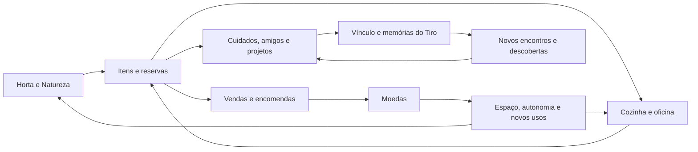

# Economia e ritmo do Tiro

> Atualização de 17/10/2026: após novo pedido do Vitor, o [plano R1 por etapas](../docs/plans/economia/README.md) foi concluído. Este relatório preserva a análise anterior; as críticas à V0 apontam para o arquivo histórico. Nenhum balanceamento foi implementado nesta entrega.
**Pesquisa e síntese em 16/10/2026. Estado: estudo para discussão, antes de retomar o plano de etapas. Nenhum balanceamento foi implementado nesta pesquisa.**

## A economia precisa criar escolhas que aproximem o jogador do Tiro

**A direção mais promissora é alinhar produção, destinos dos produtos, espaço e disponibilidade do jogador, mantendo o Tiro como motivo para desenvolver esse pequeno mundo.** A base existente já oferece bastante conteúdo; o desafio é fazer cada sistema continuar útil depois da apresentação. Limitar armazenamento desde o começo corrige uma inversão real, mas capacidades pequenas demais podem transformar o retorno em uma sequência de vendas para liberar espaço. Alongar tempos ou aumentar preços também não garante aprendizagem: pode simplesmente aumentar a espera de quem joga pouco. O estudo enviado ajuda a organizar essas relações, porém descreve um MVP diferente e não valida as tabelas que começamos a rascunhar. Devemos preservar suas ferramentas de raciocínio, reabrir os números e experimentar poucas mudanças comparáveis antes de distribuí-las aos agentes como etapas fechadas.

Esta síntese combina três tipos de informação: **evidência externa**, que mostra regras ou interpretações de outros jogos; **diagnóstico local**, derivado dos dados e do código do Tiro; e **hipóteses de desenho**, propostas para testar. As contas são analíticas. Não houve execução de modelo Machinations, nova campanha simulada nem playtest nesta pesquisa. Na data desta pesquisa, os cinco arquivos iniciais estavam pausados; foram posteriormente preservados em `docs/plans/economia/historico_v0/`; números, produtos e durações ali escritos não são decisões aprovadas.

### O dossiê oferece um bom método, mas seu MVP não é o nosso jogo

O principal mérito do [dossiê enviado](<C:/Users/Vitor/.codex/codex-remote-attachments/01a145eb-7e5d-75d3-b858-ef3b77b50400/6C1711EC-C0DD-4209-98AD-6FAD132BBDBC/1-Farm_Virtual_Pet_Game_Design_Economia_Pesquisa_Completa.md>) é separar moedas, itens, tempo e vínculo, explicitar propostas numéricas e reconhecer incertezas. Ele trata pedidos corretamente como saída de itens e entrada de dinheiro, preserva produtos prontos, considera sessões reais e exige caminhos de recuperação. Também registra que não confirmou templates oficiais com os nomes de fazenda, conversor e mascote citados no pedido inicial.

Há diferenças decisivas: seu MVP cobra sementes, usa estoque unificado, prevê evolução por idade e refeições e pressupõe servidor autoritativo. Tiro planta gratuitamente, possui depósitos narrativos, vínculo permanente, quatro necessidades, desejos, amigos, truques e save local. Importar aquela arquitetura criaria problemas adicionais antes de resolver os atuais. A documentação Machinations é útil para representar estoques e remoções e distinguir processamento simultâneo de fila sequencial; **é uma linguagem de modelagem, não uma certificação de equilíbrio**. ([Pools](https://machinations.io/docs/pools), [Drains](https://machinations.io/docs/drains), [Delays & Queues](https://machinations.io/docs/delays-queues-2).)

O próprio dossiê contém tensões que precisam ser resolvidas antes de qualquer implementação. A tabela tutorial ainda oferece cenoura como recompensa de uma missão que exige cenoura; o texto posterior corrige isso, mas copiar só a tabela reinstalaria o problema. O estado inicial com saciedade cheia conflita com uma refeição que precisa recuperar pontos para contar. E o alvo de adulto em cinco a oito dias não decorre automaticamente do máximo de seis refeições válidas por dia. Com duas visitas separadas por aproximadamente doze horas e perda offline limitada a dezesseis pontos por ausência, uma refeição por visita pode bastar; nesse cenário, trinta refeições levam cerca de quinze dias. O teto de seis é uma restrição, não seis oportunidades garantidas. São contradições entre objetivos e regras propostas, não defeitos comprovados do Tiro.

As referências devem manter sua natureza explícita. Wikis são comunitárias e não constituem documentação oficial; suas divergências de versão não fornecem taxas universais. As análises de Deconstructor of Fun sobre SimCity BuildIt, Township e Everdale são interpretações históricas, de 2015, 2020 e 2021. A entrevista de 2013 com o responsável por Hay Day relata que o lançamento limitado levou à revisão de praticamente todos os valores iniciais: isso reforça a necessidade de observar jogadores, sem fornecer números transferíveis. ([Entrevista sobre Hay Day](https://www.deconstructoroffun.com/blog//2013/01/behind-success-of-hay-day.html).)

Também precisamos separar inspiração de finalidade comercial. O suporte oficial de Hay Day descreve ofertas que vendem exatamente os materiais faltantes para ampliar depósitos. A pressão de inventário participa, portanto, de um sistema de monetização naquele jogo. Tiro pode aproveitar a decisão de guardar, produzir ou vender sem reproduzir o desconforto criado para vender alívio. ([Upgrade Offers](https://support.supercell.com/hay-day/en/articles/upgrade-offers.html).)

## Produção, dinheiro e atenção precisam ser medidos juntos

O problema local é de **utilidade da moeda e qualidade das decisões**. Saldo crescente em um jogo solo de preços fixos não é, por si só, inflação. Poupar e terminar uma campanha com conforto pode ser desejável. O sinal de problema é comprar tudo cedo demais, deixar de escolher entre investimentos ou descobrir que o caminho mais elaborado é menos interessante que repetir a primeira cultura.

O diagnóstico anterior encontrou 81 missões e 3.360 moedas somadas entre seus prêmios e os capítulos. Essa soma ajuda a identificar fontes, mas não informa quando o dinheiro chega nem quanto fica disponível entre marcos. Compras que liberam uma missão e um capítulo podem devolver grande parte do esforço imediatamente; compras de canteiros, animais e vagas também aumentam a produção futura. **Uma ampliação pode retirar moeda hoje e acelerar sua abundância amanhã.** É necessário orçar cada trecho da jornada, incluindo os prêmios que a própria compra libera. ([Missões](../game/data/quests.json), [progressão](../game/data/progression.json).)

| Recurso | Fontes ou entradas | Conversões e saídas | Pergunta de equilíbrio |
|---|---|---|---|
| Moedas | Colheita, venda, pedidos, prêmios, presentes | Construções, melhorias, animais, compras e cosméticos | Ainda existem duas escolhas desejadas entre as quais poupar e decidir? |
| Culturas e comidas | Horta, receitas, presentes | Alimentar, atender amigos/desejos, vender, entregar, transformar | Cada produto tem destino compreensível além de esvaziar o depósito? |
| Materiais | Buscas, passeios e recompensas | Oficina, costura, melhorias e projetos | A produção encontra demanda antes de virar acúmulo sem uso? |
| Espaço | Capacidade provisória e ampliações | Ocupação por unidades e reservas | Uma volta normal cabe junto do que será usado em seguida? |
| Atenção | Tempo que a pessoa escolhe dedicar | Gestos, navegação, decisões, coleta e reorganização | Quanto da sessão é escolha e quanto é manutenção repetitiva? |
| Vínculo | Carinho, desejos e marcos afetivos | Progressão permanente; não precisa ser gasto | O ganho representa convivência variada e reconhecível? |

O modelo mínimo precisa conservar inventário, ingredientes já comprometidos, trabalhos em andamento, produtos prontos na origem, prêmios pendentes e relógios. Um canteiro maduro é estoque fora da mochila, mas continua ocupado. Uma saída pronta ocupa a fila até ser recebida. Ignorar esses estados faz parecer que existe mais produção e espaço do que o jogador realmente tem. ([GameState](../game/autoload/game_state.gd), [StationState](../game/scripts/state/station_state.gd).)

O diagrama abaixo propõe a relação desejada entre sistemas; não descreve uma mudança já executada.

### Margem por produto é importante, mas não basta

Atualmente a caixa de petiscos vende por 60, enquanto seus ingredientes imediatos poderiam ser vendidos por 121. A diferença de 61 é **custo de oportunidade**, não dinheiro debitado nem déficit da carteira. A matéria-prima agrícola da cadeia vale 55; o problema é que interromper o processamento nos intermediários permite vender por mais. O contrato de três caixas paga 220, além de parafuso e XP, contra 363 dos intermediários. A peça pode justificar a escolha, desde que seu valor e as alternativas sejam legíveis. ([Receitas](../game/data/recipes.json), [itens](../game/data/items.json), [pedidos](../game/data/progression.json).)

| Conversão atual | Ingredientes imediatos vendidos | Saída vendida | Valor acrescentado | Tempo da etapa |
|---|---:|---:|---:|---:|
| Petisco de cenoura | 6 | 12 | +6 | 1 min |
| Dois biscoitos de maçã | 26 | 80 | +54 | 5 min |
| Caixa de petiscos | 121 | 60 | −61 | 7 min |
| Dois sacos de farinha | 9 | 28 | +19 | 2 min |
| Queijo | 24 | 32 | +8 | 4 min |

São valores de venda, sem XP, vínculo, cultivo, desbloqueios ou navegação. Uma receita pode pagar menos por minuto e oferecer melhor resultado por abertura, uma descoberta ou uma peça útil. O requisito adequado é ter uma função competitiva em algum contexto real. Exigir que toda receita avançada supere a anterior em todos os eixos eliminaria escolhas; aceitar qualquer margem nominal positiva também esconderia receitas pouco úteis.

Os rascunhos já mostram esse risco. A caixa candidata passa a acrescentar 30 sobre os intermediários, mas toda a preparação ocupa o mesmo fogão por 54 minutos, incluindo os subprodutos. Três vagas nessa estação não são três fogões: os trabalhos acontecem em sequência. Vagas compram **autonomia**, medida em lotes preparados e minutos de ausência cobertos. Podem melhorar muito a vida de quem sai do jogo, sem multiplicar a velocidade de uma máquina mantida ocupada continuamente. ([Tabela V0 pausada](../docs/plans/economia/historico_v0/02_TABELAS_BALANCEAMENTO.md), [fila real](../game/scripts/state/station_state.gd).)

### O resultado muda quando a unidade de comparação é uma visita

Quatro canteiros de cenoura, com rega imediata e venda integral, têm teto atual de aproximadamente 51,4 moedas/minuto. Isso exige repetição ideal sem tempo de interação, reservas ou outras demandas; não é renda medida. Se a pessoa abrir apenas três vezes ao dia e recolher uma rodada por visita, os mesmos quatro canteiros entregam 108 moedas/dia. Abóbora entrega 336 nessa hipótese. O tempo ocioso entre aberturas muda a escolha vantajosa. ([Culturas](../game/data/crops.json), [preços](../game/data/items.json), [rega](../game/autoload/game_state.gd).)

Na V0, os valores propostos fariam essa comparação virar 48 para cenoura e 864 para abóbora. São cenários de estado estável, com culturas já abertas, espaço suficiente e venda possível; não são previsão de campanha. A diferença evidencia que aumentar rendimento para compensar uma duração longa também aumenta o volume do retorno e a pressão sobre o silo. Antes de aprovar a tabela, precisamos comparar moeda por minuto ativo, por visita, por espaço e por tempo da estação que limita a cadeia.

A direção inicial continua sendo reduzir a dependência das moedas automáticas de colheita e dar papel maior a vendas e encomendas. Entretanto, **zerar tudo é uma alternativa a testar**, junto de redução parcial ou recompensa restrita à primeira descoberta. Não há justificativa para combinar imediatamente essa mudança com cortes de todos os prêmios, aumento de preços, novos lotes e novos tempos. Separar as intervenções permite entender qual melhora as escolhas e qual cria escassez indesejada.

## O espaço deve ensinar organização e a ausência deve preservar convivência

O pedido de Vitor identifica um problema concreto: `storage_active` só aplica capacidade depois da construção. Assim, o silo pode trocar espaço ilimitado por limitado; sua missão chega depois do queijo, seguida por armazém e baú. **A categoria deve nascer finita, e sua construção deve trazer alívio.** O suporte oficial de Hay Day também apresenta silo e celeiro desde o começo, enquanto a caixa de pesca aparece junto da área correspondente. É uma referência de introdução contextual, não fundamento para copiar capacidades. ([GameState](../game/autoload/game_state.gd), [missões](../game/data/quests.json), [suporte Supercell](https://support.supercell.com/hay-day/es/articles/silo-barn-tackle-box.html).)

Minha hipótese preferida mantém os quatro depósitos existentes, apresenta apenas categorias já usadas e concede a primeira capacidade na introdução da respectiva atividade. O silo acompanha a primeira horta e a venda de excedentes; a geladeira acompanha a cozinha; o armazém acompanha a chegada dos materiais; o baú aparece quando passeios e costura lhe dão conteúdo suficiente. Melhorias posteriores disputam investimentos. Isso evita quatro cobranças de entrada consecutivas. Uma alternativa de dois grandes grupos no começo reduziria conceitos, mas exigiria redistribuição de categorias e migração mais complexas; ainda não há evidência de que compense.

Capacidade não deve nascer de números redondos. O rascunho de silo provisório 12 comporta três rodadas de dois canteiros de cenoura, mas apenas uma rodada e meia com quatro canteiros, sem reserva. Os lotes propostos de quatro morangueiros produziriam 32 unidades contra silo de 24; quatro mirtilos produziriam 80 contra um nível de 64. Cada lote individual caber evita uma trava básica, porém não garante uma volta agradável. Exigir colher, vender e voltar repetidamente pode converter a melhoria de rendimento em trabalho de limpeza. ([V0 pausada](../docs/plans/economia/historico_v0/02_TABELAS_BALANCEAMENTO.md).)

Devemos verificar separadamente quatro condições: o maior lote obrigatório cabe; existe uma sequência viável para fabricar e ampliar; uma volta típica cabe com reservas; e liberar espaço não domina a sessão. A construção precisa ser alcançável com o espaço anterior e as rotas já abertas. Se a compra também abre culturas maiores, convém separar os marcos para o jogador perceber a folga adquirida. Venda, transformação e uso no objetivo atual devem ser saídas claras; coleta fracassada preserva o produto, e saves acima da nova capacidade preservam seus itens, com consumo e venda disponíveis.

### O cachorro não pode ficar preso fora de casa porque o baú encheu

Hoje o passeio permanece ativo até a coleta, e `collect_walk_error` verifica espaço antes de permitir recebê-lo. Materiais de trilha estão isentos. Se passarem para o baú sem outra mudança, um inventário cheio pode impedir o retorno do Tiro e bloquear cuidados. Isso precisa ser tratado como dependência do redesenho, antes de distribuir a tarefa de armazenamento. Uma solução candidata separa **volta do cachorro** de **recebimento da bagagem**: ele volta ao fim do passeio e uma única bagagem fica pendente, sem permitir acumular novos passeios como depósito infinito. ([Passeios e coleta](../game/autoload/game_state.gd), [categorias dos itens](../game/data/items.json).)

Também existe desconforto offline independente de dinheiro. As taxas atuais são barriga −8/h, felicidade −5/h, energia −6/h e higiene −3/h, sem regra diferente de ausência ou piso positivo. Partindo de 100, sem ações e **permanecendo acordado**, o resultado analítico é:

| Ausência acordado | Barriga | Felicidade | Energia | Higiene |
|---|---:|---:|---:|---:|
| 8 horas | 36 | 60 | 52 | 76 |
| 12 horas | 4 | 40 | 28 | 64 |
| 24 horas | 0 | 0 | 0 | 28 |

O sono é outro cenário: regenera energia a 40/h, substituindo sua queda; as outras necessidades continuam caindo. O código não autoriza presumir que, offline, o Tiro acorde exatamente ao chegar a 100 e passe o restante do intervalo gastando energia. Essa sequência precisa de teste próprio. Portanto, a tabela não representa uma noite em que o jogador o colocou para dormir. ([DogState](../game/scripts/state/dog_state.gd), [configuração](../game/data/config.json), [SaveManager](../game/autoload/save_manager.gd).)

Sem descanso ou comida energética, recuperar energia zero até o mínimo de 15 para brincar demanda 22,5 minutos. Um retorno acolhedor deveria permitir alguma convivência significativa imediatamente. Podemos comparar perda offline reduzida e limitada, descanso protegido ou uma interação simples sem custo de energia. Cada alternativa tem consequências: proteção excessiva reduz utilidade fisiológica da comida; proteção fraca deixa a volta parecer uma lista de reparos. A decisão precisa partir da experiência de retorno, depois definir as taxas.

**A barriga não pode absorver a fábrica.** Em manutenção contínua, sem desperdício nem barras zeradas, a queda equivale a 192 pontos de saciedade/dia, aproximadamente 9,6 petiscos de cenoura. Já o teto do fogão é sessenta petiscos por hora, com matérias-primas e atenção disponíveis. Quem entra uma vez por dia e deixa a barra zerar precisa de no máximo cem pontos naquela visita; não acumula fome abaixo de zero. Aumentar fome para equilibrar produção transformaria o cuidado em obrigação. A demanda adicional deve vir de amigos, projetos, encomendas e descobertas. ([Receitas](../game/data/recipes.json), [itens](../game/data/items.json), [DogState](../game/scripts/state/dog_state.gd).)

A progressão afetiva também pede ajuste específico. A interface já limita carinho a uma concessão a cada **1,2 segundo**, correção importante ao diagnóstico inicial de “sem recarga”. O método ainda dá afeto em cada concessão: aproximadamente cinquenta por minuto no teto de interação contínua. Os patamares atuais chegam a 520, equivalentes a 10,4 minutos teóricos, sem pausas. Isso não é uma campanha medida nem fonte infinita de moedas: os prêmios de vínculo são únicos. É um sinal para deslocar parte do avanço para momentos variados, preservando a reação ao carinho livre. Banho e alimentação também contam ações mesmo quando parte do benefício é nula; a proteção de XP não protege automaticamente as rotinas. ([PetScreen](../game/scenes/ui/pet_screen/pet_screen.gd), [cuidados](../game/autoload/game_state.gd), [vínculo](../game/data/progression.json), [rotinas](../game/data/routines.json).)

Não devemos proibir toda comida com barriga cheia: picolé beneficia principalmente felicidade, ensopado também recupera energia e um desejo pode justificar o mimo. O critério candidato é ganho efetivo nas necessidades relevantes ou contexto afetivo, com recompensa de progressão separada do gesto. Cuidado básico deve continuar acessível mesmo sem dinheiro.

## A curva deve combinar relações conhecidas e abrir novos momentos com o Tiro

O percurso de aprendizagem mais coerente é **experimentar, escolher destino, combinar cadeias, preparar a próxima visita e realizar projetos**. Cada sistema novo começa confortável; a etapa seguinte pede uso deliberado. A dificuldade cresce ao compartilhar um ingrediente entre duas finalidades, organizar uma fila ou escolher qual melhoria atende melhor à rotina. Não precisa introduzir simultaneamente quatro depósitos, nova moeda, receita de vários subprodutos e requisito de atributo.

Há três alternativas compatíveis para o ritmo: receitas curtas com filas maiores cedo; opções curtas e longas lado a lado; ou preparação em lotes de receitas conhecidas. A primeira preserva atividade, mas exige ingredientes suficientes; a segunda adapta o jogo à agenda, mas precisa de rendimento e espaço coerentes; a terceira oferece autonomia sem multiplicar produtos, porém adiciona uma escolha de quantidade. Devemos experimentar combinações simples antes de criar automação. Uma tarefa de sessenta minutos e uma de cinco minutos entregam uma rodada cada para quem retorna seis horas depois. A duração, sozinha, não cria profundidade. A análise histórica de SimCity BuildIt descreve a relação entre timers, filas e sessões, mas suas metas comerciais não determinam o ritmo do Tiro. ([Análise de 2015](https://www.deconstructoroffun.com/blog//2015/02/simcity-buildit-nice-town-but-would-you.html).)

As melhorias também precisam ter funções distintas: capacidade compra folga; fila compra autonomia; receita abre um destino; eficiência aumenta rendimento; decoração expressa progresso. Dar mais vagas, mais produto, menos tempo e maior prêmio na mesma evolução compõe aceleradores. Distribuir esses benefícios torna a escolha legível e permite que uma melhoria continue boa sem exigir a próxima imediatamente.

### O conteúdo novo deve explicar por que esta é a aventura do Tiro

O jogo já conecta comida a amigos com preferências, passeios a materiais e descobertas, Nina a costura e truques, e o tesouro a uma nova cultura. Essas relações são uma base mais forte que seis novos produtos voltados sobretudo à venda para humanos. **Não precisamos decidir a quantidade de itens antes de identificar a função que falta.** Para cada candidato, precisamos saber quem o deseja, qual escolha cria, que insumos reutiliza, em que momento volta a importar e que cena ou utilidade oferece. ([Amigos](../game/data/friends.json), [desejos](../game/data/wishes.json), [missões](../game/data/quests.json).)

As referências ajudam a separar duas possibilidades. Slime Rancher 2 liga alimentação a plorts vendáveis ou usados na refinaria; comida favorita dobra essa produção. É coerente com aquele jogo, mas não justifica transformar carinho no Tiro em produção monetária. Tamagotchi Uni oferece uma analogia mais próxima ao mostrar personalidades, objetos favoritos, passeios com materiais e fabricação de acessórios: o preparo modifica a relação e a expressão do personagem. ([Monomi Park](https://slimerancher2.zendesk.com/hc/en-us/articles/44996362847123-New-Player-Tips), [Bandai](https://tamagotchi-official.com/us/series/uni/howtoplay/).)

Um primeiro experimento poderia aproveitar a Festa da Vila como projeto visível em etapas: preparar um encontro dos cães, contribuir com comidas já conhecidas ou um objeto de oficina, ver Tiro e amigos usarem o lugar e guardar uma lembrança. Entregas parciais finitas podem aliviar reservas; caminhos alternativos permitem especialização sem exigir todas as cadeias. Outra direção é uma descoberta: Tiro fareja uma pista, um personagem ajuda, um preparo simples viabiliza a aventura e o retorno muda algo no mundo. Reformar seu cantinho também pode render cenas e opções de brincadeira, sem virar manutenção obrigatória.

Clientes com pequenas histórias podem sustentar a produção recorrente, mas não devem ocupar todo o significado da campanha. Maestrias podem celebrar receitas variadas que já tenham demanda; um contador alto de lotes incentiva repetir o mais barato sem propósito. O valor das reformas deve aparecer no cenário e na convivência, não apenas numa nova linha de renda. As análises históricas de Township e Everdale ajudam a formular essas perguntas sobre legibilidade, complexidade e especialização; não demonstram quais soluções funcionarão para nosso público. ([Township, 2020](https://www.deconstructoroffun.com/blog/2020/10/13/how-playrix-township-became-a-billion-dollar-game), [Everdale, 2021](https://www.deconstructoroffun.com/blog/2021/8/29/everdale-by-supercell).)

| Direção | Parecer desta pesquisa | Motivo |
|---|---|---|
| Depósitos finitos desde o primeiro uso; construção amplia | **Manter** | Corrige a inversão atual; capacidades e momentos seguem abertos |
| Produção pronta persistente, cuidado acessível e ausência sem perda permanente | **Manter** | Protege esforço e liberdade de rotina |
| Filas, alternativas de duração e projetos visíveis | **Manter como hipóteses prioritárias** | Podem acrescentar autonomia e decisões usando a base |
| Zerar moedas automáticas, reduzir prêmios e aumentar preços em conjunto | **Rever** | Isolar efeitos e orçamento por marco antes de aprovar pacote |
| Capacidades 12/24/64, grandes lotes, seis produtos e duração em semanas | **Rever** | Não foram validados por sessões, demanda ou conforto |
| Percentuais globais de prêmio e mesma curva para todos os depósitos | **Rever** | Categorias e marcos têm fluxos e utilidades diferentes |
| Sementes pagas, estoque único e servidor como solução necessária | **Descartar deste redesenho** | São pressupostos de outro MVP, não requisitos do problema atual |
| Aumentar fome, exigir refeições/calendário ou gastar vínculo | **Descartar** | Converte convivência em cobrança e não resolve excesso produtivo |
| Escassez permanente, perdas por ausência, dívida e prazos coercitivos | **Descartar** | Não são necessários para planejamento interessante |
| Mais agentes simulados como prova automática de equilíbrio | **Descartar como garantia** | Muitas execuções de um modelo incorreto repetem o mesmo erro |

## Seis experimentos podem transformar direções em decisões de projeto

O próximo trabalho precisa produzir evidência para um plano, não outra tabela definitiva. Primeiro devemos reproduzir trajetórias concretas com as regras atuais. O teste de progressão existente usa estoque ilimitado e serve para alcançabilidade; não valida uma campanha com capacidade real. Agendas e estratégias também precisam variar: sessão contínua, visitas espaçadas, uma visita diária, ausência irregular, jogador que cuida primeiro e jogador que prioriza renda. Essas categorias são cenários de teste, ainda não segmentos medidos. ([Teste de progressão](../game/tests/progression_test.gd).)

| Experimento prioritário | O que comparar e observar | Critério e decisão que informa |
|---|---|---|
| **1. Linha de base fiel** | Reproduzir manualmente uma sequência de plantio, fila, coleta, compra e prêmio; depois acompanhar marcos com estoque real e produtos pendentes | Contabilidade e horários devem coincidir com as ações reais. Só então usar o modelo para escolher preços ou durações |
| **2. Primeiro aperto de espaço** | Capacidade provisória e depósito contextual; testar colheita completa, reservas, dinheiro zero, animal extra e save acima da capacidade | Nenhuma perda ou caminho sem recuperação; ampliação deve dar folga percebida. Define categorias, capacidade inicial e posição das missões |
| **3. Fontes e destinos da renda** | Comparar moeda automática atual, reduzida e deslocada para primeiras descobertas, mantendo demais regras controladas; revisar uma cadeia comercial problemática | Deve haver recuperação e mais de uma escolha viável; registrar entregas por melhoria e renda por origem. Decide o papel de venda, pedidos e prêmios |
| **4. Preparar para sair e voltar** | Filas maiores, opção longa e lote de receita existente; medir produção útil por retorno, bloqueios e tempo ocupado durante a ausência | O jogador consegue encerrar a sessão e recolher progresso sem limpeza dominante. Define tempos, lotes e valor das vagas |
| **5. Retorno e vínculo** | Ausências acordado e dormindo, proteção offline candidata, energia para brincar, carinho e cuidados úteis; passeio pronto com depósito cheio | Cuidado significativo disponível ao voltar, sem cachorro retido por loot; progressão não deve depender de repetição vazia. Define proteção e fontes de afeto |
| **6. Um projeto centrado no Tiro** | Comparar pedido quantitativo, projeto com produtos existentes e projeto com um novo produto funcional | Jogador entende para quem prepara, reconhece consequência e escolhe uma rota. Decide se novos itens, reformas e histórias justificam expansão |

Para cada experimento, registrar **minutos ativos, aberturas e dias de calendário separadamente**. Dinheiro livre deve ser comparado ao custo das próximas escolhas desejadas; renda deve ser separada por origem e por prêmios únicos ou recorrentes. No estoque, observar ações até liberar espaço e lotes que ficaram pendentes, além da ocupação. Na produção, distinguir ociosidade por ausência, falta de ingrediente, falta de demanda e bloqueio de saída. No cuidado, medir disponibilidade do Tiro, recuperação efetiva, desperdício e fontes de vínculo.

Percentis de ações de limpeza e tempo até marcos serão mais úteis que médias isoladas. Ainda não há limites numéricos de aprovação para eles: devem ser definidos com a linha de base e observação no celular. Há, porém, invariantes claros desde já: não perder esforço por falta de espaço, não exigir conteúdo inacessível, não impedir recuperação econômica, não retirar aquisições de saves e não condicionar o retorno do cachorro à capacidade da bagagem. Uma sequência matematicamente possível que exige dezenas de trocas de tela ainda pode falhar como experiência.

Permanecem abertas a duração desejada da campanha, a autonomia adequada por sessão, a intensidade de pressão de estoque e a proporção entre aventura afetiva e produção comercial. Nenhuma fonte consultada decide esses parâmetros. Antes de retomar etapas, a conversa de projeto deve escolher a experiência pretendida de uma abertura e o papel de cada sistema; os experimentos então delimitam os números. A oportunidade mais forte é fazer o crescimento econômico render novas formas de viver com o Tiro e seus personagens, mantendo espaço para jogar pouco, errar uma compra e voltar com vontade.

## Fontes verificadas e limites de uso

As notas de pesquisa registram leitura do dossiê, inspeção local e verificação das páginas abaixo. Algumas páginas Machinations e Supercell retornaram corpo vazio na abertura direta; seus textos foram recuperados na indexação da busca. Isso sustenta as regras citadas, sem equivaler a inspeção de seus aplicativos. O PDF do manual Bandai falhou ao abrir e foi excluído das conclusões centrais; a página oficial de apresentação foi suficiente. Não revalidamos toda a bibliografia do dossiê, nem usamos números de suas wikis como novos fatos oficiais.

| Fonte direta | Natureza e uso nesta síntese |
|---|---|
| [Machinations — Pools](https://machinations.io/docs/pools), [Drains](https://machinations.io/docs/drains), [Delays & Queues](https://machinations.io/docs/delays-queues-2) | Documentação primária de ferramenta; representação de estoque, saída e processamento |
| [Machinations — How to design idle games](https://machinations.io/articles/idle-games-and-how-to-design-them) | Orientação comercial de design; repertório de perguntas, sem parâmetros validados para Tiro |
| [Supercell — Silo, Barn & Tackle Box](https://support.supercell.com/hay-day/es/articles/silo-barn-tackle-box.html) | Suporte oficial; introdução e separação dos depósitos |
| [Supercell — Production Buildings](https://support.supercell.com/hay-day/en/articles/production-building.html) | Suporte oficial; filas e maestrias, sem transferência de preços ou financiamento premium |
| [Supercell — Upgrade Offers](https://support.supercell.com/hay-day/en/articles/upgrade-offers.html) | Suporte oficial; vínculo entre expansão e monetização |
| [Supercell — Nothing bad happens in Hay Day](https://supercell.com/en/news/nothing-bad-happens-in-hay-day/) | Comunicação oficial de 2026; intenção acolhedora declarada, não prova de ausência de frustração |
| [Bandai — Tamagotchi Uni, How to play](https://tamagotchi-official.com/us/series/uni/howtoplay/) | Apresentação oficial; personalidade, objetos, passeios e fabricação |
| [Monomi Park — New Player Tips](https://slimerancher2.zendesk.com/hc/en-us/articles/44996362847123-New-Player-Tips) | Guia oficial de Slime Rancher 2; alimentação, plorts e destinos |
| [Deconstructor of Fun — Behind the Success of Hay Day](https://www.deconstructoroffun.com/blog//2013/01/behind-success-of-hay-day.html) | Entrevista histórica de 2013; relato do responsável sobre revisão no lançamento limitado |
| [Deconstructor of Fun — SimCity BuildIt](https://www.deconstructoroffun.com/blog//2015/02/simcity-buildit-nice-town-but-would-you.html) | Análise secundária de 2015; timers, filas, inventário e monetização |
| [Deconstructor of Fun — Township](https://www.deconstructoroffun.com/blog/2020/10/13/how-playrix-township-became-a-billion-dollar-game) | Análise secundária de 2020; legibilidade e expansão de cadeias |
| [Deconstructor of Fun — Everdale](https://www.deconstructoroffun.com/blog/2021/8/29/everdale-by-supercell) | Análise secundária de 2021; especialização, complexidade e atenção |

Rastreabilidade detalhada: [modelagem econômica](../research_notes/Economia%20e%20ritmo%20do%20Tiro/modelagem.md), [ritmo e referências](../research_notes/Economia%20e%20ritmo%20do%20Tiro/ritmo_referencias.md) e [cuidado e integração](../research_notes/Economia%20e%20ritmo%20do%20Tiro/cuidado_integracao.md). O [índice dos rascunhos pausados](../docs/plans/economia/historico_v0/README.md) registra o estado do planejamento anterior.
